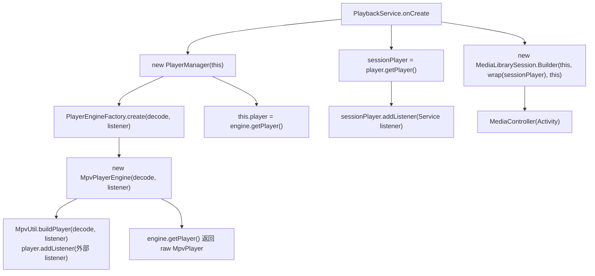
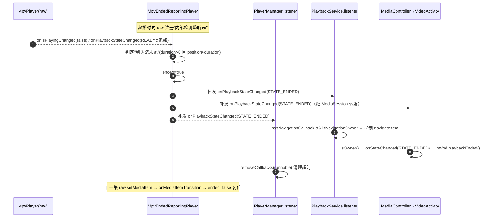
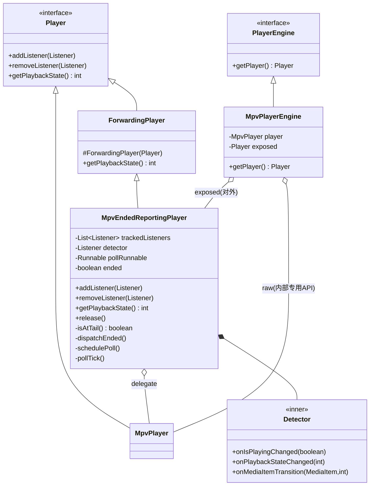
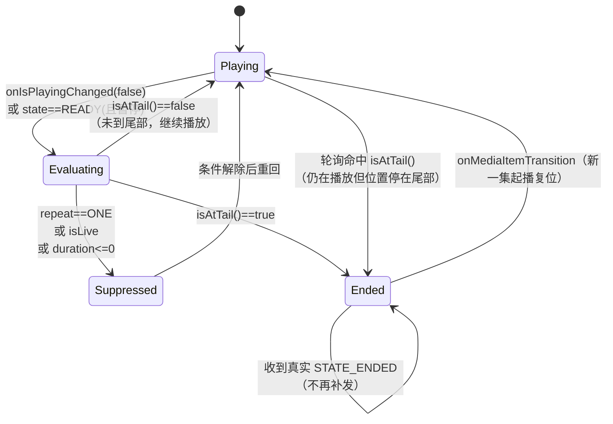

# MPV 引擎 STATE_ENDED 补齐开发设计文档

> 作者：Shiro
> 日期：2026-10-19
> 关联文档：[TV端自动连播失效问题定位与修复方案.md](./TV端自动连播失效问题定位与修复方案.md)（本方案对应其中「方案四」）
> 适用范围：`app` 模块，`main`（共享逻辑）+ `leanback` / `mobile`（设备形态）

---

## 一、背景与目标

### 1.1 背景

TV 端与移动端共用同一套播放骨架：`PlayerManager` 通过 `PlayerEngineFactory` 创建播放引擎，引擎类型分为 `EXO` 与 `MPV` 两种。

- Exo 引擎（`ExoPlayerEngine` → `ExoPlayerSession`）由 media3 原生实现，播放到流末尾会自然进入 `Player.STATE_ENDED`。
- MPV 引擎（`MpvPlayerEngine`）包装第三方 media3 扩展 `androidx.media3.mpvplayer.MpvPlayer`，**播放到流末尾时是否上报 `Player.STATE_ENDED` 不确定**。

自动连播（`VodPlaybackController.playbackEnded()` → `nextEpisode()`）等全部下游逻辑，都**强依赖** `Player.STATE_ENDED` 这一个事件：

- Activity 侧：[PlaybackActivity.onPlaybackStateChanged](../../app/src/main/java/com/fongmi/android/tv/ui/activity/PlaybackActivity.java#L571-L574) → `onStateChanged(STATE_ENDED)` → leanback [VideoActivity.onStateChanged](../../app/src/leanback/java/com/fongmi/android/tv/ui/activity/VideoActivity.java#L1218-L1235) `mVod.playbackEnded()`。
- Service 侧：[PlaybackService.listener.onPlaybackStateChanged](../../app/src/main/java/com/fongmi/android/tv/service/PlaybackService.java#L530-L540)。

若 MPV 引擎不上报 `STATE_ENDED`，则：**播放结束事件在源头缺失 → 自动连播、片尾自动跳转、以及 `PlayerManager` 的播放超时回调清理全部失效**。

> 说明：`MpvPlayerEngine.addSubtitle` 中已经存在 `getPlaybackState() == Player.STATE_ENDED` 的判断（[MpvPlayerEngine.java L87](../../app/src/main/java/com/fongmi/android/tv/player/mpv/MpvPlayerEngine.java#L84-L89)），说明「STATE_ENDED」这一概念在库层面存在，但**是否会在 EOF 时被真实派发**需要实证确认（见第三节）。

### 1.2 目标

在**不修改第三方库**的前提下，让 MPV 引擎在「单集自然播放结束」时，向上层（`PlayerManager`、`PlaybackService`、`MediaSession`/`MediaController`）**可靠、且仅一次**地发出 `Player.STATE_ENDED`，使自动连播链路重新成立。

### 1.3 非目标

- 不修复 Tv 端自动连播链路中「归属判定（key 不一致）」的结构性问题（属关联文档的「方案一」）。
- 不改动 Exo 引擎行为。
- 不处理直播（Live）场景的「结束」语义（直播无自然结束，见第八节边界）。
- 不引入新的第三方依赖。

---

## 二、现状分析

### 2.1 播放器实例的唯一性与事件源头

MPV 引擎只有**一个** `MpvPlayer` 实例，它是整个事件链路的唯一源头。关键构建与暴露路径如下。



要点（均为现状代码事实）：

| 环节 | 位置 | 说明 |
| --- | --- | --- |
| 引擎创建 | [PlayerManager L75](../../app/src/main/java/com/fongmi/android/tv/player/PlayerManager.java#L70-L79) | `PlayerEngineFactory.create(decode, listener)`，`listener` 即 `PlayerManager.listener` |
| MPV 构建 | [MpvUtil.buildPlayer L52-L57](../../app/src/main/java/com/fongmi/android/tv/player/mpv/MpvUtil.java#L52-L57) | `player.addListener(listener)`，把 `PlayerManager.listener` 直接挂到 raw `MpvPlayer` |
| 对外暴露 | [MpvPlayerEngine.getPlayer L46-L48](../../app/src/main/java/com/fongmi/android/tv/player/mpv/MpvPlayerEngine.java#L40-L48) | 直接返回 raw `MpvPlayer`，无任何包装 |
| Service 持有 | [PlaybackService.onCreate L105-L108](../../app/src/main/java/com/fongmi/android/tv/service/PlaybackService.java#L101-L113) | `sessionPlayer = player.getPlayer()`；`sessionPlayer.addListener(listener)`；MediaSession 用 `wrap(sessionPlayer)` |
| 引擎重建 | [PlaybackService.onPlayerRebuild L501-L508](../../app/src/main/java/com/fongmi/android/tv/service/PlaybackService.java#L501-L508) | 重建后重新挂监听并 `session.setPlayer(wrap(newPlayer))` |

**结论**：`PlayerManager`、`PlaybackService`、`MediaSession`（进而 `MediaController` → Activity）三者观察的是**同一个 raw `MpvPlayer`**。因此，`STATE_ENDED` 必须**由该实例本身发出**，才能被全链路感知；仅在引擎内部「回调某个 listener」无法触达 `MediaSession → MediaController` 这条路。

### 2.2 缺口定位

`MpvPlayerEngine` 已实现 `Player.Listener`，但**仅覆写了 `onTracksChanged`**（[L96-L99](../../app/src/main/java/com/fongmi/android/tv/player/mpv/MpvPlayerEngine.java#L96-L99)），既未在 `onPlaybackStateChanged` 中做任何补发，也没有任何「流末尾」检测逻辑。因此：

- 若库本身会上报 `STATE_ENDED`：现状即已满足，本方案退化为「验证 + 兜底」。
- 若库本身**不上报**：现状在 `STATE_ENDED` 处**断链**，需按本方案补齐。

---

## 三、前置确认（诊断先行）

> 实现前必须先用日志确认「库是否上报 ENDED」，避免做无效改动或引入重复上报。

在 [PlayerManager.listener](../../app/src/main/java/com/fongmi/android/tv/player/PlayerManager.java#L651-L693) 的 `onPlaybackStateChanged` 与 [PlaybackService.listener](../../app/src/main/java/com/fongmi/android/tv/service/PlaybackService.java#L530-L540) 的 `onPlaybackStateChanged` 中临时加入日志（仅打印，不改行为），逐集播放至自然结束，观察：

| 观测项 | 判定 |
| --- | --- |
| 结束瞬间是否出现 `state=4 (STATE_ENDED)` | 出现 → 库已上报，进入第五节「方案 C」 |
| 结束瞬间是否出现 `state=1 (STATE_IDLE)`，且此前为 `STATE_READY` | 出现 → 库把 EOF 映射为 IDLE，进入「方案 A/B」 |
| 结束瞬间**没有任何** `onPlaybackStateChanged` | 库完全不上报，进入「方案 A」 |
| 结束瞬间 `getCurrentPosition()` 是否≈`getDuration()` | 用于 A 方案的检测阈值标定 |
| `getRepeatMode()` 是否为 `REPEAT_MODE_ONE` | 排除「单集循环永不到尾」的干扰（见第八节） |

实测结论：**待补充实测日志**（本文档给出判定方法；落地时以实测为准）。

---

## 四、设计目标与约束

| 项 | 约束 |
| --- | --- |
| 不改库 | 不允许修改或反编译 `androidx.media3.mpvplayer` |
| 单一事件源 | 补发的 `STATE_ENDED` 必须能被 `PlayerManager`、`PlaybackService`、`MediaSession`/`MediaController` 同时感知 |
| 仅一次 | 不得出现「库真实 ENDED + 补发 ENDED」双发，进而引发双跳集 |
| 可复位 | 新一集起播后，上一次的「已结束」状态必须复位 |
| 不越权 | 直播、单集循环、无时长（duration 未知）场景不得补发 |
| 线程契约 | `Player.Listener` 回调必须在应用主线程派发 |

---

## 五、总体方案

### 5.1 方案对比与选型

| 方案 | 做法 | 优点 | 缺点 | 适用 |
| --- | --- | --- | --- | --- |
| **A（主选）** | 用 `ForwardingPlayer` 包装 raw `MpvPlayer`，由包装层检测流末尾并**补发** `STATE_ENDED` | 不改库；补发事件经包装实例流转，可被全链路感知；对库行为不敏感 | 增加一个包装类；需谨慎处理「仅一次」与「复位」 | 库不上报 ENDED |
| **B（备选）** | 若能确认库存在 EOF 回调/开关（如 mpv `keep-open`、库级 EOF 回调），优先调用库能力 | 无检测误差 | 依赖库内部能力，现状不可得，存在不确定性 | 库具备但默认未开启 |
| **C（退路）** | 库其实已上报 `STATE_ENDED`，仅上层某闸门拦截 | 零改动 | — | 诊断结论为「已上报」 |

**选型：以方案 A 作为主设计**（对库行为不敏感、可覆盖 B/C 全部分支；B/C 作为前置分支）。

### 5.2 目标链路时序图（方案 A）



### 5.3 组件 / 类图



---

## 六、详细设计

### 6.1 新增类：`MpvEndedReportingPlayer`

- 包路径：`com.fongmi.android.tv.player.mpv`
- 职责：`ForwardingPlayer` 装饰器，拦截 raw `MpvPlayer` 的**播放状态信号**，在检测到「到达流末尾」时，向**登记在包装层**的监听器补发一次 `onPlaybackStateChanged(STATE_ENDED)`，并令 `getPlaybackState()` 返回 `STATE_ENDED`。

设计要点：

1. **继承 `ForwardingPlayer`**：所有 `Player` 方法默认透传给 raw，零侵入；仅覆写 `getPlaybackState()` 与监听器登记方法。
2. **自持监听器列表**：`addListener` / `removeListener` 同时（a）透传给 raw、并（b）登记到内部 `trackedListeners`。这样：真实事件照常到达，补发事件也能到达。
3. **内部检测监听器**：向 raw 注册一个私有 `Player.Listener`，用于观察 `onIsPlayingChanged` / `onPlaybackStateChanged` / `onMediaItemTransition`。
4. **EOF 判定**（`isAtTail()`，主判据，不依赖库内部实现）：
   - `delegate.getDuration() > 0`
   - 且 `delegate.getCurrentPosition() >= delegate.getDuration() - END_EPS_MS`（`END_EPS_MS` 建议 300ms 量级，以实测标定）
   - 且 `!delegate.isCurrentMediaItemLive()` 且 `delegate.getRepeatMode() != REPEAT_MODE_ONE`
5. **两条触发路径 + 轮询兜底**：
   - 暂停路径：`onIsPlayingChanged(false)` 或 `STATE_READY` 且 `!isPlaying` 时，命中 `isAtTail()` → 补发（对应「库在尾部驻留并进入暂停」）。
   - 轮询路径：`STATE_READY && isPlaying` 时每 `EOF_POLL_MS`（建议 400ms）校验 `isAtTail()` → 补发（对应「库停留在 READY 且仍在播放、位置停在尾部」）。
6. **仅一次**：`ended` 置位后不再补发；若内部检测监听器先收到 raw 的**真实** `STATE_ENDED`，同样置 `ended=true` 并**不**补发（避免与真实事件双发）。
7. **复位**：收到 `onMediaItemTransition` 时 `ended=false`（新一集起播）。
8. **线程**：补发与状态变更统一经 `App.post(...)` 派发到主线程，满足 `Player.Listener` 契约。

参考实现骨架（设计示例，落地时按阿里规范补全 Javadoc）：

```java
package com.fongmi.android.tv.player.mpv;

import androidx.annotation.NonNull;
import androidx.media3.common.ForwardingPlayer;
import androidx.media3.common.MediaItem;
import androidx.media3.common.Player;

import com.fongmi.android.tv.App;

import java.util.List;
import java.util.concurrent.CopyOnWriteArrayList;

/**
 * MPV 引擎的"结束上报"装饰器。
 *
 * <p>包装 {@code MpvPlayer}，在检测到单集到达流末尾时，向登记在本层的监听器补发一次
 * {@link Player#STATE_ENDED}，以弥补底层库在 EOF 处可能不上报结束事件的问题。</p>
 *
 * @author Shiro
 */
public final class MpvEndedReportingPlayer extends ForwardingPlayer {

    /** 判定"到达尾部"的容差，单位毫秒。 */
    private static final long END_EPS_MS = 300L;
    /** 轮询兜底周期，单位毫秒。 */
    private static final long EOF_POLL_MS = 400L;

    private final List<Player.Listener> trackedListeners = new CopyOnWriteArrayList<>();
    private final Player.Listener detector = new Detector();
    /** 轮询任务（保持同一引用，便于 App.post 内部去重）。 */
    private final Runnable pollRunnable = this::pollTick;

    /** 是否已经上报/补发过结束。 */
    private boolean ended;

    public MpvEndedReportingPlayer(Player delegate) {
        super(delegate);
        delegate.addListener(detector);
    }

    @Override
    public void addListener(@NonNull Player.Listener listener) {
        super.addListener(listener);
        trackedListeners.add(listener);
    }

    @Override
    public void removeListener(@NonNull Player.Listener listener) {
        super.removeListener(listener);
        trackedListeners.remove(listener);
    }

    @Override
    public int getPlaybackState() {
        return ended ? Player.STATE_ENDED : super.getPlaybackState();
    }

    /** 释放检测监听器，由引擎在 release 时调用。 */
    public void release() {
        getWrappedPlayer().removeListener(detector);
        trackedListeners.clear();
    }

    /** 内部检测监听器：观察播放是否到达流末尾。 */
    private final class Detector implements Player.Listener {

        @Override
        public void onIsPlayingChanged(boolean isPlaying) {
            if (!isPlaying && isAtTail()) App.post(MpvEndedReportingPlayer.this::dispatchEnded);
        }

        @Override
        public void onPlaybackStateChanged(int state) {
            if (state == Player.STATE_ENDED) {
                ended = true;                 // 真实事件已发出，不再补发
            } else if (state == Player.STATE_READY && !getWrappedPlayer().isPlaying() && isAtTail()) {
                App.post(MpvEndedReportingPlayer.this::dispatchEnded);
            }
        }

        @Override
        public void onMediaItemTransition(MediaItem mediaItem, int reason) {
            ended = false;                    // 新一集起播，复位
            schedulePoll();
        }
    }

    /** 判定是否已到达流末尾（纯判定，无副作用）。 */
    private boolean isAtTail() {
        Player delegate = getWrappedPlayer();
        if (delegate.getRepeatMode() == Player.REPEAT_MODE_ONE) return false;
        if (delegate.isCurrentMediaItemLive()) return false;
        long duration = delegate.getDuration();
        if (duration <= 0) return false;
        return delegate.getCurrentPosition() >= duration - END_EPS_MS;
    }

    private void dispatchEnded() {
        if (ended) return;
        ended = true;
        for (Player.Listener listener : trackedListeners) listener.onPlaybackStateChanged(Player.STATE_ENDED);
    }

    private void schedulePoll() {
        // 播放中周期性兜底校验，覆盖"库停留在 READY 且仍在播放、位置停在尾部"的情形
        App.post(pollRunnable, EOF_POLL_MS);
    }

    private void pollTick() {
        Player delegate = getWrappedPlayer();
        if (ended) return;
        if (delegate.getPlaybackState() == Player.STATE_READY && delegate.isPlaying() && isAtTail()) dispatchEnded();
        // App.post 会先 removeCallbacks 同一实例，天然形成"单飞"轮询
        App.post(pollRunnable, EOF_POLL_MS);
    }
}
```

> 说明：`getWrappedPlayer()` 为 `ForwardingPlayer` 的受保护访问方法（media3 提供），用于取出被包装的 delegate。若当前 media3 版本未提供该方法，则改为在构造时自行持有 delegate 引用。

### 6.2 `MpvUtil.buildPlayer` 调整

现状在构建时把外部 `listener` 直接挂到 raw 实例上（[L52-L57](../../app/src/main/java/com/fongmi/android/tv/player/mpv/MpvUtil.java#L52-L57)）：

```java
public static MpvPlayer buildPlayer(int decode, Player.Listener listener) {
    MpvPlayer player = new MpvPlayer.Builder(App.get()).setDecode(decode).setConfig(buildConfig()).build();
    setPreferredTextLanguages(player);
    player.addListener(listener);   // ← 现状：直接挂到 raw，补发事件无法触达
    return player;
}
```

调整为「构建 raw、由引擎完成包装与监听器登记」，职责更单一：

```java
/**
 * 构建原始 MpvPlayer 实例（不做监听器登记）。
 *
 * @param decode 解码模式
 * @return 原始 MpvPlayer
 */
public static MpvPlayer buildPlayer(int decode) {
    MpvPlayer player = new MpvPlayer.Builder(App.get()).setDecode(decode).setConfig(buildConfig()).build();
    setPreferredTextLanguages(player);
    return player;
}
```

> 若倾向最小改动，也可保留旧签名不删、新增重载；但建议直接调整以避免「监听器挂在 raw、无法收到补发事件」的隐患（见第七节风险）。

### 6.3 `MpvPlayerEngine` 调整

现状单字段 `player`（[L25](../../app/src/main/java/com/fongmi/android/tv/player/mpv/MpvPlayerEngine.java#L20-L34)），对外直接返回 raw（[L46-L48](../../app/src/main/java/com/fongmi/android/tv/player/mpv/MpvPlayerEngine.java#L40-L48)）。调整为**双引用**：内部保留 raw 供 MpvPlayer 专有 API 调用，对外暴露包装实例。

```java
public class MpvPlayerEngine implements PlayerEngine, Player.Listener {

    private final MpvErrorMessageProvider provider;
    private final MpvPlayerEffect effect;
    /** 原始播放器：供 MpvPlayer 专有 API（音视频特效、字幕等）调用。 */
    private final MpvPlayer player;
    /** 对外暴露的播放器：包装补发 STATE_ENDED，供 PlayerManager / Service / MediaSession 使用。 */
    private final MpvEndedReportingPlayer exposed;
    private PlaySpec spec;

    public MpvPlayerEngine(int decode, Player.Listener listener) {
        this.player = MpvUtil.buildPlayer(decode);
        this.exposed = new MpvEndedReportingPlayer(player);
        this.provider = new MpvErrorMessageProvider();
        this.effect = new MpvPlayerEffect(player);
        this.player.setAudioOutputListener(effect::applyAudioEffect);
        this.exposed.addListener(listener);   // 外部监听器登记到包装层，可收到补发事件
        this.player.addListener(this);        // 引擎内部监听器仍挂在 raw
        applySecondarySubtitleMode(SubtitleSetting.getSecondaryMode());
    }

    @Override
    public Player getPlayer() {
        return exposed;
    }

    @Override
    public void release() {
        player.removeListener(this);
        player.setAudioOutputListener(null);
        exposed.release();
        player.release();
    }
    // 其余方法（start/stop/setDecode/addSubtitle/applySubtitleStyle 等）继续使用 raw player，不改动
}
```

关键点：

- **对外统一暴露 `exposed`**：`PlayerManager` 的 `this.player = engine.getPlayer()`（[L78](../../app/src/main/java/com/fongmi/android/tv/player/PlayerManager.java#L70-L79)）拿到包装实例；`PlaybackService` 的 `sessionPlayer` 因而也是包装实例，`sessionPlayer.addListener(listener)` 与 `MediaSession` 均登记到包装层，补发事件可全链路到达。
- **内部专有 API 继续用 raw**：`MpvPlayerEffect`、`MpvUtil.applySubtitleStyle`、`getSecondarySubtitleState` 等依赖 MpvPlayer 专有方法者，均直接持有 raw（构造函数传入 `player`），不受影响。
- **`release` 顺序**：先摘除检测监听器（`exposed.release()`）再 `player.release()`，避免释放过程中的事件回调。

### 6.4 结束检测状态机



状态说明：

- `Playing`：正常播放态。
- `Evaluating`：收到「暂停」或「READY(且暂停)」信号后执行一次 `isAtTail()` 判定（纯判定，无副作用）。
- `Suppressed`：命中抑制条件（单集循环 / 直播 / 时长未知），不补发。
- `Ended`：已补发 `STATE_ENDED`，`getPlaybackState()` 返回 `STATE_ENDED`；收到下一集的 `onMediaItemTransition` 后复位回 `Playing`。轮询路径使 `Playing` 可直接进入 `Ended`。

### 6.5 关键方法契约

| 方法 | 契约 |
| --- | --- |
| `MpvEndedReportingPlayer.addListener/removeListener` | 必须同时作用于 delegate 与 `trackedListeners`，两者保持一致 |
| `MpvEndedReportingPlayer.getPlaybackState()` | `ended` 为真时返回 `STATE_ENDED`，否则透传 |
| `dispatchEnded()` | 幂等，`ended` 已置位时直接返回；遍历 `trackedListeners` 派发 |
| `isAtTail()` | 纯判定，不产生副作用；命中后由调用方经 `App.post` 派发 `dispatchEnded()` |
| 复位（`onMediaItemTransition`） | 将 `ended` 置 false，保证新一集可再次上报 |
| `MpvPlayerEngine.getPlayer()` | 返回 `exposed`（包装实例），不得再返回 raw |

---

## 七、接口变更清单

| 文件 | 变更类型 | 内容 |
| --- | --- | --- |
| `player/mpv/MpvEndedReportingPlayer.java` | 新增 | 全量类（见 6.1） |
| [MpvUtil.java L52-L57](../../app/src/main/java/com/fongmi/android/tv/player/mpv/MpvUtil.java#L52-L57) | 修改 | `buildPlayer(int, Player.Listener)` → `buildPlayer(int)`，移除内部监听器登记 |
| [MpvPlayerEngine.java L20-L48](../../app/src/main/java/com/fongmi/android/tv/player/mpv/MpvPlayerEngine.java#L20-L48) | 修改 | 新增 `exposed` 字段；构造改为「raw + 包装」；`getPlayer()` 返回 `exposed`；`release()` 增加 `exposed.release()` |
| `player/mpv/` 其余文件 | 不变 | `MpvPlayerEffect`、`MpvErrorMessageProvider`、`MpvConfigFile` 等继续使用 raw |

> 本次改动**不触碰** `PlayerManager`、`PlaybackService`、`PlaybackActivity`、两处 `VideoActivity`、`VodPlaybackController`，因此对非 MPV（Exo）路径零影响。

---

## 八、边界与异常处理

| 场景 | 处理 | 依据 |
| --- | --- | --- |
| 单集循环 `REPEAT_MODE_ONE` | 不补发（`isAtTail()` 直接返回 false） | 循环播放无自然结束语义；避免在循环边界误判 |
| 直播 / Live | 不补发（`isCurrentMediaItemLive()` 为真直接返回 false） | 直播无 duration 或 duration 不稳定 |
| `duration <= 0`（时长未知） | 不补发 | 无法判定尾部 |
| 用户暂停在临近结尾处 | 暂停路径命中 `isAtTail()` 即补发；容差取 300ms 量级以降低误判 | 与 Exo 行为对齐：停在片尾即视为结束 |
| 真实 `STATE_ENDED` 与补发并存 | 内部检测监听器先收到真实 ENDED 则置位 `ended`，抑制补发 | 保证「仅一次」，避免双跳集 |
| 库把 EOF 映射为 `STATE_IDLE` | 由暂停路径（`onIsPlayingChanged(false)` 命中 `isAtTail()`）兜住，不依赖具体迁移目标状态 | 不依赖库内部状态映射 |
| 库停留在 `STATE_READY` 且仍在播放 | 由轮询路径（`STATE_READY && isPlaying && isAtTail()`）补发 | 覆盖「不迁移状态」的库行为 |
| 连续快速切集 | `onMediaItemTransition` 复位 `ended`，新一轮可正常上报 | 无漏报/串扰 |
| 释放阶段 | `release()` 先摘检测监听器再释放 raw | 避免释放途中的回调 |
| 线程 | 补发统一 `App.post` 到主线程 | 满足 `Player.Listener` 主线程契约 |

---

## 九、风险与回归影响

1. **误判风险（中）**：以「位置/时长对账」为判据，长视频在结尾附近若出现卡顿（位置停在尾部但仍在缓冲），可能被误判为结束。缓解：暂停路径要求 `!isPlaying`、轮询路径要求 `STATE_READY`；容差与轮询周期可配置化并实机标定。
2. **双发风险（低）**：若库本身会上报 ENDED，`ended` 置位逻辑保证不补发；需以第三节诊断结论确认。
3. **包装一致性风险（低）**：`addListener/removeListener` 必须成对作用于 delegate 与内部列表，否则会导致「登记泄漏」或「收不到事件」。以 6.5 契约约束，并补充单元测试。
4. **MediaSession 一致性（低）**：`getPlaybackState()` 覆写后可能影响 MediaSession 的命令可用性判断与播放器 UI 呈现，需回归「播放/暂停按钮状态」「通知栏状态」。
5. **上游同步成本（中）**：本改动偏离上游 `fongmi`，后续合并上游时 `MpvUtil`、`MpvPlayerEngine` 存在冲突，需重点核对。
6. **非 MPV 路径零影响**：Exo 路径完全不经过本包装，回归仅需覆盖 MPV 引擎。

---

## 十、测试方案

**前置**：设置播放引擎为 MPV（`PlayerSetting` 选择 MPV 且设备 `MpvPlayerEngine.isAvailable()` 为真），准备 ≥3 集的同一线路剧集。

| 用例 | 操作 | 期望结果 |
| --- | --- | --- |
| T1 基础上报 | MPV 下播放第 1 集至自然结束 | 恰好发出一次 `STATE_ENDED`（日志确认无重复） |
| T2 自动连播 | 承接 T1 | 自动切到第 2 集并起播 |
| T3 连续连播 | 让第 2 集自然结束 | 自动切到第 3 集 |
| T4 最后一集 | 在第 N 集结束 | 提示「已是最后一集」，不误切 |
| T5 复位 | T2 成功后再次播放至结束 | 仍能上报并连播（验证 `onMediaItemTransition` 复位） |
| T6 单集循环 | 开启「重复」后播放至结束 | 不补发、不连播（验证抑制） |
| T7 直播 | 切到直播频道 | 不补发（验证 live 抑制） |
| T8 拖到片尾 | 播放中拖到最末尾 | 上报一次并连播（验证尾部判定） |
| T9 暂停在结尾 | 播放到最后暂停 | 不产生异常连播或可接受地触发一次（按容差策略确认） |
| T10 引擎切换 | MPV 与 Exo 各跑 T1/T2 | 两者行为一致 |
| T11 通知栏 / 控件 | T1 前后观察通知栏与播放控件状态 | 状态正确、无残留播放态 |
| T12 释放回归 | 播放中频繁进出、切后台再返回 | 无崩溃、无监听器泄漏 |

**日志校验**：每次自然结束，`STATE_ENDED` 只能出现**一次**；不能出现「库真实 + 补发」双发。

---

## 十一、埋点与灰度

- 保留第三节的诊断日志（可降级为 `debug` 级别）：
  - `isAtTail()` 命中时打印 `duration / position / repeatMode / live / state`。
  - `dispatchEnded()` 打印 `trackedListeners.size()` 与是否由真实事件触发。
- 灰度：建议先以「MPV 引擎 + 单集自然结束」为灰度面，观察线上连播成功率与「双跳集」负反馈。
- 开关（可选）：如需快速回滚，可加一个 `Prefers` 布尔开关控制是否启用包装补发；默认开启。

---

## 十二、上线与回滚

- 上线：按第七节清单落地，编译后覆盖 T1–T12。
- 回滚：将 `MpvPlayerEngine.getPlayer()` 恢复为返回 raw，并恢复 `MpvUtil.buildPlayer` 的监听器登记，即可回到现状（不影响 Exo 与其它模块）。

---

## 十三、附：涉及文件清单

- 新增：[MpvEndedReportingPlayer.java](../../app/src/main/java/com/fongmi/android/tv/player/mpv/)（`player/mpv` 包下）
- 修改：[MpvUtil.java](../../app/src/main/java/com/fongmi/android/tv/player/mpv/MpvUtil.java)
- 修改：[MpvPlayerEngine.java](../../app/src/main/java/com/fongmi/android/tv/player/mpv/MpvPlayerEngine.java)
- 只读依赖（不改动）：
  - [PlayerManager.java](../../app/src/main/java/com/fongmi/android/tv/player/PlayerManager.java)
  - [PlaybackService.java](../../app/src/main/java/com/fongmi/android/tv/service/PlaybackService.java)
  - [PlaybackActivity.java](../../app/src/main/java/com/fongmi/android/tv/ui/activity/PlaybackActivity.java)
  - [VideoActivity.java (leanback)](../../app/src/leanback/java/com/fongmi/android/tv/ui/activity/VideoActivity.java)
  - [PlayerEngine.java](../../app/src/main/java/com/fongmi/android/tv/player/engine/PlayerEngine.java)、[PlayerEngineFactory.java](../../app/src/main/java/com/fongmi/android/tv/player/engine/PlayerEngineFactory.java)
  - [ExoPlayerEngine.java](../../app/src/main/java/com/fongmi/android/tv/player/exo/ExoPlayerEngine.java)、[ExoPlayerSession.java](../../app/src/main/java/com/fongmi/android/tv/player/exo/ExoPlayerSession.java)（对照实现）
