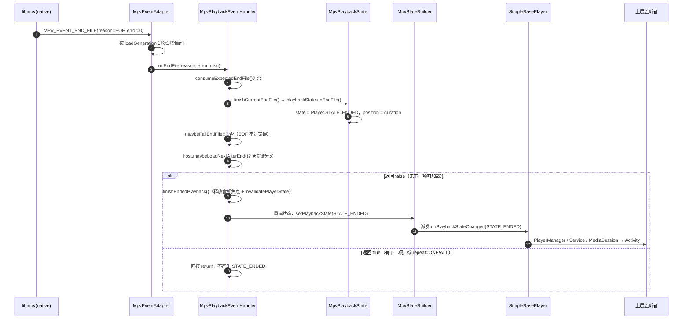
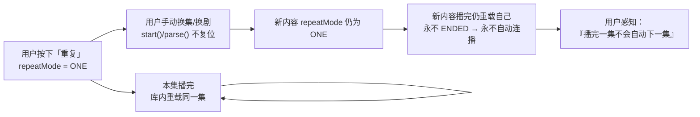
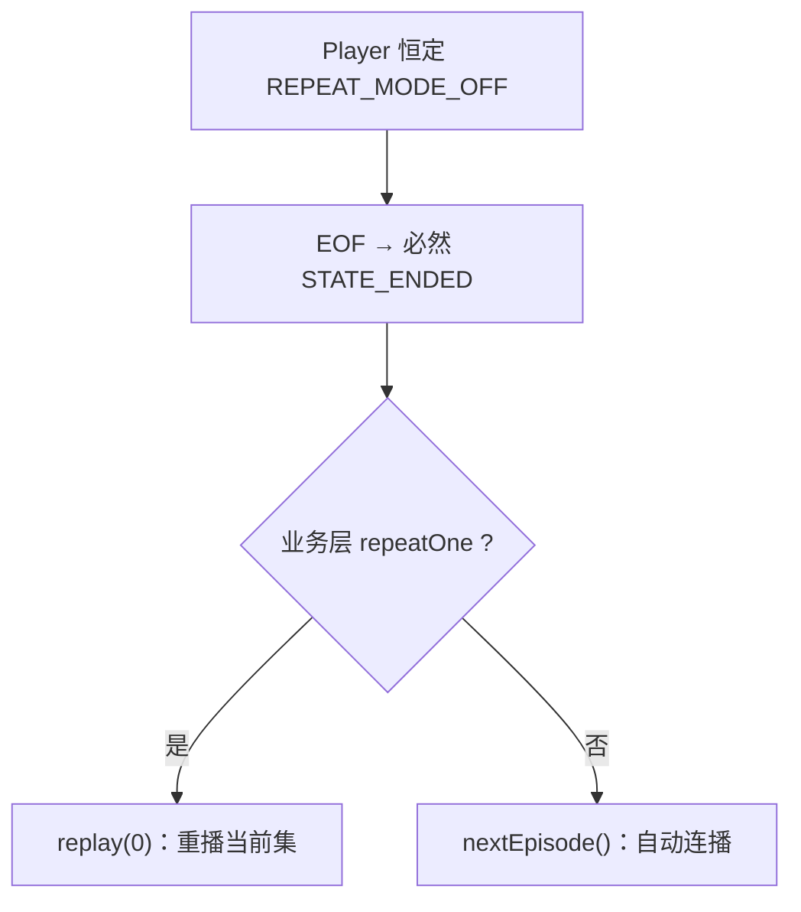
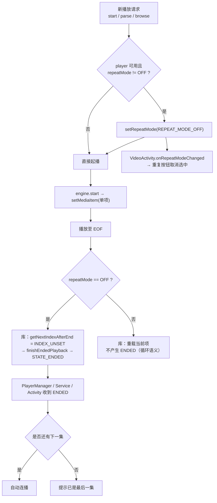
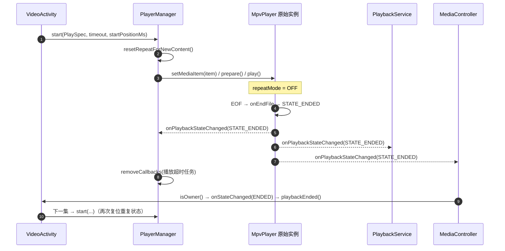

# MPV 引擎 STATE_ENDED 上报核实与自动连播修复开发设计文档

> 作者：Shiro
> 日期：2026-10-25
> 修订说明：本文档为原《MPV 引擎 STATE_ENDED 补齐开发设计文档》的**修订版**。依据上游 MPV 库真实源码核实后，原文档「库可能不上报 STATE_ENDED、需用 `ForwardingPlayer` 补发」的核心前提**不成立**，故整体重写。
> 关联文档：[TV端自动连播失效问题定位与修复方案.md](./TV端自动连播失效问题定位与修复方案.md)（本方案对应其中「方案四」，并修正其 RC-2 的结论）
> 适用范围：`app` 模块，`main`（共享逻辑）+ `leanback` / `mobile`（设备形态）

---

## 一、核实结论（先看这里）

| 序号 | 结论 | 影响 |
| --- | --- | --- |
| C1 | 上游 MPV 库在真实 EOF 时**会**正常产生 `Player.STATE_ENDED`，无需任何包装或补发 | **原「补齐 STATE_ENDED」的编码工作取消** |
| C2 | 库内一共有三条会让 `onEndFile` 提前 `return` 的分支，其中只有一条与业务相关：**有下一项可加载**（`maybeLoadNextAfterEnd()`） | 这是唯一需要 App 侧规避的抑制条件 |
| C3 | App 始终使用**单项 timeline**（`setMediaItem` 单条），因此 `REPEAT_MODE_ONE` 恒等于「重载同一集」，**永不产生 ENDED**；`REPEAT_MODE_ALL` 同理（App 当前未使用） | 重复模式是 MPV 侧唯一的「永不到尾」根因 |
| C4 | `REPEAT_MODE_ONE` 在 App 内**没有任何跨集/跨内容复位点**，只随 `PlaybackService` 的播放器实例生命周期存在 | 用户一旦开启「重复」，后续所有内容都会永久丧失自动连播能力 |
| C5 | 库未使用 mpv 的 `keep-open` 选项，App 也未配置；`MpvUtil` 中不存在该选项 | 排除「keep-open 导致不结束」的猜测 |
| C6 | `MpvEndFileGuard`（预期结束拦截）只会拦截**程序化结束**（切文件 / stop），且 `onStartFile()` 会 `clear()` 清空计数 | 不会误吞真实 EOF，风险低 |
| C7 | `STATE_ENDED` 一旦产生，`PlayerManager`、`PlaybackService`、`MediaSession`→`MediaController`→Activity 三者观察的是同一个实例，事件可全链路到达 | 无需改动事件源拓扑 |

**一句话结论**：MPV 引擎不存在「STATE_ENDED 缺失」，真正要补的是「**让进入 ENDED 的前置条件成立**」——即收敛「重复」状态的作用域，避免其跨集/跨内容粘连。

---

## 二、上游源码证据链

### 2.1 核实对象与方式

| 项 | 内容 |
| --- | --- |
| 仓库 | `https://github.com/chengshengru/media` |
| 分支 | `release-1.11.0-fongmi-libass` |
| 模块 | `libraries/mpvplayer`（包名 `androidx.media3.mpvplayer`） |
| 获取方式 | `git clone --depth 1 --branch release-1.11.0-fongmi-libass --filter=blob:none --sparse`，再 `git sparse-checkout set libraries/mpvplayer` |

> 下文引用均以库根 `libraries/mpvplayer/src/main/java/androidx/media3/mpvplayer/` 为基准，行号对应上述分支。

### 2.2 事件主链路



### 2.3 逐条证据

**证据 1：`onEndFile` 会把状态置为 `STATE_ENDED`**

`core/MpvPlaybackState.java` L236-L250：

```java
public boolean onEndFile() {
  boolean loadFailed = loading && !currentFileLoaded;
  currentFileStarted = false;
  currentFileLoaded = false;
  seeking = false;
  if (!loadFailed) {
    if (!isCurrentMediaLive() && hasKnownDuration()) {
      positionMs = durationMs;
      updateBufferedPosition(durationMs);
    }
    loading = false;
    state = Player.STATE_ENDED;     // ← 库确实会上报 ENDED
  }
  return loadFailed;
}
```

**证据 2：ENDED 的三个提前 `return` 分支**

`core/MpvPlaybackEventHandler.java` L140-L153：

```java
@Override
public void onEndFile(int reason, int error, @Nullable String errorString) {
  if (consumeExpectedEndFile()) {          // 分支①：预期结束（切文件 / stop）
    return;
  }
  boolean loadFailed = finishCurrentEndFile();
  if (maybeFailEndFile(reason, error, errorString, loadFailed)) {   // 分支②：真错误
    return;
  }
  if (host.maybeLoadNextAfterEnd()) {      // 分支③：有下一项可加载 ★唯一业务相关
    return;
  }
  finishEndedPlayback();                   // 正常路径：进入 ENDED
}
```

| 分支 | 触发条件 | 是否应产生 ENDED | 是否可规避 |
| --- | --- | --- | --- |
| ① `consumeExpectedEndFile()` | 程序化 `stop()` 或 `load()` 换文件 | 否（本就不该报结束） | 无需规避 |
| ② `maybeFailEndFile()` | `reason == ERROR` 或 `error < 0` | 否（走 `onPlayerError`） | 无需规避 |
| ③ `maybeLoadNextAfterEnd()` | timeline 中存在可前进的下一项 | 否（库内自动续播） | **需规避**：让 timeline 无下一项 |

**证据 3：`maybeLoadNextAfterEnd()` 在单项 timeline + 重复模式下恒为 `true`**

`media/MpvPlaybackNavigator.java` L30-L42：

```java
public int getNextIndexAfterEnd(@Player.RepeatMode int repeatMode) {
  int currentIndex = playlist.currentIndex();
  if (playlist.isEmpty() || currentIndex == C.INDEX_UNSET) {
    return C.INDEX_UNSET;
  }
  if (repeatMode == Player.REPEAT_MODE_ONE) {
    return currentIndex;                                   // ← 单集循环：回到自己
  }
  if (currentIndex < playlist.size() - 1) {
    return currentIndex + 1;
  }
  return repeatMode == Player.REPEAT_MODE_ALL ? 0 : C.INDEX_UNSET;
}
```

`media/MpvTimelineController.java` L81-L91：

```java
public boolean maybeLoadNextAfterEnd(@Player.RepeatMode int repeatMode) {
  int nextIndex = playbackNavigator.getNextIndexAfterEnd(repeatMode);
  if (nextIndex == C.INDEX_UNSET) {
    return false;
  }
  playlist.setCurrentIndex(nextIndex);
  host.resetCurrentMediaState(0);
  host.setPendingDiscontinuity(Player.DISCONTINUITY_REASON_AUTO_TRANSITION, 0);
  host.loadCurrent(checkNotNull(playlist.current()), 0);   // ← 重载同一集
  return true;
}
```

推导（设 timeline 只有 1 项，`currentIndex = 0`、`size = 1`）：

| `repeatMode` | `getNextIndexAfterEnd` 返回值 | `maybeLoadNextAfterEnd` | 是否 ENDED |
| --- | --- | --- | --- |
| `REPEAT_MODE_OFF` | `C.INDEX_UNSET`（`0 < 0` 为假，且非 ALL） | `false` | **是** |
| `REPEAT_MODE_ONE` | `0`（走 `return currentIndex`） | `true` → 重载同一集 | **否（永久循环）** |
| `REPEAT_MODE_ALL` | `0`（走 `repeatMode == ALL ? 0`） | `true` → 重载同一集 | **否（永久循环）** |

**证据 4：预期结束守卫不会误吞真实 EOF**

`media/MpvEndFileGuard.java` L18-L44（计数式守卫：`expect()` / `consumeExpected()` / `cancelExpected()` / `clear()`），其 `expect()` 仅在两处被调用：

- `MpvPlayer.stopActiveFile()`（L711-L724）：stop 前 `expect()`，命令失败则 `cancelExpected()`
- `media/MpvMediaLoader.load()`（L67-L80）：`if (host.hasActiveMpvFile()) host.expectProgrammaticEndFile();`

且 `core/MpvPlaybackEventHandler.onStartFile()`（L120-L125）会执行 `endFileGuard.clear();`，即**每次新文件开始加载都会清空待抵扣计数**。因此不存在「预期结束计数泄漏 → 后续真实 EOF 被吞」的稳定路径，风险等级低。

**证据 5：EOF 不会被误判为错误**

`nativebridge/MpvPlaybackErrorFactory.java` L34-L36：

```java
public static boolean isEndFileError(int reason, int error) {
  return reason == MPV_END_FILE_REASON_ERROR || error < MPV_ERROR_SUCCESS;
}
```

EOF 的 `reason = 0`、`error = 0`，不满足条件，故走正常结束路径。

**证据 6：状态对外可见性**

`core/MpvStateBuilder.java` L114-L124：

```java
private @Player.State int getVisiblePlaybackState(
    boolean playlistEmpty, @Nullable PlaybackException playerError) {
  if (playerError != null) {
    return Player.STATE_IDLE;
  }
  @Player.State int state = playbackState.getState();
  if (!playlistEmpty) {
    return state;                                  // ← 非空时间线：ENDED 原样透出
  }
  return state == Player.STATE_ENDED ? Player.STATE_ENDED : Player.STATE_IDLE;
}
```

结论：不存在「库内部为 ENDED、但对外映射成 IDLE/READY」的隐藏映射；只要 `onEndFile()` 走到了 `finishEndedPlayback()`，上层必然收到 `STATE_ENDED`。

**证据 7：`keep-open` 排除**

全库检索 `keep-open` / `PROP_KEEP_OPEN` 无任何匹配；`nativebridge/MpvConstants.java` 仅定义 `idle-active`、`pause` 等属性；[MpvUtil.java](../../app/src/main/java/com/fongmi/android/tv/player/mpv/MpvUtil.java) 的 `PLAYER_OPTIONS` / `CACHE_OPTIONS` 亦未设置 `keep-open`。故「mpv 停在末帧不结束」不成立。

### 2.4 库内与重复模式相关的第二处特殊处理

`core/MpvPlaybackEventHandler.java` L162-L174：

```java
private void handleActiveFileSeek() {
  if (seekController.isCommandedSeekPending()) {
    return;
  }
  if (playbackNavigator.isRepeatOneLoopSeek(host.getRepeatMode(), playbackState)) {
    eventState.setIgnoreRepeatOneBuffering(true);
    playbackState.setPositionMs(0);                       // 拖到片尾 → 直接回 0 循环
    host.setPendingDiscontinuity(Player.DISCONTINUITY_REASON_AUTO_TRANSITION, 0);
    host.invalidatePlayerState();
    return;
  }
  playbackState.onSeek();
  host.invalidatePlayerState();
}
```

说明：重复模式下「拖到片尾」也被库内部转化为循环，App 侧同样收不到 ENDED。这进一步印证「重复模式 = 语义性抑制 ENDED」，属**预期行为**，不应由补发逻辑去覆盖。

---

## 三、App 侧现状与真实缺口

### 3.1 App 使用的是单项 timeline

[MpvPlayerEngine.startInternal](../../app/src/main/java/com/fongmi/android/tv/player/mpv/MpvPlayerEngine.java#L107-L112)：

```java
private void startInternal(long startPositionMs) {
    effect.applyVideoEffect();
    effect.clearAudioEffect();
    player.setMediaItem(MediaItemFactory.from(spec), startPositionMs);   // ← 每次仅一项
    prepareAndPlay();
}
```

Exo 侧同理（`ExoPlayerEngine.startInternal` 每次构造单个 `MediaSource`）。因此 2.3 证据 3 的推导表在 App 内**完全成立**：只要 `repeatMode` 为 `ONE`（或 `ALL`），MPV 就永远停在「重载同一集」，上层永远收不到 ENDED。

### 3.2 「重复」状态在 App 内没有任何复位点

| 环节 | 位置 | 行为 |
| --- | --- | --- |
| UI 切换 | [VideoActivity.onRepeat L880-L887](../../app/src/leanback/java/com/fongmi/android/tv/ui/activity/VideoActivity.java#L880-L887) | `player().setRepeatOne(!player().isRepeatOne())` |
| 通知栏/媒体键 | [PlaybackService.dispatchRepeat L349-L351](../../app/src/main/java/com/fongmi/android/tv/service/PlaybackService.java#L349-L351) | `player.setRepeatOne(!player.isRepeatOne())` |
| DLNA | [DLNAAvTransportImpl L220](../../app/src/leanback/java/com/fongmi/android/tv/dlna/DLNAAvTransportImpl.java#L220) | `player.setRepeatOne(repeat)` |
| 实际写入 | [PlayerManager.setRepeatOne L410-L412](../../app/src/main/java/com/fongmi/android/tv/player/PlayerManager.java#L410-L412) | `player.setRepeatMode(ONE / OFF)` |
| 引擎切换 / 解码重试 | [PlayerManager.PlaybackSnapshot.restore L641-L648](../../app/src/main/java/com/fongmi/android/tv/player/PlayerManager.java#L641-L648) | **会原样恢复 `repeatMode`** |
| 新集 / 新内容起播 | [PlayerManager.start L520-L523](../../app/src/main/java/com/fongmi/android/tv/player/PlayerManager.java#L520-L523)、[parse L529-L534](../../app/src/main/java/com/fongmi/android/tv/player/PlayerManager.java#L529-L534) | **无任何 `repeatMode` 复位** |

关键事实：`repeatMode` 只存活于 `PlaybackService` 持有的 `Player` 实例上，而该实例在整部剧、甚至跨剧集浏览时都不会重建（只有 `PlayerManager.ensureEngine` 因引擎类型变化时才重建）。因此：



### 3.3 这不是 MPV 专有缺陷

`REPEAT_MODE_ONE` 在 Exo 上同样是「库内循环、不产生 ENDED」。因此：

> 原第一轮文档中的 RC-4「非 Exo 引擎未上报 STATE_ENDED」应修正为 **RC-4'「重复模式跨集粘连导致所有引擎都不产生 ENDED」**，而 `REPEAT_MODE_ONE` 的语义本身是**正确且预期**的（循环播放本就不该自动下一集）。

这也解释了为什么「换成 MPV 引擎后才出问题」的直觉不可靠：只要重复状态被打开过，两个引擎表现一致。

### 3.4 缺口小结

| 缺口 | 性质 | 处理 |
| --- | --- | --- |
| MPV 不产生 ENDED（真实 EOF） | **不存在** | 无需处理 |
| 重复模式下不产生 ENDED | 预期语义 | 不补发、不覆盖 |
| 重复状态跨集/跨内容粘连 | **真实缺陷** | 本次修复目标 |
| MediaSession 在 ENDED 后 `play()` 的映射 | 库已处理（见 `MpvEndedSeekHandler` 注释） | 无需处理 |

---

## 四、修复方案

### 4.1 方案 A：重复状态作用域收敛（推荐）

**做法**：在「新的播放请求」入口，将 `repeatMode` 复位为 `REPEAT_MODE_OFF`，使「重复」只作用于**当前这一集**，不跨集、不跨内容。

- 复位点：`PlayerManager.start(...)` 与 `PlayerManager.parse(...)`（`browse(...)` 内部调用 `start(...)`，自动覆盖 Service 侧自动连播与 MediaSession 播放）。
- 不复位点：`startCurrent(...)`（被 `retryDecode` / `setEngine` / `setSub` / `onParseSuccess` 复用）。这些路径属于「同一内容的状态修复」，必须由 `PlaybackSnapshot` 保持重复状态，否则会破坏「切换解码/引擎后重复状态丢失」的既有体验。

**优点**：改动极小（新增 1 个方法 + 2 处调用）；不动库、不动事件拓扑；对 Exo/MPV 一致生效。
**代价 / 产品决策**：手动换集时「重复」按钮会自动取消选中。语义解释为「重复 = 循环当前集」，符合按钮的即时可见状态。

### 4.2 方案 B：把「重复」语义上移到 App 层（可选，需产品确认）

**做法**：播放器永远保持 `REPEAT_MODE_OFF`；`repeatMode` 不再承担业务语义，改由 `PlayerManager` 持有一个 `boolean repeatOne` 字段；ENDED 之后由业务层决定「重播」还是「下一集」。



**改动面**：`PlayerManager.setRepeatOne/isRepeatOne`（改为字段）、`PlaybackService.listener.onPlaybackStateChanged`（ENDED 分支区分重播/连播）、`VideoActivity.onStateChanged`（ENDED 分支区分）、`VodPlaybackController.playbackEnded()`。
**优点**：`STATE_ENDED` 永不被库吞掉，事件语义单一；后续若接入其它引擎也不会再遇到同类问题。
**缺点**：循环重播要走一次完整起播流程（可能出现短暂黑屏/重新缓冲），体验不如 Exo 原生无缝循环；改动面比方案 A 大，需要产品确认「循环是否接受一次起播抖动」。

### 4.3 方案 C：`ForwardingPlayer` 补发（**不采用**，原方案 A 撤回）

原文档设计的 `MpvEndedReportingPlayer` 装饰器在本轮核实后**不再采用**，原因如下：

1. **前提消失**：库已能上报 ENDED，补发属冗余，且存在「真实 ENDED + 补发 ENDED」双发风险（会导致双跳集）。
2. **解决不了真实问题**：补发检测器在 `REPEAT_MODE_ONE` 下必须自我抑制（否则会破坏循环语义）；一旦抑制，它就无法修复本轮的真正缺口。
3. **其它抑制路径已有兜底**：`onStartFile()` 的 `endFileGuard.clear()` 使得「预期结束计数泄漏」难以稳定复现（见 2.3 证据 4）。
4. **引入额外回归面**：包装层会改变 `PlayerManager`/`MediaSession` 持有的实例身份，需要额外回归命令可用性、通知栏、`setMediaItem` 拦截（`PlaybackService.wrap`）三者叠加的行为。

> 若后续升级库后确实出现「真实 EOF 但无 ENDED」的异常，再以 4.3 的检测思路作为**应急开关**实现，届时需重新评审，不纳入本次范围。

### 4.4 选型

| 方案 | 改动量 | 解决问题 | 风险 | 结论 |
| --- | --- | --- | --- | --- |
| **A** | 小（1 方法 + 2 调用） | 是 | 低（仅「重复」状态复位时机） | **本次实施** |
| B | 中（4 处语义迁移） | 是，且更彻底 | 中（循环重播体验退化） | 可选，需产品确认 |
| C | 中（新增包装类 + 改造引擎） | 否 | 中（双发、实例身份变化） | **不采用** |

---

## 五、方案 A 详细设计

### 5.1 改动点

| 文件 | 变更 |
| --- | --- |
| [PlayerManager.java](../../app/src/main/java/com/fongmi/android/tv/player/PlayerManager.java) | 新增 `resetRepeatForNewContent()`；在 `start(PlaySpec, long, long)`、`parse(String, Result, boolean, MediaMetadata, long)` 入口调用 |
| 其余文件 | 不改动 |

### 5.2 代码

在 `PlayerManager` 内新增（按规范置于类末尾区域，紧邻 `PlaybackSnapshot` 之前的私有方法段）：

```java
/**
 * 起播新的播放请求前，复位「单集循环」状态。
 *
 * <p>MPV 库在 {@code REPEAT_MODE_ONE} 下会经 {@code maybeLoadNextAfterEnd()} 自行重载当前项，
 * 并抑制 {@link Player#STATE_ENDED}；若该状态跨集或跨内容残留，上层的自动连播将永久失效。
 * 因此「重复」仅在当前这一集内有效，任何新的播放请求都必须回到 {@code REPEAT_MODE_OFF}。</p>
 *
 * <p>注意：本方法只用于「新内容起播」入口，{@code startCurrent(...)}（解码重试 / 引擎切换 /
 * 补挂字幕）不得调用，以免破坏 {@link PlaybackSnapshot} 对重复状态的恢复。</p>
 */
private void resetRepeatForNewContent() {
    if (player == null) return;
    if (!player.isCommandAvailable(Player.COMMAND_SET_REPEAT_MODE)) return;
    if (player.getRepeatMode() == Player.REPEAT_MODE_OFF) return;
    player.setRepeatMode(Player.REPEAT_MODE_OFF);
}
```

在既有方法首行插入调用（`browse()` 内部已调用 `start(...)`，无需重复添加）：

```java
public void start(PlaySpec spec, long timeout, long startPositionMs) {
    resetRepeatForNewContent();
    this.spec = spec;
    setMediaItem(timeout, startPositionMs);
}

public void parse(String key, Result result, boolean useParse, MediaMetadata metadata, long startPositionMs) {
    resetRepeatForNewContent();
    stopParse();
    pendingStartPositionMs = startPositionMs;
    spec = PlaySpec.fromParse(result, key, metadata);
    parseJob = ParseJob.create(this).start(result, useParse);
}
```

### 5.3 判定流程图



### 5.4 时序图（修复后正常路径）



### 5.5 方法契约

| 方法 | 契约 |
| --- | --- |
| `resetRepeatForNewContent()` | 幂等；仅在 `repeatMode != OFF` 且命令可用时写入；不得在 `startCurrent(...)` 链路调用 |
| `start(...)` / `parse(...)` | 必须先复位再起播，保证「新内容从干净状态开始」 |
| `PlaybackSnapshot.restore(...)` | 维持现状（引擎切换/解码重试保留重复状态），与方案 A 不冲突 |
| `PlayerManager.setRepeatOne(...)` | 维持现状（UI/通知栏/DLNA 仍可随时切换） |

---

## 六、方案 B 详细设计（可选，不作为本次实施项）

若产品确认「循环重播可以接受一次起播抖动」，可采用本方案彻底解耦「库的 repeatMode」与「业务重复语义」。

### 6.1 改动点

| 文件 | 变更 |
| --- | --- |
| [PlayerManager.java](../../app/src/main/java/com/fongmi/android/tv/player/PlayerManager.java) | `setRepeatOne/isRepeatOne` 改为内存字段，不再写 `player.setRepeatMode`；`PlaybackSnapshot` 不再保存/恢复 `repeatMode` |
| [PlaybackService.java](../../app/src/main/java/com/fongmi/android/tv/service/PlaybackService.java#L530-L540) | ENDED 分支区分「重播当前集」与「下一集」 |
| [VideoActivity.java(L1217-L1235)](../../app/src/leanback/java/com/fongmi/android/tv/ui/activity/VideoActivity.java#L1217-L1235) | ENDED 分支同上 |
| [VodPlaybackController.java L242-L244](../../app/src/main/java/com/fongmi/android/tv/playback/vod/VodPlaybackController.java#L242-L244) | `playbackEnded()` 增加重复判定 |

### 6.2 关键代码（示意）

```java
/**
 * 单集循环开关（业务层语义，不再写入播放器的 repeatMode）。
 */
private boolean repeatOne;

public boolean isRepeatOne() {
    return repeatOne;
}

public void setRepeatOne(boolean repeat) {
    repeatOne = repeat;
    // 播放器始终 REPEAT_MODE_OFF，保证 EOF 必然产生 STATE_ENDED
    if (player != null && player.isCommandAvailable(Player.COMMAND_SET_REPEAT_MODE)) {
        player.setRepeatMode(Player.REPEAT_MODE_OFF);
    }
}
```

`VodPlaybackController.playbackEnded()`：

```java
public void playbackEnded() {
    if (host.isRepeatOne()) {
        host.replayRepeatOne();
        return;
    }
    nextEpisode(true);
}
```

> 该方案需要 `VodPlaybackHost` 增加 `isRepeatOne()` / `replayRepeatOne()` 两个方法，并在 leanback / mobile 两个 `VideoActivity` 中实现，属跨层改动，故列为可选。

### 6.3 取舍

- 收益：`STATE_ENDED` 语义单一，任何引擎都不会被「重复模式」屏蔽；后续新增引擎无需再排查同类问题。
- 成本：循环重播走完整起播流程（黑屏/缓冲抖动）；改动面覆盖 Activity、Service、Controller 与 Host 接口。

---

## 七、边界与异常处理

| 场景 | 期望行为 | 依据 |
| --- | --- | --- |
| 正常单集播完（repeat=OFF） | 恰好一次 `STATE_ENDED` → 自动连播 | 2.3 证据 3 |
| 用户开启「重复」后播完 | 不产生 ENDED，循环当前集（预期语义，不修复） | 2.4 |
| 用户开启「重复」后手动换集/换剧 | 新内容起播时复位为 OFF，后续可自动连播 | 方案 A |
| 播放中切换解码 / 引擎 | 保留重复状态（走 `PlaybackSnapshot`），不触发复位 | 5.5 契约 |
| 直播流被服务端关闭 | 库仍会置 `STATE_ENDED`（`isCurrentMediaLive()` 仅跳过 position 归位，不跳过状态置位） | 证据 1；上层按既有 ENDED 逻辑处理即可 |
| 无时长媒体 | `onEndFile` 不写 position/duration，但仍置 ENDED；上层按 ENDED 处理即可 | 证据 1 |
| EOF 同时伴随解码错误 | 走 `onPlayerError`，不产生 ENDED | 证据 2 分支② |
| 快速连续切集 | 旧文件的 END_FILE 被 `EndFileGuard` 拦截；新文件 `onStartFile()` 清空计数 | 证据 4 |
| MediaSession 在 ENDED 后 `play()` | 库映射为 `seekToDefaultPosition() + play()`，仍允许 App 消费 ENDED | `seek/MpvEndedSeekHandler` 注释 |
| `repeatMode = ALL`（当前 App 未使用） | 单项 timeline 下同样永不 ENDED；若将来启用需同时评审 | 证据 3 |

---

## 八、风险与回归影响

| 风险 | 等级 | 说明与缓解 |
| --- | --- | --- |
| 重复按钮在换集后自动取消选中 | 中 | 属方案 A 的显式产品决策；需在 Release Note 说明「重复仅对当前集生效」 |
| 用户在「重复」状态下换集后误以为仍循环 | 低 | 按钮选中态会随 `onRepeatModeChanged` 实时刷新（[VideoActivity L886-L888](../../app/src/leanback/java/com/fongmi/android/tv/ui/activity/VideoActivity.java#L886-L888)） |
| 误在 `startCurrent` 链路复位导致解码重试丢重复状态 | 中 | 由 5.5 契约与用例 T9 约束 |
| 仅修复重复模式，仍存在第一轮文档中的 RC-1（归属判定 key 不一致） | 高 | 本文档不覆盖；需按[关联文档](./TV端自动连播失效问题定位与修复方案.md)「方案一」并行修复 |
| 上游同步成本 | 低 | `PlayerManager` 为项目自有代码，仅新增私有方法，冲突面极小 |

---

## 九、测试方案

**前置**：`PlayerSetting` 选择 MPV 且 `MpvPlayerEngine.isAvailable()` 为真；准备 ≥3 集的同一线路剧集（`leanback` 与 `mobile` 各跑一轮关键用例）。

| 用例 | 操作 | 期望结果 |
| --- | --- | --- |
| T1 基础 ENDED | repeat=OFF，播放第 1 集至自然结束 | 日志中出现**恰好一次** `STATE_ENDED` |
| T2 自动连播 | 承接 T1 | 自动切第 2 集并起播 |
| T3 连续连播 | 让第 2 集自然结束 | 自动切第 3 集 |
| T4 最后一集 | 在第 N 集结束 | 提示「已是最后一集」，不误切 |
| **T5 重复粘连专项** | 开启「重复」→ 播放至结束（本集循环）→ 手动点「下一集」 | 下一集起播时重复按钮取消选中；该集播完后**自动连播** |
| **T6 跨剧粘连专项** | 开启「重复」→ 退出播放 → 打开另一部剧并播放至结束 | 另一部剧可自动连播 |
| T7 重复语义保留 | 开启「重复」后播放至结束 | 不产生 ENDED，当前集循环（符合预期） |
| T8 拖到片尾 | repeat=OFF 下拖到最末尾 | 产生一次 ENDED 并连播 |
| T9 解码切换保态 | 开启「重复」→ 播放中切换硬/软解 | 重复状态保持（不被复位） |
| T10 引擎切换保态 | 开启「重复」→ 在 MPV/Exo 间切换 | 重复状态保持 |
| T11 通知栏/DLNA | 通过通知栏或 DLNA 切换重复 → 播放至结束 | 与 UI 行为一致 |
| T12 直播 | 播放直播频道并持续观察；随后让服务端关闭流 | 正常播放期间不出现异常 ENDED；流被关闭时的 ENDED 按既有逻辑处理，不误连播 |
| T13 引擎一致性 | 在 Exo 下重复 T1/T2/T5 | 行为与 MPV 完全一致 |

**日志校验**：每次自然结束只允许出现一次 `STATE_ENDED`；不得出现「重复模式下仍补发 ENDED」（本轮已无补发逻辑，属静态校验）。

---

## 十、诊断埋点

在不改变行为的前提下补充以下日志，用于确认线上问题是否已被收敛到「重复模式」：

1. `PlayerManager.resetRepeatForNewContent()`：打印 `before / after repeatMode`、`spec.getKey()`。
2. `PlayerManager.listener.onPlaybackStateChanged`（[L653-L657](../../app/src/main/java/com/fongmi/android/tv/player/PlayerManager.java#L653-L657)）：打印 `state`、`repeatMode`、`position / duration`。
3. `PlaybackService.listener.onPlaybackStateChanged`（[L530-L540](../../app/src/main/java/com/fongmi/android/tv/service/PlaybackService.java#L530-L540)）：打印 `state`、`hasNavigationCallback()`、`isNavigationOwner()`、`navigationKey`、`player.getKey()`。
4. 起播处打印 `engine.getType()` 与 `player.getRepeatMode()`，用于区分「引擎差异」与「重复状态差异」。

判定口径：

| 现象 | 结论 |
| --- | --- |
| 结束瞬间 `repeatMode == ONE` 且无 ENDED | 命中本方案目标 |
| `repeatMode == OFF`、引擎为 MPV 且无 ENDED | 库异常（保留 4.3 应急方案待评审） |
| ENDED 有出现但未连播 | 属第一轮文档 RC-1/RC-3，不在本方案范围 |

---

## 十一、上线与回滚

- 上线：仅落地第五节（`PlayerManager` 新增方法 + 2 处调用），编译后执行 T1–T13。
- 回滚：删除两处 `resetRepeatForNewContent()` 调用即可（方法保留无副作用），行为回到现状。
- 灰度建议：先以「MPV 引擎 + 多集剧集」为观察面，重点看「重复」相关负反馈。

---

## 十二、涉及文件清单

**修改**

- [PlayerManager.java](../../app/src/main/java/com/fongmi/android/tv/player/PlayerManager.java)：新增 `resetRepeatForNewContent()`；`start(...)` / `parse(...)` 入口调用

**只读依赖（不改动）**

- [MpvPlayerEngine.java](../../app/src/main/java/com/fongmi/android/tv/player/mpv/MpvPlayerEngine.java)：单项 timeline 起播
- [MpvUtil.java](../../app/src/main/java/com/fongmi/android/tv/player/mpv/MpvUtil.java)：mpv 配置（确认无 `keep-open`）
- [PlaybackService.java](../../app/src/main/java/com/fongmi/android/tv/service/PlaybackService.java)：ENDED 分发与 `dispatchRepeat`
- [PlaybackActivity.java](../../app/src/main/java/com/fongmi/android/tv/ui/activity/PlaybackActivity.java)：状态回调与归属判定
- [VideoActivity.java (leanback)](../../app/src/leanback/java/com/fongmi/android/tv/ui/activity/VideoActivity.java)：`onRepeat` / `onStateChanged(ENDED)`
- [VodPlaybackController.java](../../app/src/main/java/com/fongmi/android/tv/playback/vod/VodPlaybackController.java)：`playbackEnded()` → `nextEpisode()`
- [PlayerEngineFactory.java](../../app/src/main/java/com/fongmi/android/tv/player/engine/PlayerEngineFactory.java)：引擎选择

**上游核实（只读，非本仓库）**

- `libraries/mpvplayer/src/main/java/androidx/media3/mpvplayer/core/MpvPlaybackState.java`
- `libraries/mpvplayer/src/main/java/androidx/media3/mpvplayer/core/MpvPlaybackEventHandler.java`
- `libraries/mpvplayer/src/main/java/androidx/media3/mpvplayer/core/MpvStateBuilder.java`
- `libraries/mpvplayer/src/main/java/androidx/media3/mpvplayer/media/MpvPlaybackNavigator.java`
- `libraries/mpvplayer/src/main/java/androidx/media3/mpvplayer/media/MpvTimelineController.java`
- `libraries/mpvplayer/src/main/java/androidx/media3/mpvplayer/media/MpvMediaLoader.java`
- `libraries/mpvplayer/src/main/java/androidx/media3/mpvplayer/media/MpvEndFileGuard.java`
- `libraries/mpvplayer/src/main/java/androidx/media3/mpvplayer/nativebridge/MpvPlaybackErrorFactory.java`
- `libraries/mpvplayer/src/main/java/androidx/media3/mpvplayer/seek/MpvEndedSeekHandler.java`
- `libraries/mpvplayer/src/main/java/androidx/media3/mpvplayer/MpvPlayer.java`
