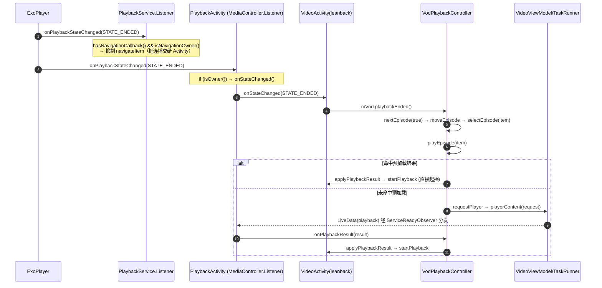

# TV 端自动连播失效问题定位与修复方案

> 作者：Shiro
> 日期：2026-10-19
> 适用模块：`app`（`leanback` / `mobile` 两种设备形态，核心逻辑位于 `main`）

---

## 一、问题现象

在 TV（leanback）端播放剧集，某一集播放结束后：

- 不会自动切到下一集；
- 画面停留在“播放结束/黑屏”状态，需要用户手动点击「下集」或返回剧集列表重新选择。

同为 `main` 共享代码的移动端（mobile）逻辑与 TV 端一致，说明问题不在“设备形态差异”，而在共享的**自动连播触发链路**中的某个闸门被静默跳过。

---

## 二、结论摘要

通过对自动连播全链路的静态走查，并与上游 `upstream/fongmi`（`0af3b31a1`）逐文件对比确认：

- 自动连播的**主链路代码完整、逻辑正确**，且与上游**完全一致**（`app/src/main/.../playback/**`、`app/src/leanback/.../VideoActivity.java`、`PlaybackService.java` 均无差异；`PlaybackActivity.java` 仅有弹幕控制器 API 更名，与本问题无关）。
- 因此本问题**不是连播逻辑缺失**，而是连播链路上某个“闸门（gate）”条件不满足，导致触发被**静默丢弃**。

自动连播真正生效，必须**同时**满足下列 6 个闸门（详见第四节）。其中**最脆弱、也最可能的断点**是归属判定（G2/G3）：

> **Activity 与 Service 两端都使用“播放 key 一致”作为“由谁处理播放结束”的判据，且两端判据并不完全一致。一旦 `spec.key` 与 `getHistoryKey()`（或 `navigationKey`）出现偏差，Activity 会丢弃 `STATE_ENDED`，而 Service 又会走一个在“详情页点播”场景下无法生效的 `navigateItem`（BrowseTree）分支——两端都不处理，连播就此中断。**

---

## 三、自动连播完整触发链路

### 3.1 时序图



### 3.2 关键代码索引

| 步骤 | 位置 | 说明 |
| --- | --- | --- |
| ① 播放器结束 | `Player.STATE_ENDED` | Exo 播放完单集 |
| ② Service 抑制 | [PlaybackService.java](../../app/src/main/java/com/fongmi/android/tv/service/PlaybackService.java#L530-L540) `listener.onPlaybackStateChanged` | 有导航回调且 key 一致时**不**调用 `navigateItem` |
| ③ Activity 分发 | [PlaybackActivity.java](../../app/src/main/java/com/fongmi/android/tv/ui/activity/PlaybackActivity.java#L571-L574) `onPlaybackStateChanged` | `if (isOwner()) onStateChanged(state)` |
| ④ TV UI 处理 | [VideoActivity.java](../../app/src/leanback/java/com/fongmi/android/tv/ui/activity/VideoActivity.java#L1218-L1235) `onStateChanged` | `STATE_ENDED` → `mVod.playbackEnded()` |
| ⑤ 控制器连播 | [VodPlaybackController.java](../../app/src/main/java/com/fongmi/android/tv/playback/vod/VodPlaybackController.java#L242-L244)、[#L273-L289](../../app/src/main/java/com/fongmi/android/tv/playback/vod/VodPlaybackController.java#L273-L289)、[#L167-L183](../../app/src/main/java/com/fongmi/android/tv/playback/vod/VodPlaybackController.java#L167-L183) | `playbackEnded → nextEpisode → moveEpisode → selectEpisode → playEpisode` |
| ⑥ 请求下一集 | [VodPlaybackController.java](../../app/src/main/java/com/fongmi/android/tv/playback/vod/VodPlaybackController.java#L269-L271)、[#L418-L425](../../app/src/main/java/com/fongmi/android/tv/playback/vod/VodPlaybackController.java#L418-L425) | `requestSelectedEpisode → requestPlayer → dataSource.playerContent` |
| ⑦ 结果分发 | [PlaybackActivity.java](../../app/src/main/java/com/fongmi/android/tv/ui/activity/PlaybackActivity.java#L631-L660) `ServiceReadyObserver` | `canDispatch()` 不满足时结果被 **pending** |
| ⑧ 应用结果 | [VodPlaybackController.java](../../app/src/main/java/com/fongmi/android/tv/playback/vod/VodPlaybackController.java#L108-L122)、[#L468-L473](../../app/src/main/java/com/fongmi/android/tv/playback/vod/VodPlaybackController.java#L468-L473) | `cannotApply` 校验通过后 `startPlayback` |
| ⑨ 起播新集 | [VideoActivity.java](../../app/src/leanback/java/com/fongmi/android/tv/ui/activity/VideoActivity.java#L524-L527)、[PlaybackActivity.java](../../app/src/main/java/com/fongmi/android/tv/ui/activity/PlaybackActivity.java#L263-L268) | `startPlayer(getHistoryKey(), …)` |

---

## 四、自动连播的必要条件（闸门清单）

| 闸门 | 判据 | 代码位置 | 不满足时的现象 |
| --- | --- | --- | --- |
| **G1** 必须真正到达 `STATE_ENDED` | 播放器未处于 `REPEAT_MODE_ONE` | [PlayerManager.java](../../app/src/main/java/com/fongmi/android/tv/player/PlayerManager.java#L406-L412) | 单集循环，永不结束，永不连播 |
| **G2** Service 侧归属 | `hasNavigationCallback() && isNavigationOwner()` | [PlaybackService.java](../../app/src/main/java/com/fongmi/android/tv/service/PlaybackService.java#L311-L313)、[#L530-L540](../../app/src/main/java/com/fongmi/android/tv/service/PlaybackService.java#L530-L540) | 走 `navigateItem`（BrowseTree），详情页点播场景**无效** |
| **G3** Activity 侧归属 | `isOwner()`：`getPlaybackKey().equals(player().getKey())` | [PlaybackActivity.java](../../app/src/main/java/com/fongmi/android/tv/ui/activity/PlaybackActivity.java#L129-L132) | `onStateChanged` 不被调用，`playbackEnded` 永远不触发 |
| **G4** 存在可切换的下一集 | `state.hasEpisode()` 且相对集未选中 | [VodPlaybackState.java](../../app/src/main/java/com/fongmi/android/tv/playback/vod/VodPlaybackState.java#L119-L127) | 直接 return / 提示“已是最后一集” |
| **G5** 结果能分发到 Activity | `canDispatch()`：`!isFinishing() && isBindingOwner()` | [PlaybackActivity.java](../../app/src/main/java/com/fongmi/android/tv/ui/activity/PlaybackActivity.java#L380-L382)、[#L641-L649](../../app/src/main/java/com/fongmi/android/tv/ui/activity/PlaybackActivity.java#L641-L649) | 结果被 pending，若再无 `activateService/onResume` 则**永不投递** |
| **G6** 结果与请求匹配 | `cannotApply(playback) == false` | [VodPlaybackController.java](../../app/src/main/java/com/fongmi/android/tv/playback/vod/VodPlaybackController.java#L468-L473) | 结果被丢弃，不切集 |

其中 **G2 与 G3 使用的是“两个不同来源的 key 判据”**，是本问题的核心风险点。

---

## 五、根因定位

### RC-1（首要）：归属判定不一致，且两端都会“静默丢弃”结束事件

**证据链：**

1. Activity 侧归属判据（key 维度）：

   [PlaybackActivity.java](../../app/src/main/java/com/fongmi/android/tv/ui/activity/PlaybackActivity.java#L129-L132)

   ```java
   protected boolean isOwner() {
       String key = getPlaybackKey();
       return key == null || (mService != null && key.equals(player().getKey()));
   }
   ```

   其中 TV 端 `getPlaybackKey()` 返回 `getHistoryKey()`：

   [VideoActivity.java](../../app/src/leanback/java/com/fongmi/android/tv/ui/activity/VideoActivity.java#L213-L215)、[#L1182-L1185](../../app/src/leanback/java/com/fongmi/android/tv/ui/activity/VideoActivity.java#L1182-L1185)

   ```java
   public String getHistoryKey() {
       return getKey().concat(AppDatabase.SYMBOL).concat(getId()).concat(AppDatabase.SYMBOL) + VodConfig.getCid();
   }

   @Override
   protected String getPlaybackKey() {
       return getHistoryKey();
   }
   ```

2. Service 侧归属判据（另一份 key）：

   [PlaybackService.java](../../app/src/main/java/com/fongmi/android/tv/service/PlaybackService.java#L311-L313)

   ```java
   private boolean isNavigationOwner() {
       return navigationKey == null || navigationKey.equals(player.getKey());
   }
   ```

3. 结束事件的两个消费者：

   [PlaybackService.java](../../app/src/main/java/com/fongmi/android/tv/service/PlaybackService.java#L530-L540)

   ```java
   @Override
   public void onPlaybackStateChanged(int state) {
       if (state == Player.STATE_ENDED && !(hasNavigationCallback() && isNavigationOwner())) navigateItem(1);
   }
   ```

   [PlaybackActivity.java](../../app/src/main/java/com/fongmi/android/tv/ui/activity/PlaybackActivity.java#L571-L574)

   ```java
   @Override
   public void onPlaybackStateChanged(int state) {
       if (isOwner()) onStateChanged(state);
   }
   ```

**失效推演：** 当 `player().getKey()`（即 `spec.getKey()`，在 [startPlayback](../../app/src/leanback/java/com/fongmi/android/tv/ui/activity/VideoActivity.java#L524-L527) 时以当时的 `getHistoryKey()` 固化）与之后的 `getHistoryKey()` 出现偏差时：

- Activity：`isOwner() == false` → **`STATE_ENDED` 被丢弃**；
- Service：
  - 若 `navigationKey` 恰好等于 `player.getKey()` → 判定“由 Activity 处理”而**抑制** `navigateItem` → 无人处理；
  - 若 `navigationKey` 也不等于 `player.getKey()`（同一偏差）→ 调用 `navigateItem(1)`，而该方法走 [BrowseTree.navigate](../../app/src/main/java/com/fongmi/android/tv/service/PlaybackService.java#L370-L383)：

    ```java
    MediaItem next = BrowseTree.navigate(current.mediaId, delta);
    if (next == null || next.localConfiguration == null) return;
    ```

    **详情页点播场景下 `current.mediaId` 并非 BrowseTree 节点**，`navigate` 返回 `null` → 直接 return → **依然无人处理**。

**结论：** 两条路径同时失效，表现为“播放结束后毫无反应”。

**`spec.key` 与 `getHistoryKey()` 可能发生偏差的触发点：**

- `VodPlaybackController.replaceVodId` → `host.setVodId(id)` 改写 Intent 的 `id`：

  [VodPlaybackController.java](../../app/src/main/java/com/fongmi/android/tv/playback/vod/VodPlaybackController.java#L99-L106)、[VideoActivity.java](../../app/src/leanback/java/com/fongmi/android/tv/ui/activity/VideoActivity.java#L413-L416)

- `prepareSource` 改写 Intent 的 `key/id`（换线路/换站源）：

  [VideoActivity.java](../../app/src/leanback/java/com/fongmi/android/tv/ui/activity/VideoActivity.java#L494-L504)

- `getHistoryKey()` 末尾拼接的 `VodConfig.getCid()` 在**换接口/配置热更新**后变化；

- 聚合搜索 / `push://` 场景下 `getId()` 与源返回 `id` 不一致。

> 说明：上述偏差在上游同样存在，属于**架构层的单点脆弱**，非本仓库相对上游的“新增缺陷”。

### RC-2：播放器处于单集循环（`REPEAT_MODE_ONE`）

`onRepeat()` 会把共享的 Exo 播放器切到单集循环：

[VideoActivity.java](../../app/src/leanback/java/com/fongmi/android/tv/ui/activity/VideoActivity.java#L880-L883)

```java
private void onRepeat() {
    player().setRepeatOne(!player().isRepeatOne());
    mBinding.control.action.repeat.setSelected(player().isRepeatOne());
}
```

`REPEAT_MODE_ONE` 下播放器到达末尾会**重播而不进入 `STATE_ENDED`**（[PlayerManager.java](../../app/src/main/java/com/fongmi/android/tv/player/PlayerManager.java#L406-L412)），因此 **G1 直接不成立**，连播永久失效。

并且：新视频/新一集起播时**没有重置循环模式**（`setMediaItem` 未复位 repeat），一旦用户在 TV 遥控器上误触「重复」按钮，该状态会**跨集延续**，直到再次手动切换或被 `CastActivity` 之类的显式复位覆盖（[CastActivity.java](../../app/src/leanback/java/com/fongmi/android/tv/ui/activity/CastActivity.java#L161)）。

### RC-3：`ServiceReadyObserver` 结果被永久 pending

[PlaybackActivity.java](../../app/src/main/java/com/fongmi/android/tv/ui/activity/PlaybackActivity.java#L631-L660)

若 `canDispatch()`（`!isFinishing() && isBindingOwner()`）在结果到达时为 false，结果被 `pending`；此后只有在 `activateService()` / `onResume()` 再次发生时才会 `dispatchPendingObservers()`。TV 端在“详情页起播 + 播放结束”全程不离开页面时，通常不会再次触发，pending 结果**永久不投递** → 下一集不启动。

### RC-4：非 Exo 引擎未上报 `STATE_ENDED`

预加载与部分状态回调强依赖 Exo（[PlayerManager.java](../../app/src/main/java/com/fongmi/android/tv/player/PlayerManager.java#L182-L183)）。若 TV 端因硬解失败切到 MPV（软解），需确认 `MpvPlayerEngine` 是否同样上报 `STATE_ENDED`；若上报缺失，同样会在 G1 断链。

---

## 六、修复方案

> 以下为方案与建议代码，本文档仅做设计说明，**不直接修改代码**。落地时请按第六节任一方案小步提交并回归。

### 方案一（推荐）：统一“播放结束”的归属判据，并让 Service 端兜底

**目标：** 消除“两个 key 判据 + 两端都可能丢弃结束事件”的结构性隐患，保证结束事件**必然**被一个明确的处理者消费。

**设计原则：** 谁注册了导航回调，谁负责连播；Service 端不再用 key 决定是否抑制。

1. Service 端结束事件改为“回调优先，BrowseTree 兜底”：

```java
// PlaybackService.java
@Override
public void onPlaybackStateChanged(int state) {
    if (state != Player.STATE_ENDED) return;
    // 只要注册方存在，就把连播交给注册方（Activity），不再依赖 key 是否一致
    if (hasNavigationCallback()) dispatch(NavigationCallback::onNext);
    // 无注册方（如纯后台/BrowseTree 播放）时才走 BrowseTree 导航
    else navigateItem(1);
}
```

2. 同时，Activity 端 `STATE_ENDED` 不再自行触发连播（避免与上方 `onNext` 双重切集），仅保留 UI 收尾：

```java
// VideoActivity.java (leanback)  onStateChanged
case Player.STATE_ENDED:
    hideProgress();
    // mVod.playbackEnded();   // ← 删除：连播改由 Service 统一分发 onNext → checkNext → nextEpisode
    mClock.setCallback(null);
    break;
```

```java
// VideoActivity.java (mobile)  onStateChanged —— 同样删除连播调用，保留 UI 逻辑
case Player.STATE_ENDED:
    hideProgress();
    setR1Callback();
    // mVod.playbackEnded();
    updatePlayControl(false);
    mClock.setCallback(null);
    break;
```

> `dispatch(NavigationCallback::onNext)` 最终会回调到
> [VideoActivity.mNavigationCallback.onNext → checkNext() → mVod.nextEpisode(true)](../../app/src/leanback/java/com/fongmi/android/tv/ui/activity/VideoActivity.java#L1160-L1180)，
> 与原来的 `playbackEnded()` 等价，但**摆脱了 key 归属判据**。

**收益：** 结束事件只有一个消费入口；`spec.key` 与 `getHistoryKey()` 偏差不再导致连播丢失。

**注意：** 直播（Live）场景同样会收到 `STATE_ENDED`，需确认 `LiveActivity` 的 `NavigationCallback.onNext` 语义正确（切换下一个电视台），否则应把该改动限定为“仅 VOD”。

### 方案二：每次开始新视频时复位循环模式（防 G1）

在进入新视频（而非每一集）时复位 `REPEAT_MODE_ONE`，既保留用户对“当前视频”的循环选择，又避免跨视频遗留：

```java
// PlaybackActivity.java —— 建议在 onServiceConnected() 或 VideoActivity 首次 bind 后调用
protected void resetRepeatMode() {
    if (mService != null && player().isRepeatOne()) player().setRepeatOne(false);
}
```

或将 `onRepeat` 的持久化语义改为“按视频维度记录”，起播时按记录恢复。

### 方案三：放宽 `canDispatch()`，避免结果永久 pending（防 G5）

在 `ServiceReadyObserver` 中增加一次“服务就绪后强制 dispatch”的兜底（例如 `onServiceConnected`、`onResume`、以及播放器 `onPrepare` 回调中调用 `dispatchPendingObservers()`），确保 pending 结果不会因缺少再次激活而丢失。当前仅在 [activateService](../../app/src/main/java/com/fongmi/android/tv/ui/activity/PlaybackActivity.java#L384-L390) 与 [onResume](../../app/src/main/java/com/fongmi/android/tv/ui/activity/PlaybackActivity.java#L600-L607) 调用，建议在 `mPlayerCallback.onPrepare` 中补一次。

### 方案四：为 MPV 引擎补齐 `STATE_ENDED`（防 G1，条件触发）

> 已核实（2026-10-25）：上游 MPV 库（[chengshengru/media @ release-1.11.0-fongmi-libass](https://github.com/chengshengru/media/tree/release-1.11.0-fongmi-libass)）在真实 EOF 时会正常产生 `STATE_ENDED`，无需包装补发。RC-4 修正为「重复模式跨集粘连导致所有引擎都不产生 ENDED」，修复方案见 [MPV引擎STATE_ENDED补齐开发设计文档.md](./MPV引擎STATE_ENDED补齐开发设计文档.md)。

若经日志确认使用的是 MPV 引擎、`repeatMode` 为 `REPEAT_MODE_OFF` 且仍不上报结束，才需在 `MpvPlayerEngine` 内于播放完成回调中主动触发 `Player.Listener.onPlaybackStateChanged(Player.STATE_ENDED)`。

---

## 七、诊断埋点（先定位再改）

在不改变行为的前提下，先加日志确认断在哪一环，可快速收敛到 RC-1 ~ RC-4：

1. `PlaybackService.listener.onPlaybackStateChanged`：打印 `state`、`hasNavigationCallback()`、`isNavigationOwner()`、`navigationKey`、`player.getKey()`。
2. `PlaybackActivity.onPlaybackStateChanged`：打印 `state`、`isOwner()`、`getPlaybackKey()`、`player().getKey()`——**重点比对两者是否相等**。
3. `PlaybackService.navigateItem`：打印 `current.mediaId` 与 `BrowseTree.navigate` 返回值（`null` 即证实 RC-1 的 BrowseTree 分支无效）。
4. `VodPlaybackController.moveEpisode` / `playEpisode`：打印 `hasEpisode()`、相对集的 `isSelected()`、`preloader.consume` 是否命中。
5. `PlaybackActivity.ServiceReadyObserver.onChanged`：打印 `canDispatch()`、是否进入 pending。
6. 起播处打印 `player().getRepeatMode()` 是否为 `REPEAT_MODE_ONE`（验证 RC-2）。

---

## 八、验证步骤

**前置：** 准备一部**多集剧集**（≥3 集），确认同一线路、同一源。

| 用例 | 操作 | 期望结果 |
| --- | --- | --- |
| V1 基础连播 | 播放第 1 集，拖到结尾（或设置片尾提前跳转）等待结束 | 自动切到第 2 集并起播 |
| V2 连续连播 | 让第 2 集也自然结束 | 自动切到第 3 集 |
| V3 最后一集 | 在第 N 集（最后一集）结束 | 提示“已经是最后一集”，不误切 |
| V4 手动交叉验证 | 结束后手动点「下集」 | 能正常切集（说明数据/请求链路 OK，问题在触发闸门）|
| V5 循环模式回归 | 开启「重复」后播放至结束 | 不连播（符合单集循环语义）；关闭后**立即恢复**连播（验证方案二）|
| V6 归属偏差复现 | 播放中触发换线路/换站源（改写 Intent key/id）后播放至结束 | 修复后仍能连播（验证方案一）|
| V7 引擎覆盖 | 分别在硬解(Exo)与软解(MPV)下重复 V1 | 两者均能连播（验证方案四）|
| V8 后台/重定向 | 播放中切后台再回前台、PiP 切换后再等待结束 | 仍能连播（验证方案三 pending 分发）|

**日志校验：** 连播成功时，日志应显示结束事件被**恰好一个**处理者消费（不出现“Activity 与 Service 各切一集”的双跳）。

---

## 九、风险与回归

- **双重切集风险**：方案一在“Service 分发 `onNext` + Activity 仍自行 `playbackEnded`”会一次跳两集，因此**必须同时删除 Activity 端 `STATE_ENDED` 的连播调用**。
- **直播影响面**：`STATE_ENDED` 同属 Live；方案一物理上会改变 Live 的结束处理，建议先限定 VOD 或同步回归 `LiveActivity`。
- **重复模式语义**：方案二复位循环模式需评估是否会破坏用户“自定义循环”的预期，建议仅在“进入新视频”时复位。
- **上游同步**：本次改动会偏离 `upstream/fongmi`，后续合并上游时需关注 `PlaybackService`、`PlaybackActivity`、两处 `VideoActivity` 的同步冲突。

---

## 十、附：涉及文件清单

- [PlaybackService.java](../../app/src/main/java/com/fongmi/android/tv/service/PlaybackService.java)
- [PlaybackActivity.java](../../app/src/main/java/com/fongmi/android/tv/ui/activity/PlaybackActivity.java)
- [VideoActivity.java (leanback)](../../app/src/leanback/java/com/fongmi/android/tv/ui/activity/VideoActivity.java)
- [VideoActivity.java (mobile)](../../app/src/mobile/java/com/fongmi/android/tv/ui/activity/VideoActivity.java)
- [VodPlaybackController.java](../../app/src/main/java/com/fongmi/android/tv/playback/vod/VodPlaybackController.java)
- [VodPlaybackState.java](../../app/src/main/java/com/fongmi/android/tv/playback/vod/VodPlaybackState.java)
- [VodPreloader.java](../../app/src/main/java/com/fongmi/android/tv/playback/vod/VodPreloader.java)
- [PlayerManager.java](../../app/src/main/java/com/fongmi/android/tv/player/PlayerManager.java)
- [VideoViewModel.java](../../app/src/main/java/com/fongmi/android/tv/model/VideoViewModel.java)
- [ViewModelTaskRunner.java](../../app/src/main/java/com/fongmi/android/tv/model/ViewModelTaskRunner.java)
