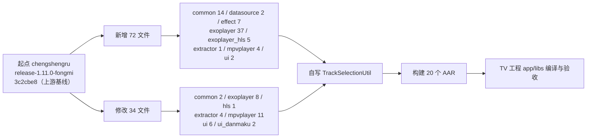
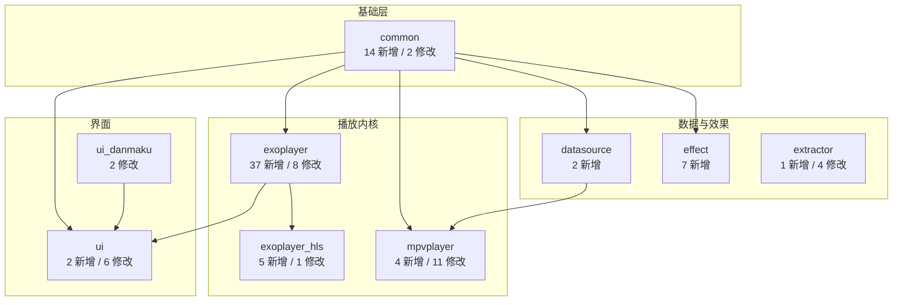
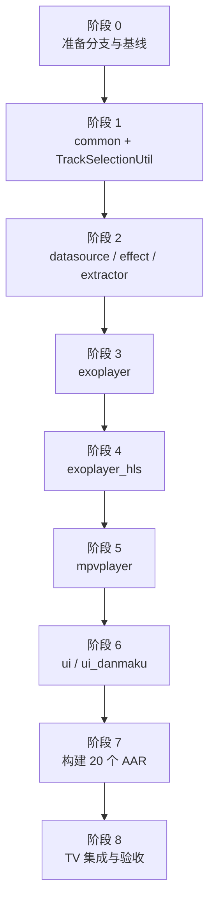
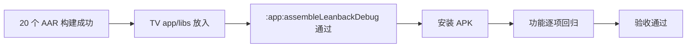

# dlgt6 移植到自有 media3 fork 详细方案

> 文档版本：v1.0
> 编写日期：2026-11-01
> 作者：Shiro
> 起点仓库：`chengshengru/media`，分支 `release-1.11.0-fongmi`（`3c2cbe8`）
> 目标增量：`dlgt6/media`，分支 `release-1.11.0-fongmi`（`01116ca`，2026-10-25）
> 文档类型：移植方案设计（只读分析，**未修改任何代码**）

## 1. 起点确认与总体结论

### 1.1 起点、目标与前提

| 项目 | 取值 | 说明 |
| --- | --- | --- |
| 起点分支 | `chengshengru/media@release-1.11.0-fongmi` | `3c2cbe8`（2026-07-27），与上游 `FongMi/media` 同名分支同一 commit，可视为上游基线镜像 |
| 目标分支 | `dlgt6/media@release-1.11.0-fongmi` | `01116ca`（2026-10-25），包含 10 月播放器改动与 libass 合并实现 |
| 移植范围 | 仅 `libraries/` | 根目录构建脚本、`gradle.properties`、`move.txt`、`build-logic*` 经逐文件哈希比对**零差异** |
| 模块结构 | 20 个 AAR，不变 | 起点与 dlgt6 的 `move.txt` 完全一致，均无独立 libass 模块 |
| 结论 | 可整文件覆盖式移植 | 无新增模块、无构建脚本重写、无根配置调整 |

关键前提：**起点分支不包含 libass 自定义实现**（libass 是 `release-1.11.0-fongmi-libass` 分支的成果）。dlgt6 把 libass 直接放在 `exoplayer`、`ui` 模块内，因此本方案不存在“两套 libass 实现冲突”，移植路径最干净。若坚持保留 libass 拆分模块，请先看附录 B。

### 1.2 总体结论

1. 差异总量：**72 个新增文件（69 Java + 3 GLSL）+ 34 个修改文件，0 个删除**。
2. 补齐 TV 5.8.4 所需的 **37/38** 个缺失类；唯一缺口 `androidx.media3.common.util.TrackSelectionUtil` 需按第 7 节自写。
3. 编译闭环可达成：AAR 仍为 20 个，模块名、包名、AAR 产物名与工程侧引用一致。
4. 最大风险不在编译，而在 **native 产物**：`libmedia3ass.so`、`libisoJNI.so`、`libcmg_decrypt.so` 不在 dlgt6 源码树内（`libmedia3effect.so` 对应类无调用方，影响可忽略），详见第 8 节。



### 1.3 差异构成

| 模块 | 新增 | 修改 | 说明 |
| --- | --- | --- | --- |
| `common` | 14 | 2 | 播放器契约、盘片菜单、字幕/音频/视频公共模型 |
| `datasource` | 2 | 0 | ISO URI 与渐进缓存 |
| `effect` | 7 | 0 | 画质调节效果与 GLSL 着色器 |
| `exoplayer` | 37 | 8 | libass、ISO、字幕转写、播放源包装、解码器 |
| `exoplayer_hls` | 5 | 1 | CMG 解密链路 |
| `extractor` | 1 | 4 | UDF 文件系统、SACD、MP4/Matroska 扩展 |
| `mpvplayer` | 4 | 11 | 解码模式、字幕配置、脚本桥接 |
| `ui` | 2 | 6 | libass/弹幕控制器、PlayerView 扩展、字幕亮度 |
| `ui_danmaku` | 0 | 2 | 弹幕快照与时间线 |
| **合计** | **72** | **34** | 0 删除 |



## 2. 兼容性核对

| 核对项 | 结果 | 依据 |
| --- | --- | --- |
| 根构建文件 | 完全一致 | `build.gradle.kts`、`settings.gradle.kts`、`gradle.properties`、`move.txt`、`build-logic*` 哈希相同 |
| Gradle 工程名 | 一致 | `Media3Modules.kt` 中 `lib-common`、`lib-exoplayer`、`lib-exoplayer-hls` 等映射相同 |
| 模块依赖方向 | 无新增环 | `ui` 新增 `api(project(":lib-exoplayer"))`，方向为 ui → exoplayer |
| `ui_danmaku` | 无需改动依赖 | `ui` 已 `api(project(":lib-ui-danmaku"))` |
| AndroidManifest | 无新增 | 72 个新增文件中无 manifest |
| Kotlin / AGP / Java | 无差异 | 仅 `libraries/` 内容变化 |
| AAR 命名与路径 | 一致 | `buildDir=buildout`，产物 `libraries/<dir>/buildout/outputs/aar/lib-<dir>-release.aar` |

结论：可以把 dlgt6 的 `libraries/` 目录内容按文件覆盖到起点分支，不需要改任何构建配置。

## 3. 新增文件清单（72）

> 目录均为 `libraries/<模块>/src/main/java/androidx/media3/...`；“作用”取自类注释，括号内为工程侧使用情况。

### 3.1 `common`（14）

| 文件 | 作用 |
| --- | --- |
| `common/DecoderMode.java` | 面向播放引擎无关的解码偏好枚举（`AUTO`/`HARDWARE`/`SOFTWARE`/`FFMPEG`），供设置项与 mpv 映射使用 |
| `common/DiscMenuController.java` | 光盘菜单控制接口：`open/sendAction/isActive/isNavigationPlayback`，含 `OpenResult` 五态 |
| `common/DiscMenuHighlight.java` | DVD 菜单当前按钮高亮数据（native 层产出） |
| `common/DiscMenuOverlay.java` | 蓝光 HDMV 菜单叠加位图帧（ARGB 像素） |
| `common/DiscMenuState.java` | 菜单状态值对象：`availability`、`phase`、`navigationPlaybackOngoing` |
| `common/VideoTransform.java` | 画面平移/缩放变换，`IDENTITY`/`DEFAULT`/`MAX_SCALE` |
| `common/audio/AudioChannelMix.java` | PCM 与 mpv 音频滤波共用的声道混合策略 |
| `common/audio/AudioChannelMode.java` | 声道模式（自动/立体声/单声道/反向）解析与可用性判断 |
| `common/audio/AudioEffectParameters.java` | 音频效果参数不可变集合（均衡器、声道、增益） |
| `common/audio/AudioEffectProcessor.java` | 对 16 位 PCM 应用音频效果的 `AudioProcessor` |
| `common/text/SubtitleContent.java` | 字幕轨道解码结果与状态（`UNSUPPORTED`/`LOADING`/`State`） |
| `common/text/SubtitleOffsets.java` | 主/副字幕时间偏移（毫秒） |
| `common/text/SubtitleSelectionState.java` | 当前主/副字幕选择状态 |
| `common/util/LocalClearKeyLicense.java` | 本地 ClearKey（JWK）许可解析，供 MP4/Matroska 解密 |

### 3.2 `datasource`（2）、`effect`（7）、`extractor`（1）

| 文件 | 作用 |
| --- | --- |
| `datasource/IsoUri.java` | 构造带“版本索引”的 ISO URI |
| `datasource/ProgressiveIsoCache.java` | 让 ISO 读取复用共享磁盘 `Cache` 的数据源工厂 |
| `effect/ColorToneAdjustEffect.java` | 应用 `VideoAdjustment` 的色彩部分（饱和度/对比度/增益/Gamma） |
| `effect/DetailAdjustEffect.java` | 应用细节部分（边缘锐化、暗部提亮） |
| `effect/VideoAdjustment.java` | 画质调节参数模型（Builder） |
| `effect/NativeWindow.java` | 设置输出 Surface 缓冲区尺寸的 JNI 封装（当前**无调用方**） |
| `effect/res/raw/fragment_shader_color_tone_adjustment_es2.glsl` | 色彩调节片元着色器 |
| `effect/res/raw/fragment_shader_detail_adjustment_es2.glsl` | 细节调节片元着色器 |
| `effect/res/raw/vertex_shader_video_adjustment_es2.glsl` | 视频调节顶点着色器 |
| `extractor/iso/udf/NativeUdfFileSystem.java` | JNI 版 UDF 文件系统，直接读取 ISO 镜像 |

### 3.3 `exoplayer`（37）

#### 3.3.1 根级与子包（共 18）

| 文件 | 作用 |
| --- | --- |
| `exoplayer/DecoderMode.java` | ExoPlayer 侧解码偏好枚举，与 `common.DecoderMode` 一一对应 |
| `exoplayer/DecoderManager.java` | 保存音/视频解码模式，并下发给 `MediaCodecSelector` 与渲染器 |
| `exoplayer/DecoderFallback.java` | 解码失败时按“硬解→软解→FFMPEG”顺序降级 |
| `exoplayer/audio/AudioEqualizerController.java` | 基于音频会话（AudioEffect）的均衡器控制 |
| `exoplayer/iso/BdjRuntime.java` | 准备 BD-J 运行时（依赖独立安装包 `com.fongmi.runtime.bdj`） |
| `exoplayer/iso/IsoDiscPreparation.java` | ISO 识别工具（`isIso(MediaItem)`） |
| `exoplayer/iso/IsoNavigationPlayerController.java` | ISO/DVD/蓝光导航播放控制器，实现 `DiscMenuController` |
| `exoplayer/iso/IsoNavigationSession.java` | 原生光盘导航会话（`System.loadLibrary("isoJNI")`） |
| `exoplayer/source/ContentTypeResolvingMediaSource.java` | 按内容类型解析后再创建下游 `MediaSource` 的包装工厂 |
| `exoplayer/source/DefaultPositionMediaSource.java` | 首窗口从指定位置开始的包装源 |
| `exoplayer/source/EndTrimMediaSource.java` | 提前结束播放的包装源（片尾裁剪） |
| `exoplayer/text/SubtitleContentLoader.java` | 字幕内容加载接口（`load(MediaItem, Uri, Format)`） |
| `exoplayer/text/DefaultSubtitleContentLoader.java` | 基于 `DataSource` 的默认字幕加载/解码实现 |
| `exoplayer/text/SecondaryTextOutput.java` | 副字幕文本渲染输出 |
| `exoplayer/text/SubtitleTranscript.java` | 媒体项内各字幕轨的文本索引集合 |
| `exoplayer/text/SubtitleTranscriptParserFactory.java` | 把解析出的 cue 索引进 `SubtitleTranscript` 的解析器工厂 |
| `exoplayer/text/SubtitleTranscriptSession.java` | 管理各媒体项转写会话（`getContent`/`setContentEnabled`/`retryContent`） |
| `exoplayer/trackselection/SecondaryTextTrackSelector.java` | 主轨交给下游选择器、副字幕强制独立选择的 `TrackSelector` 包装 |

#### 3.3.2 `exoplayer/libass`（19）

| 文件 | 作用 |
| --- | --- |
| `libass/LibassConfiguration.java` | libass 渲染配置 |
| `libass/LibassFontConfig.java` | 生成 fontconfig 配置（工程侧 [AndroidFontConfig.java](../../app/src/main/java/com/fongmi/android/tv/player/subtitle/AndroidFontConfig.java#L22) 使用） |
| `libass/LibassFontFile.java` | 读取 TTF/OTF/TTC 字体信息 |
| `libass/LibassClockRenderer.java` | 跟随播放时钟触发 libass 帧渲染的 Renderer |
| `libass/LibassFrame.java` | 一帧渲染结果（含一张或多张图） |
| `libass/LibassImage.java` | 帧内的单张图像 |
| `libass/LibassGlImage.java` | GPU 侧纹理图像 |
| `libass/LibassGlRenderer.java` | OpenGL ES 2.0 帧渲染器 |
| `libass/LibassLibrary.java` | 原生库加载（`System.loadLibrary("media3ass")`） |
| `libass/LibassMediaSession.java` | 单个媒体项的 libass 状态（轨道、字体、渲染选项） |
| `libass/LibassNative.java` | libass JNI 绑定 |
| `libass/LibassNativeLibrary.java` | 原生 libass 库实例（字体只能加一次） |
| `libass/LibassPlaybackSession.java` | 播放级 libass 会话（字号、底部位置、样式覆盖） |
| `libass/LibassRenderThread.java` | 专用 GL 线程 + EGL 上下文 |
| `libass/LibassRenderView.java` | 承载渲染结果的 `TextureView` |
| `libass/LibassStyleOverride.java` | 字幕样式覆盖 |
| `libass/LibassSubtitleController.java` | libass 字幕控制（主/副字幕选择、偏移），工程侧 [ExoSubtitleController.java](../../app/src/main/java/com/fongmi/android/tv/player/exo/ExoSubtitleController.java#L21-L64) 使用 |
| `libass/LibassSubtitleParserFactory.java` | 把 ASS/SSA 样本送入 libass 的解析器工厂 |
| `libass/LibassTrackSession.java` | 单条字幕轨的原生渲染会话 |

### 3.4 `exoplayer_hls`（5）

| 文件 | 作用 |
| --- | --- |
| `exoplayer/hls/CmgConfiguration.java` | 从媒体 URI 识别 CMG 保护流（`cmg=1` 或 `*.ysp.cctv.cn` 的 `.m3u8`） |
| `exoplayer/hls/CmgDataSource.java` | 透明解密 CMG 保护的 TS 分片，只包装媒体请求 |
| `exoplayer/hls/CmgDecryptor.java` | 按 188 字节 TS 包原地解密 |
| `exoplayer/hls/CmgNativeRuntime.java` | CMG JNI 绑定（`System.loadLibrary("cmg_decrypt")`，API 版本 2） |
| `exoplayer/hls/CmgSession.java` | 单条 `HlsMediaSource` 的原生解密运行时引用计数与配置 |

### 3.5 `mpvplayer`（4）、`ui`（2）

| 文件 | 作用 |
| --- | --- |
| `mpvplayer/MpvConfigFileInspector.java` | 解析 mpv 配置文件（注释、`option=value`），读取字体目录与选项名 |
| `mpvplayer/MpvDecoderMode.java` | mpv 视频解码偏好（由 `DecoderMode` 映射） |
| `mpvplayer/MpvSubtitleContentLoader.java` | mpv 后端的字幕内容加载器（工程侧以接口实现方式使用） |
| `mpvplayer/media/MpvDrmSupport.java` | 判断 mpv 能否处理某 `MediaItem` 的 DRM |
| `ui/libass/LibassPlayerViewController.java` | 把 `PlayerView` 绑定到 libass 渲染（主字幕视图 + 副字幕 `SubtitleView`） |
| `ui/danmaku/DanmakuPlayerViewController.java` | 把弹幕渲染挂到 `PlayerView`，暴露数据源/配置/即时发送/开关 |

> `DanmakuPlayerViewController` 依赖 `androidx.media3.ui.PlayerView`，因此**必须放在 `ui` 模块**，不能移到 `ui_danmaku`（否则形成 `ui_danmaku → ui` 反向依赖）。

## 4. 修改文件清单（34）

> “增删行”由 `diff -u` 统计；除标注外，其余文件均为**纯新增行**，可直接整文件覆盖。

### 4.1 `common`（2）

| 文件 | 增/删 | 变更要点 |
| --- | --- | --- |
| `common/Player.java` | +69 / -1 | 新增 8 个默认方法：`getSubtitleOffsets`、`setSubtitleOffsets`、`getSubtitleSelectionState`、`getSubtitleContentForSelection`、`setSubtitleContentEnabled`、`canRetrySubtitleContent`、`retrySubtitleContent`、`getDiscMenuState`；新增监听回调 `onDiscMenuStateChanged` |
| `common/SimpleBasePlayer.java` | +32 / 0 | `Builder.setDiscMenuState(...)`、字段 `discMenuState`、`getDiscMenuState()` |

### 4.2 `exoplayer`（8）

| 文件 | 增/删 | 变更要点 |
| --- | --- | --- |
| `DefaultRenderersFactory.java` | +84 / -2 | 新增 `setDecoderManager/getDecoderManager`、SurfaceControl 帧保留开关；内部新增 `DecoderModeMediaCodecSelector`，把解码模式作用到 `MediaCodecSelector` |
| `ExoPlayer.java` | +10 / 0 | 新增默认方法 `setDiscMenuState(DiscMenuState)` |
| `ExoPlayerImpl.java` | +40 / 0 | 实现 `getSubtitleOffsets/setSubtitleOffsets`、`getDiscMenuState/setDiscMenuState`，并同步字幕转写会话 |
| `ExoPlayerImplInternal.java` | +16 / 0 | 副字幕偏移的存取（`setSecondaryTextOffsetMs/getSecondaryTextOffsetMs`） |
| `audio/DefaultAudioSink.java` | +13 / 0 | `Builder.setEnableSurfaceControlFrameRetention(boolean)` |
| `mediacodec/MediaCodecSelector.java` | +36 / 0 | `getDecoderInfos(..., DecoderMode)` 默认实现，按模式过滤解码器 |
| `source/iso/SacdSourceHelper.java` | +5 / -1 | TOC 解析为 `null` 时抛 `IOException` |
| `source/preload/PreloadManagerListener.java` | +7 / 0 | 新增回调 `onPreloadPaused(MediaItem)` |

### 4.3 `exoplayer_hls`（1）、`extractor`（4）

| 文件 | 增/删 | 变更要点 |
| --- | --- | --- |
| `exoplayer/hls/HlsMediaSource.java` | +11 / 0 | 构建时若 URI 命中 `CmgConfiguration`，用 `CmgDataSource.Factory` 包装分片数据源 |
| `extractor/DefaultExtractorsFactory.java` | +55 / -11 | 新增 `setMp4ClearKeys`、`setMatroskaExtractorFlagsForHttpSources`，重构文件类型分发逻辑（**含删除行，需人工核对**） |
| `extractor/mkv/MatroskaExtractor.java` | +93 / -16 | 新增 `FLAG_DEFER_SEEK_FOR_CUES` 与延迟 seek/cues 处理（**含删除行**） |
| `extractor/mp4/Mp4Extractor.java` | +22 / 0 | 新增 `setClearKeys/getClearKeys` |
| `extractor/iso/sacd/SacdTocParser.java` | +66 / 0 | 原生 SACD TOC 解析（`nativeParse`，JNI `isoJNI`），原生不可用时回退 |

### 4.4 `mpvplayer`（11）

| 文件 | 增/删 | 变更要点 |
| --- | --- | --- |
| `MpvPlayer.java` | +412 / -3 | 实现 `DiscMenuController`；新增视频解码模式、盘片数据源、字幕偏移/选择/内容、脚本加载与日志监听等 API |
| `MpvPlayerConfig.java` | +143 / 0 | 新增字体目录、字体族、垂直偏移、位图字幕亮度、副字幕位置、ASS 样式覆盖等配置 |
| `MpvSubtitleOptions.java` | +154 / 0 | 上述字幕选项的存储与校验 |
| `nativebridge/MpvCommandDispatcher.java` | +122 / 0 | 新增命令/脚本/属性桥接（`command`、`loadScript`、`getInputBindings`、`setVideoDecoderMode` 等） |
| `nativebridge/MpvEventAdapter.java` | +21 / 0 | 新事件映射 |
| `nativebridge/MpvConstants.java` | +3 / 0 | 新增常量 |
| `MpvLibrary.java` | +16 / 0 | 自定义库加载器 `setLibraryLoader`（供宿主注入 `libmpv.so`） |
| `MpvPlayerHosts.java` | +15 / 0 | 宿主回调扩展 |
| `audio/MpvAudioFilter.java` | +14 / 0 | 音频滤波参数扩展（与 `AudioChannelMix` 对齐） |
| `core/MpvPlaybackEventHandler.java` | +18 / 0 | 播放事件扩展 |
| `core/MpvPropertyEventHandler.java` | +15 / 0 | 属性事件扩展 |

### 4.5 `ui`（6）、`ui_danmaku`（2）

| 文件 | 增/删 | 变更要点 |
| --- | --- | --- |
| `ui/build.gradle.kts` | +1 / 0 | 新增 `api(project(":lib-exoplayer"))`（`LibassPlayerViewController` 需要） |
| `ui/PlayerView.java` | +156 / 0 | 新增 `setBackendPlayer`、`setDiscMenuController`、`dispatchDiscMenuTouchEvent`、`getVideoTransform/setVideoTransform/animateVideoTransform`、`getVideoBounds`、`getVideoAspectRatioOverride/setVideoAspectRatioOverride` |
| `ui/PlayerSeekView.java` | +30 / 0 | 新增 `setDurationSupplier(LongSupplier)` |
| `ui/SubtitleView.java` | +11 / 0 | 新增位图字幕亮度 `setBitmapSubtitleBrightness` |
| `ui/SubtitlePainter.java` | +31 / 0 | 位图字幕亮度实现（ColorMatrix） |
| `ui/CanvasSubtitleOutput.java` | +11 / 0 | 位图字幕亮度透传 |
| `ui_danmaku/DanmakuController.java` | +5 / 0 | 新增 `getItems()` |
| `ui_danmaku/DanmakuTimeline.java` | +15 / 0 | 新增 `snapshot()`（按时间排序的全量弹幕快照） |

## 5. 分阶段实施步骤



### 5.1 阶段 0：准备

```bash
# 1. 在自有仓库新建移植分支（基于起点分支）
git clone https://github.com/chengshengru/media media-work
cd media-work
git checkout -b release-1.11.0-fongmi-dlgt6

# 2. 拉取 dlgt6 参考源码（稀疏，只取 libraries）
git clone --depth 1 --filter=blob:none --sparse \
  -b release-1.11.0-fongmi https://github.com/dlgt6/media /tmp/dl6
cd /tmp/dl6 && git sparse-checkout set libraries build-logic build-logic-settings gradle
```

校验点：`git -C /tmp/dl6 rev-parse HEAD` 应为 `01116ca`。

### 5.2 阶段 1：`common`（14 新增 + 2 修改 + 1 自写）

| 动作 | 文件 |
| --- | --- |
| 新增 | 第 3.1 节 14 个文件 |
| 覆盖 | `Player.java`、`SimpleBasePlayer.java` |
| 自写 | `common/src/main/java/androidx/media3/common/util/TrackSelectionUtil.java`（第 7 节） |

```bash
cp -r /tmp/dl6/libraries/common/src/main/java/androidx/media3/common/{DecoderMode.java,DiscMenuController.java,DiscMenuHighlight.java,DiscMenuOverlay.java,DiscMenuState.java,VideoTransform.java} \
  libraries/common/src/main/java/androidx/media3/common/
cp -r /tmp/dl6/libraries/common/src/main/java/androidx/media3/common/audio libraries/common/src/main/java/androidx/media3/common/
cp -r /tmp/dl6/libraries/common/src/main/java/androidx/media3/common/text libraries/common/src/main/java/androidx/media3/common/
cp /tmp/dl6/libraries/common/src/main/java/androidx/media3/common/util/LocalClearKeyLicense.java \
  libraries/common/src/main/java/androidx/media3/common/util/
cp /tmp/dl6/libraries/common/src/main/java/androidx/media3/common/{Player.java,SimpleBasePlayer.java} \
  libraries/common/src/main/java/androidx/media3/common/
./gradlew --no-daemon :lib-common:assembleDebug
```

### 5.3 阶段 2：`datasource` / `effect` / `extractor`

```bash
cp /tmp/dl6/libraries/datasource/src/main/java/androidx/media3/datasource/{IsoUri.java,ProgressiveIsoCache.java} \
  libraries/datasource/src/main/java/androidx/media3/datasource/
cp -r /tmp/dl6/libraries/effect/src/main/java/androidx/media3/effect/{ColorToneAdjustEffect.java,DetailAdjustEffect.java,VideoAdjustment.java,NativeWindow.java} \
  libraries/effect/src/main/java/androidx/media3/effect/
mkdir -p libraries/effect/src/main/res/raw
cp /tmp/dl6/libraries/effect/src/main/res/raw/*.glsl libraries/effect/src/main/res/raw/
mkdir -p libraries/extractor/src/main/java/androidx/media3/extractor/iso/udf
cp /tmp/dl6/libraries/extractor/src/main/java/androidx/media3/extractor/iso/udf/NativeUdfFileSystem.java \
  libraries/extractor/src/main/java/androidx/media3/extractor/iso/udf/
cp /tmp/dl6/libraries/extractor/src/main/java/androidx/media3/extractor/{DefaultExtractorsFactory.java} \
  libraries/extractor/src/main/java/androidx/media3/extractor/
cp /tmp/dl6/libraries/extractor/src/main/java/androidx/media3/extractor/mkv/MatroskaExtractor.java \
  libraries/extractor/src/main/java/androidx/media3/extractor/mkv/
cp /tmp/dl6/libraries/extractor/src/main/java/androidx/media3/extractor/mp4/Mp4Extractor.java \
  libraries/extractor/src/main/java/androidx/media3/extractor/mp4/
cp /tmp/dl6/libraries/extractor/src/main/java/androidx/media3/extractor/iso/sacd/SacdTocParser.java \
  libraries/extractor/src/main/java/androidx/media3/extractor/iso/sacd/
./gradlew --no-daemon :lib-datasource:assembleDebug :lib-effect:assembleDebug :lib-extractor:assembleDebug
```

注意：`DefaultExtractorsFactory`、`MatroskaExtractor` 含删除行，若起点分支后续升级，需按 hunk 手工合并，不能盲目覆盖（`SacdSourceHelper` 同样含删除行，见阶段 3）。

### 5.4 阶段 3：`exoplayer`（37 新增 + 8 修改）

```bash
# 新增：libass / iso / text / source / trackselection / 根级
cp -r /tmp/dl6/libraries/exoplayer/src/main/java/androidx/media3/exoplayer/libass \
  libraries/exoplayer/src/main/java/androidx/media3/exoplayer/
cp -r /tmp/dl6/libraries/exoplayer/src/main/java/androidx/media3/exoplayer/iso \
  libraries/exoplayer/src/main/java/androidx/media3/exoplayer/
cp -r /tmp/dl6/libraries/exoplayer/src/main/java/androidx/media3/exoplayer/text \
  libraries/exoplayer/src/main/java/androidx/media3/exoplayer/
cp /tmp/dl6/libraries/exoplayer/src/main/java/androidx/media3/exoplayer/source/{ContentTypeResolvingMediaSource.java,DefaultPositionMediaSource.java,EndTrimMediaSource.java} \
  libraries/exoplayer/src/main/java/androidx/media3/exoplayer/source/
cp -r /tmp/dl6/libraries/exoplayer/src/main/java/androidx/media3/exoplayer/trackselection \
  libraries/exoplayer/src/main/java/androidx/media3/exoplayer/
cp /tmp/dl6/libraries/exoplayer/src/main/java/androidx/media3/exoplayer/{DecoderMode.java,DecoderManager.java,DecoderFallback.java} \
  libraries/exoplayer/src/main/java/androidx/media3/exoplayer/
cp /tmp/dl6/libraries/exoplayer/src/main/java/androidx/media3/exoplayer/audio/AudioEqualizerController.java \
  libraries/exoplayer/src/main/java/androidx/media3/exoplayer/audio/

# 修改：8 个文件，逐类覆盖
for f in DefaultRenderersFactory.java ExoPlayer.java ExoPlayerImpl.java ExoPlayerImplInternal.java \
         audio/DefaultAudioSink.java mediacodec/MediaCodecSelector.java \
         source/iso/SacdSourceHelper.java source/preload/PreloadManagerListener.java; do
  cp "/tmp/dl6/libraries/exoplayer/src/main/java/androidx/media3/exoplayer/$f" \
     "libraries/exoplayer/src/main/java/androidx/media3/exoplayer/$f"
done

./gradlew --no-daemon :lib-exoplayer:assembleDebug
```

注意：起点分支的 `exoplayer/text`（`CuesResolver.java` 等 3 个文件）、`exoplayer/source`、`exoplayer/audio` 已存在，`cp -r` 为**合并覆盖**，不会删除原有文件；`exoplayer/iso`、`exoplayer/libass`、`exoplayer/trackselection` 为全新目录。

### 5.5 阶段 4：`exoplayer_hls`

```bash
cp /tmp/dl6/libraries/exoplayer_hls/src/main/java/androidx/media3/exoplayer/hls/{CmgConfiguration.java,CmgDataSource.java,CmgDecryptor.java,CmgNativeRuntime.java,CmgSession.java} \
  libraries/exoplayer_hls/src/main/java/androidx/media3/exoplayer/hls/
cp /tmp/dl6/libraries/exoplayer_hls/src/main/java/androidx/media3/exoplayer/hls/HlsMediaSource.java \
  libraries/exoplayer_hls/src/main/java/androidx/media3/exoplayer/hls/
./gradlew --no-daemon :lib-exoplayer-hls:assembleDebug
```

### 5.6 阶段 5：`mpvplayer`（4 新增 + 11 修改）

```bash
cp /tmp/dl6/libraries/mpvplayer/src/main/java/androidx/media3/mpvplayer/{MpvConfigFileInspector.java,MpvDecoderMode.java,MpvSubtitleContentLoader.java} \
  libraries/mpvplayer/src/main/java/androidx/media3/mpvplayer/
mkdir -p libraries/mpvplayer/src/main/java/androidx/media3/mpvplayer/media
cp /tmp/dl6/libraries/mpvplayer/src/main/java/androidx/media3/mpvplayer/media/MpvDrmSupport.java \
  libraries/mpvplayer/src/main/java/androidx/media3/mpvplayer/media/

# 修改：11 个文件（MpvPlayer 变动最大，需重点 review）
for f in MpvLibrary.java MpvPlayer.java MpvPlayerConfig.java MpvPlayerHosts.java \
         MpvSubtitleOptions.java audio/MpvAudioFilter.java \
         core/MpvPlaybackEventHandler.java core/MpvPropertyEventHandler.java \
         nativebridge/MpvCommandDispatcher.java nativebridge/MpvConstants.java \
         nativebridge/MpvEventAdapter.java; do
  cp "/tmp/dl6/libraries/mpvplayer/src/main/java/androidx/media3/mpvplayer/$f" \
     "libraries/mpvplayer/src/main/java/androidx/media3/mpvplayer/$f"
done

./gradlew --no-daemon :lib-mpvplayer:assembleDebug
```

### 5.7 阶段 6：`ui` / `ui_danmaku`

```bash
mkdir -p libraries/ui/src/main/java/androidx/media3/ui/{libass,danmaku}
cp /tmp/dl6/libraries/ui/src/main/java/androidx/media3/ui/libass/LibassPlayerViewController.java \
  libraries/ui/src/main/java/androidx/media3/ui/libass/
cp /tmp/dl6/libraries/ui/src/main/java/androidx/media3/ui/danmaku/DanmakuPlayerViewController.java \
  libraries/ui/src/main/java/androidx/media3/ui/danmaku/

cp /tmp/dl6/libraries/ui/build.gradle.kts libraries/ui/build.gradle.kts
cp /tmp/dl6/libraries/ui/src/main/java/androidx/media3/ui/{PlayerView.java,PlayerSeekView.java,SubtitleView.java,SubtitlePainter.java,CanvasSubtitleOutput.java} \
  libraries/ui/src/main/java/androidx/media3/ui/
cp /tmp/dl6/libraries/ui_danmaku/src/main/java/androidx/media3/ui/danmaku/{DanmakuController.java,DanmakuTimeline.java} \
  libraries/ui_danmaku/src/main/java/androidx/media3/ui/danmaku/

./gradlew --no-daemon :lib-ui:assembleDebug :lib-ui-danmaku:assembleDebug
```

### 5.8 阶段 7：构建 20 个 AAR

```bash
./gradlew --no-daemon \
  :lib-common:assembleRelease :lib-container:assembleRelease :lib-database:assembleRelease \
  :lib-datasource:assembleRelease :lib-datasource-okhttp:assembleRelease :lib-datasource-rtmp:assembleRelease \
  :lib-decoder:assembleRelease :lib-decoder-ffmpeg:assembleRelease :lib-decoder-mpegh:assembleRelease \
  :lib-effect:assembleRelease \
  :lib-exoplayer:assembleRelease :lib-exoplayer-dash:assembleRelease :lib-exoplayer-hls:assembleRelease \
  :lib-exoplayer-rtsp:assembleRelease :lib-exoplayer-smoothstreaming:assembleRelease \
  :lib-extractor:assembleRelease :lib-mpvplayer:assembleRelease :lib-session:assembleRelease \
  :lib-ui:assembleRelease :lib-ui-danmaku:assembleRelease

find libraries -name 'lib-*-release.aar' -path '*buildout/outputs/aar*' -exec ls -l {} \;
```

校验：产物数量应为 20，文件名与 `move.txt` 一致；`lib-mpvplayer-release.aar` 与 `lib-decoder-ffmpeg-release.aar` 必须存在（`runtime` 模块会直接引用）。

### 5.9 阶段 8：集成到 TV 工程

```bash
# 1. 拷贝 20 个 AAR 到 app/libs（先备份原有同名文件）
# 2. 编译验证（工程有 leanback / mobile 两个 flavor）
cd /workspace
./gradlew --no-daemon :app:assembleLeanbackDebug
```

## 6. 关键实现要点

### 6.1 播放器契约扩展

| 文件 | 关键变化 | 工程侧依赖 |
| --- | --- | --- |
| `Player.java` | 8 个默认方法覆盖字幕偏移、副字幕选择、转写重试、盘片菜单状态 | [ExoPlayerEngine.java](../../app/src/main/java/com/fongmi/android/tv/player/exo/ExoPlayerEngine.java#L313-L355)、[PlaybackActivity.java](../../app/src/main/java/com/fongmi/android/tv/ui/activity/PlaybackActivity.java#L122-L230) |
| `SimpleBasePlayer.java` | 新增 `discMenuState` 字段与 `Builder.setDiscMenuState` | `MpvPlayer` 通过该基类暴露菜单状态 |
| `ExoPlayer.java` / `ExoPlayerImpl.java` | `setDiscMenuState` 默认/实现、字幕偏移存取 | [PlayerManager.java](../../app/src/main/java/com/fongmi/android/tv/player/PlayerManager.java#L163-L168) |

`DiscMenuState` 常量：`AVAILABILITY_PENDING/UNAVAILABLE/AVAILABLE`、`PHASE_IDLE/OPENING/ACTIVE`、`EMPTY`。`OpenResult` 五态：`OPENED`、`UNAVAILABLE`、`TIMED_OUT`、`CANCELLED`、`RUNTIME_MISSING`。

### 6.2 解码链

- `common.DecoderMode` 与 `exoplayer.DecoderMode` 一一对应，`DecoderManager` 持有音/视频模式。
- `DefaultRenderersFactory.setDecoderManager(...)` 把模式注入 `MediaCodecSelector.getDecoderInfos(..., DecoderMode)`。
- `DecoderFallback` 在解码失败时按硬解→软解→FFMPEG 降级。
- 附带 SurfaceControl 帧保留开关（`DefaultAudioSink.Builder.setEnableSurfaceControlFrameRetention`）。
- 工程调用点：[ExoUtil.java](../../app/src/main/java/com/fongmi/android/tv/player/exo/ExoUtil.java#L74-L106)、[ExoPlayerSession.java](../../app/src/main/java/com/fongmi/android/tv/player/exo/ExoPlayerSession.java#L44-L58)。

### 6.3 字幕转写、双字幕与偏移

- 数据模型：`SubtitleContent`、`SubtitleOffsets`、`SubtitleSelectionState`。
- 会话：`SubtitleTranscriptSession`（每媒体项一个 `SubtitleTranscript`），`SubtitleTranscriptParserFactory` 在解析时索引 cue。
- 双字幕：`SecondaryTextTrackSelector` 包装下游选择器，强制独立选择副字幕轨；`SecondaryTextOutput` 输出副字幕 cue。
- 偏移：`ExoPlayerImplInternal` 增加副字幕偏移字段，`ExoPlayerImpl` 转发。
- UI：`SubtitleView`/`SubtitlePainter`/`CanvasSubtitleOutput` 增加位图字幕亮度。
- 工程调用点：[ExoPlayerEngine.java](../../app/src/main/java/com/fongmi/android/tv/player/exo/ExoPlayerEngine.java#L313-L355)、[SubtitleOffsetPanel.java](../../app/src/main/java/com/fongmi/android/tv/ui/dialog/SubtitleOffsetPanel.java#L63-L117)、[PlayerManager.java](../../app/src/main/java/com/fongmi/android/tv/player/PlayerManager.java#L163-L168)。

### 6.4 libass（19 类）

- 入口：`LibassPlaybackSession`（播放级状态）→ `LibassMediaSession`（媒体项级）→ `LibassTrackSession`（轨道级）。
- 渲染：`LibassClockRenderer` 按播放时钟触发，`LibassRenderThread` 独占 GL 线程/EGL 上下文，`LibassRenderView` 承载 `TextureView`。
- 控制：`LibassSubtitleController(Player, LibassPlaybackSession, SecondaryTextTrackSelector.Factory, SecondaryTextOutput)`，提供主/副字幕选择与偏移。
- UI：`LibassPlayerViewController(Player, LibassPlaybackSession, LibassSubtitleController)`，`bind/setStyleOverride/setSecondarySubtitleViewConfigurator/close`。
- **native**：`LibassLibrary` 加载 `media3ass`（见第 8 节缺口）。

### 6.5 ISO / 蓝光 / 盘片菜单

- 识别与包装：`IsoDiscPreparation.isIso`、`IsoUri.withEditionIndex`、`ProgressiveIsoCache.withDiskCache`。
- 读取：`NativeUdfFileSystem`（JNI `isoJNI`）替代 Java UDF；`SacdTocParser` 原生解析 SACD。
- 导航：`IsoNavigationSession`（原生会话）+ `IsoNavigationPlayerController`（实现 `DiscMenuController`，提供 `getMenuHighlight/getMenuOverlay`）。
- BD-J：`BdjRuntime` 依赖独立安装包 `com.fongmi.runtime.bdj`（TV 工程 [AndroidManifest.xml](../../app/src/main/AndroidManifest.xml#L22) 已声明 `<queries>`），未安装时返回 `RUNTIME_MISSING`。
- 工程调用点：[ExoPlayerEngine.java](../../app/src/main/java/com/fongmi/android/tv/player/exo/ExoPlayerEngine.java#L50-L70)、[PlaybackActivity.java](../../app/src/main/java/com/fongmi/android/tv/ui/activity/PlaybackActivity.java#L122-L230)。

### 6.6 CMG（央视频）

- `CmgConfiguration.fromMediaUri` 只对 `cmg=1` 或 `*.ysp.cctv.cn` 的 `.m3u8` 生效。
- `HlsMediaSource` 构建时包装 `CmgDataSource.Factory`，仅媒体分片走解密，播放列表与 DRM 请求不变。
- `CmgSession` 做原生运行时引用计数（`libcmg_decrypt`，要求 API 版本 2）。
- 非 CMG 流不受影响；native 缺失时 `CmgNativeRuntime.isAvailable()` 为 `false`，CMG 流不可播，其余功能正常。

### 6.7 音频与视频效果

- 音频：`AudioChannelMode/AudioChannelMix`（声道模式与混合）、`AudioEffectParameters/AudioEffectProcessor`（PCM 处理）、`AudioEqualizerController`（AudioEffect 均衡器）。
- 视频：`VideoAdjustment` 参数 + `ColorToneAdjustEffect`/`DetailAdjustEffect`（两个着色器），工程侧 [ExoVideoEffectController.java](../../app/src/main/java/com/fongmi/android/tv/player/effect/video/ExoVideoEffectController.java#L14-L30) 组合使用。
- `NativeWindow` 当前**无调用方**，其 `media3effect` 依赖可以先不提供。

### 6.8 mpvplayer

- `MpvPlayer` 新增：视频解码模式、盘片数据源、字幕偏移/选择/内容、脚本加载与日志、`DiscMenuController` 实现。
- `MpvPlayerConfig` / `MpvSubtitleOptions`：字体目录、字体族、垂直偏移、位图亮度、副字幕位置、ASS 样式覆盖。
- `MpvCommandDispatcher` 新增脚本与属性命令；`MpvLibrary.setLibraryLoader` 支持宿主自定义加载器。
- native 已随源码提供：`libmpv.so`、`libplayer.so`、`libc++_shared.so`。

### 6.9 UI 与弹幕

- `PlayerView`：视频变换（缩放/平移/动画）、宽高比覆盖、视频边界、盘片菜单控制器与触摸分发、`setBackendPlayer`。
- `PlayerSeekView`：`setDurationSupplier` 供特殊时长来源。
- 弹幕：`DanmakuController.getItems` + `DanmakuTimeline.snapshot` 支撑 `DanmakuPlayerViewController` 的 `getItems()`；工程调用点 [PlaybackActivity.java](../../app/src/main/java/com/fongmi/android/tv/ui/activity/PlaybackActivity.java#L77-L78)、[PlaybackActivity.java](../../app/src/main/java/com/fongmi/android/tv/ui/activity/PlaybackActivity.java#L828-L856)。

## 7. `TrackSelectionUtil` 自写

- 位置：`libraries/common/src/main/java/androidx/media3/common/util/TrackSelectionUtil.java`（`common` 模块，不引入反向依赖）。
- 调用点：[ExoCommand.java](../../app/src/main/java/com/fongmi/android/tv/player/exo/ExoCommand.java#L100-L113)，固定使用 5 个静态方法：

| 方法 | 语义 |
| --- | --- |
| `selectTrack(Player, int, String)` | `set audio <id>` |
| `cycleTrack(Player, int, boolean, boolean)` | `cycle audio` |
| `cycleTrack(Player, int, List<String>, boolean, boolean)` | `cycle-values audio <id...>` |
| `setTrackTypeDisabled(Player, int, boolean)` | `set audio no` |
| `resetTrackSelection(Player, int)` | `set audio auto` |

完整骨架、参数语义分析与单元测试建议见 [media3缺失类代码补全方案.md](./media3缺失类代码补全方案.md) 第 6 节，本文不重复。落地时需以 `ExoCommand` 的实际行为确认第 4 个 `boolean` 参数（建议按 `includeOff` 实现）。

## 8. Native 产物与运行期依赖（关键风险）

源码树只提供 mpv / ffmpeg / mpegh 的原生产物，**libass、ISO、CMG 的 native 库不在仓库内**：

| native 库 | 加载方 | 源码树是否提供 | 缺失后果 | 处理建议 |
| --- | --- | --- | --- | --- |
| `libmedia3ass.so` | `LibassLibrary` | **否** | libass 字幕不可用（`isAvailable()` 为 false，退回普通字幕） | 从作者 AAR/APK 提取，或自建 libass JNI 工程 |
| `libisoJNI.so` | `IsoNavigationSession`、`NativeUdfFileSystem`、`SacdTocParser` | **否** | 蓝光导航/DVD 菜单/UDF 读取不可用；ISO 退回普通播放或失败 | 同上 |
| `libcmg_decrypt.so` | `CmgNativeRuntime` | **否** | 央视频 CMG 流不可播，其余正常 | 同上 |
| `libmedia3effect.so` | `NativeWindow` | 否 | 当前无调用方，**可忽略** | 需要时再补 |
| `libmpv.so` / `libplayer.so` / `libc++_shared.so` | `MpvLibrary` | 是（`mpvplayer/src/main/jniLibs`） | — | 直接打包 |
| `libav*.so` | `FfmpegLibrary`（`ffmpegJNI` 由源码 CMake 编译） | 部分（`decoder_ffmpeg/src/main/jniLibs`） | 需 NDK 构建 | 构建机安装 NDK |
| `libmpeghJNI.so` | `MpeghLibrary` | 是（`decoder_mpegh/src/main/jniLibs`） | — | 直接打包 |

补充说明：

1. 缺失的 native 库在类里都做了 `try/catch` 或 `isAvailable()` 判定，**不会导致启动崩溃**，只会让对应功能降级。
2. `BdjRuntime` 还需要独立安装包 `com.fongmi.runtime.bdj`（TV 代码通过 `ModuleViewModel` 提示安装）。
3. 若后续以 `release-1.11.0-fongmi-libass` 为起点，该分支自带 `libexo_ass.so`，但库名与 dlgt6 的 `media3ass` 不一致，不能直接复用（见附录 B）。

## 9. 验收标准

### 9.1 静态验收

```bash
# 1. 类覆盖：37/38 + 自写 1
find libraries -name 'TrackSelectionUtil.java' -path '*common/util*'

# 2. 无跨模块重复类（dlgt6 本身为 0，移植后应保持）
python3 - <<'PY'
import os
root='libraries'
seen={}
for m in os.listdir(root):
    d=os.path.join(root,m,'src/main/java')
    if not os.path.isdir(d): continue
    for dp,_,fs in os.walk(d):
        for f in fs:
            if f.endswith('.java'):
                seen.setdefault(os.path.relpath(os.path.join(dp,f),d),[]).append(m)
dups=[(k,v) for k,v in seen.items() if len(v)>1]
print('duplicates:', len(dups))
for k,v in dups: print(k,v)
PY
```

### 9.2 编译验收



### 9.3 功能验收

| 功能 | 检查点 | 依赖类 | 无 native 时预期 |
| --- | --- | --- | --- |
| 盘片菜单 | 打开/关闭、方向键导航、`OpenResult` 提示 | `IsoNavigationPlayerController`、`BdjRuntime` | 菜单不可用，提示运行时缺失 |
| ISO 播放 | 识别、版本切换、结束裁剪、预加载 | `IsoDiscPreparation`、`EndTrim/DefaultPositionMediaSource` | 普通播放或失败 |
| 字幕 | 主/副偏移、双字幕、文本转写、libass 渲染 | `SubtitleOffsets`、`SecondaryTextTrackSelector`、`LibassFontConfig` | 普通字幕正常，libass 特效不可用 |
| 解码 | 硬解/软解/FFMPEG 切换与失败降级 | `DecoderManager`、`DecoderFallback` | 正常（无 native 需求） |
| 音频 | 声道模式、均衡器、音轨命令 | `AudioChannelMode/AudioEffectProcessor`、`TrackSelectionUtil` | 正常 |
| 视频 | 双指缩放/平移、画质调节 | `VideoTransform`、`VideoAdjustment` | 正常 |
| 弹幕 | 开关、即时发送、数据源 | `DanmakuPlayerViewController` | 正常 |
| CMG | 央视频流播放 | `CmgConfiguration/CmgSession` | CMG 流不可播 |

## 10. 风险与合规

1. **native 缺口是首要风险**：`libmedia3ass.so`、`libisoJNI.so`、`libcmg_decrypt.so` 不在源码树内，必须从作者 AAR/发布 APK 提取或自建 JNI 工程，否则蓝光/菜单/libass/CMG 全部降级。
2. **第三方代码可信度**：dlgt6 的提交为 “Add files via upload”，无 CI、无 Release、无 AAR；合入前应逐文件审计 `BdjRuntime`、`IsoNavigationSession`、`CmgDecryptor`、JNI 桥接，并锁定 `01116ca`。
3. **含删除行的文件**：`DefaultExtractorsFactory`（-11）、`MatroskaExtractor`（-16）、`SacdSourceHelper`（-1）不能盲目覆盖，需 hunk 级 review；起点升级后要重新对齐。
4. **`TrackSelectionUtil` 语义**：第 4 个 `boolean` 只能按 `includeOff` 推定，必须实机验证“循环到关闭”行为。
5. **BD-J 运行时**：依赖独立 APK `com.fongmi.runtime.bdj`，未安装时菜单功能不可用（属预期降级）。
6. **CMG 合规**：CMG 配置写死了央视频页面地址与域名，仅对合法可访问内容使用；请自行确认授权与合规性。
7. **R8/混淆**：现有 [proguard-rules.pro](../../app/proguard-rules.pro) 没有 `androidx.media3.**` 全局 keep，release 包若出现反射/JNI 类丢失，需补 `LibassNative`、`MpvLibrary`、`BdjRuntime`、`IsoNavigationSession` 等 keep 规则。
8. **许可证**：dlgt6 为 Apache-2.0，文件头保留 AOSP 声明；移植到自有仓库需保留版权与 NOTICE。

## 11. 附录

### 11.1 模块 → AAR → 主要新增类

| Gradle 模块 | AAR | 新增类归属 |
| --- | --- | --- |
| `:lib-common` | `lib-common-release.aar` | `DecoderMode`、`DiscMenu*`、`VideoTransform`、`audio/*`、`text/*`、`LocalClearKeyLicense`、`TrackSelectionUtil`（自写） |
| `:lib-datasource` | `lib-datasource-release.aar` | `IsoUri`、`ProgressiveIsoCache` |
| `:lib-effect` | `lib-effect-release.aar` | `VideoAdjustment`、`ColorToneAdjustEffect`、`DetailAdjustEffect`、`NativeWindow`、GLSL |
| `:lib-exoplayer` | `lib-exoplayer-release.aar` | `libass/*`、`iso/*`、`text/*`、`source/*`、`trackselection/SecondaryTextTrackSelector`、`Decoder*`、`AudioEqualizerController` |
| `:lib-exoplayer-hls` | `lib-exoplayer-hls-release.aar` | `Cmg*` |
| `:lib-extractor` | `lib-extractor-release.aar` | `NativeUdfFileSystem` |
| `:lib-mpvplayer` | `lib-mpvplayer-release.aar` | `MpvConfigFileInspector`、`MpvDecoderMode`、`MpvSubtitleContentLoader`、`MpvDrmSupport` |
| `:lib-ui` | `lib-ui-release.aar` | `LibassPlayerViewController`、`DanmakuPlayerViewController` |
| `:lib-ui-danmaku` | `lib-ui-danmaku-release.aar` | 仅修改（`getItems`、`snapshot`） |

### 11.2 若改以 `release-1.11.0-fongmi-libass` 为起点

该分支（`1324f59`）与 dlgt6 的差异为 **72 新增 / 40 修改 / 33 仅存在于 libass 分支**，且：

- 模块结构不同：libass 分支有独立 `exoplayer_libass`、`ui_libass` 模块，`move.txt` 为 22 个 AAR；dlgt6 把 libass 合并进 `exoplayer`、`ui`（20 个 AAR）。
- 类重复：两套实现同在 `androidx.media3.exoplayer.libass` 包，`LibassClockRenderer`、`LibassConfiguration`、`LibassFontFile`、`LibassFrame`、`LibassImage`、`LibassNative`、`LibassPlaybackSession`、`LibassSubtitleController`、`SecondaryTextOutput`、`SecondaryTextTrackSelector` 等 10 个类同名 → 必须二选一，否则 `Duplicate class`。
- native 名不同：libass 分支自带 `libexo_ass.so`，dlgt6 加载 `media3ass`，不能直接复用。
- 额外文件：`Ass*` 字体子集（`AssExtractorsFactory`、`AssFontSet` 等 10 类）与 `MpvSecondarySubtitleController` 只存在于 libass 分支。

因此若坚持保留 libass 拆分模块，做法应是：**保留自有 `exoplayer_libass`/`ui_libass` 模块，从 dlgt6 只移植非 libass 的改动（共同 72 新增中的其余部分 + 40 改动中排除 libass 相关）**，并按 API 契约补齐 `LibassSubtitleController`、`LibassPlaybackSession` 的新方法。该路径工作量与风险显著高于本文主流程。

### 11.3 命令速查

```bash
# 差异统计（两个稀疏克隆目录）
git -C /tmp/dl6 log -1 --format='%h %ad %s' --date=short
diff -rq /tmp/cs/libraries /tmp/dl6/libraries | wc -l

# 覆盖率核对：37 个目标类
find /tmp/dl6/libraries -name 'DiscMenuController.java' -o -name 'IsoNavigationPlayerController.java'

# 构建 20 个 AAR（在媒体仓库根目录）
./gradlew --no-daemon \
  :lib-common:assembleRelease :lib-exoplayer:assembleRelease :lib-exoplayer-hls:assembleRelease \
  :lib-ui:assembleRelease :lib-ui-danmaku:assembleRelease

# TV 侧编译
cd /workspace && ./gradlew --no-daemon :app:assembleLeanbackDebug
```

### 11.4 参考来源

| 来源 | 地址 |
| --- | --- |
| 起点仓库 | https://github.com/chengshengru/media/tree/release-1.11.0-fongmi |
| 目标 fork | https://github.com/dlgt6/media/tree/release-1.11.0-fongmi |
| 自有 libass 分支 | https://github.com/chengshengru/media/tree/release-1.11.0-fongmi-libass |
| 上游仓库 | https://github.com/FongMi/media |

### 11.5 相关文档

- [media3 缺失类代码补全方案](./media3缺失类代码补全方案.md)（`TrackSelectionUtil` 完整骨架在第 6 节）
- [media3 缺失类问题分析与解决方案](./media3缺失类解决方案.md)
- [media3 从 APK 提取方案](./media3从APK提取方案.md)
- [fm/fongmi 分支合并方案](./fm-fongmi分支合并方案.md)

> 本文档仅做移植方案设计，未修改任何源码；所有统计均基于 `3c2cbe8 → 01116ca` 的逐文件哈希比对。
