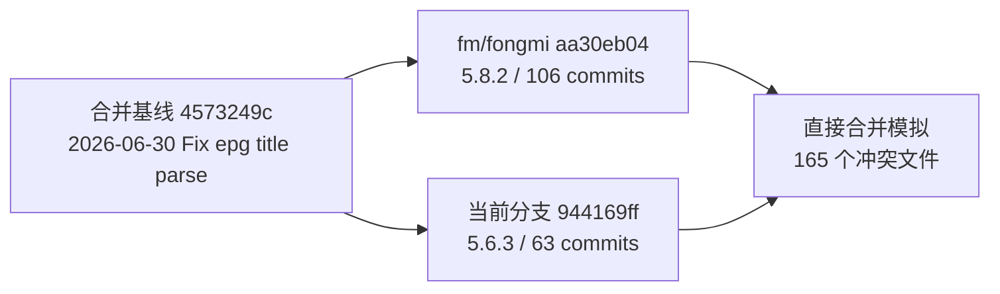
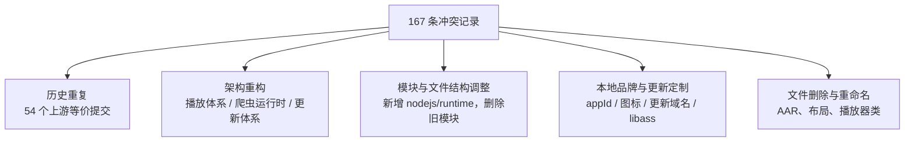
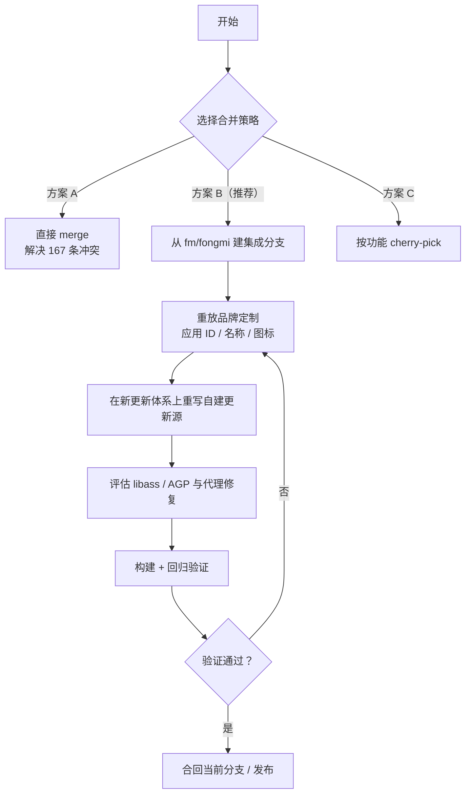

# fm/fongmi 分支合并方案

> 文档版本：v1.0
> 编写日期：2026-10-26
> 作者：Shiro
> 仓库：`/workspace`（chengshengru/TV）
> 文档类型：合并可行性分析与实施方案
> 说明：本文档只做分析与方案设计，未修改任何业务代码。

## 1. 结论摘要

当前分支与 `fm/fongmi` 已经属于两条差异很大的产品线：

- 当前分支 `trae/agent-INMyfs`（与 `fongmi-5.6.3` 指向同一提交）：版本 `5.6.3`，版本号 `563`。
- 目标分支 `fm/fongmi`：版本 `5.8.2`，版本号 `582`，包含 106 个新提交。
- 共同合并基线：`4573249c`（2026-06-30，`Fix epg title parse`）。
- 相对基线，当前分支有 63 个提交，`fm/fongmi` 有 106 个提交。

使用 `git merge-tree --write-tree` 做过一次不落盘的合并模拟，结果为：

- **165 个文件路径冲突、167 条冲突记录**。
- 其中 `content` 冲突 104 条、`add/add` 冲突 54 条、`modify/delete` 冲突 7 条、`rename/delete` 冲突 2 条。
- 冲突集中在 `app` 模块（134 个路径），其次是 `website`（15 个）、`catvod`（6 个）以及构建脚本。

直接执行 `git merge fm/fongmi` 的风险很高，不适合作为默认方案。推荐采用：

> **方案 B：以 `fm/fongmi` 为新基线，在新分支上重放本地定制提交，验证通过后再合回当前分支。**

推荐方案的核心理由：

1. 当前分支的 63 个提交中，有 54 个与上游提交是“同一改动、不同 SHA”的等价提交（`git cherry` 结果为 `-`），直接合并会让历史重复、冲突放大。
2. 上游对播放体系、爬虫运行时、应用更新、构建模块做了架构级重构，逐文件解决 167 条冲突的收益很低。
3. 本地真正需要保留的定制集中在 5 个提交，范围清晰，适合在新基线上重放或重写。

本次操作已完成 `fm/fongmi` 的抓取，仅更新 Git 引用，没有执行 `merge`、`rebase`、`cherry-pick`，工作区保持干净。

## 2. 分支与基线现状

### 2.1 基本信息

| 项目 | 当前分支 | fm/fongmi |
| --- | --- | --- |
| 分支名 | `trae/agent-INMyfs` | `fm/fongmi` |
| HEAD | `944169ff` | `aa30eb04` |
| HEAD 时间 | 2026-10-25 | 2026-10-25 |
| 应用版本 | 5.6.3 / 563 | 5.8.2 / 582 |
| applicationId | `com.keepsoft.android.tv` | `com.fongmi.android.tv` |
| 相对基线新增提交 | 63 | 106 |
| 相对基线文件变更 | 343 个，+27959 / -7326 | 859 个，+90341 / -13644 |

### 2.2 分叉关系



### 2.3 当前分支的提交构成

当前分支 63 个提交可分为三类：

| 类型 | 数量 | 说明 |
| --- | --- | --- |
| 上游等价提交 | 54 | 与 `fm/fongmi` 中提交内容等价，仅 SHA 不同，直接合并时会重复计算 |
| 上游同主题但补丁不同 | 2 | `e25b4ff8`、`cf109632`，与上游同名提交存在上下文差异，不应重复重放 |
| 本地定制提交 | 5 | 应用 ID、名称图标、更新域名、libass/AGP、代理重定向修复 |

本地定制提交清单：

| 提交 | 提交说明 | 变更范围 |
| --- | --- | --- |
| `0dddf731` | 调整应用图标和名称 | Manifest、三套 `strings.xml`、应用图标/Banner |
| `5bad1df0` | 调整应用ID和更新域名 | `app/build.gradle`、`Github.java` |
| `0df7fcad` | 调整更新域名 | `Updater.java`、`Github.java` |
| `bb15929a` | 调整libass | `libs.versions.toml`、`PlaybackActivity.java` |
| `c616c0aa` | Fix proxy selection across redirects | `catvod` 网络层及单元测试 |

## 3. fm/fongmi 主要更新内容

上游 106 个提交可以按以下主题归纳。

| 主题 | 主要内容 | 代表提交 |
| --- | --- | --- |
| 播放体系重构 | 拆分直播/点播播放控制器、状态机、预加载器、请求对象；重做播放页刷新、进度恢复、下一集预加载、画面比例、时序偏移、倍速 | `f803adce`、`a4ebdd65`、`2112cb48`、`e5ec0c60`、`c2e3ca0e`、`3f6cf436` |
| 字幕与弹幕 | libass 集成、外挂字幕、字幕缩放、字体选择、图片字幕控制、弹幕时间和显示配置、直播弹幕 | `773cae11`、`125468f0`、`66471762`、`9ebac08e`、`f98a376c` |
| 播放器与音视频效果 | ExoPlayer/mpv 引擎切换、mpv 配置、GPU 设置、音频/视频效果、轨道选择、错误信息 | `b802f538`、`179cd159`、`99726597`、`867581dc` |
| 爬虫运行时 | Java/Python/QuickJS/Node.js 运行时模块化、共享爬虫映射、隔离 JavaScript 求值、二进制请求体、代理重定向、统一网络栈 | `970862c6`、`8de89a10`、`e434458f`、`ff40eddb`、`2d84dc63` |
| 模块管理与应用更新 | 运行时模块目录、模块安装/更新提示、应用更新服务、APK 缓存、GitHub Releases 更新源 | `5181b478`、`56bf1b3b`、`e3f5d38d` |
| Web 文档与远程控制 | 新增文档站、网页遥控、本地 API、爬虫编辑器、诊断与日志、命令说明 | `dbd6d887`、`651aa7cb`、`e3f5d38d`、`07b6d554` |
| 文件、备份与安全 | 数据库备份拆分与迁移、加密工具集中、本地文件服务与导入加固 | `d930258e`、`4c7d02c1`、`c33e010a`、`2ae956ad`、`5a905f87` |
| 平台与体验 | Android Auto、DLNA 播放、直播频道历史、分类筛选、日志导出、遥控器交互 | `805f7a07`、`86ae0983`、`9c845a91`、`a906c788`、`aa30eb04` |

### 3.1 模块和构建结构变化

| 变化 | 当前分支 | fm/fongmi | 影响 |
| --- | --- | --- | --- |
| 运行时模块 | `app` 直接依赖 `:chaquo`、`:quickjs`，并使用 `app/libs/*.aar` | 新增 `nodejs`、`runtime` 构建体系；`python`、`nodejs`、`quickjs`、`thunder` 作为可独立安装的运行时模块 | 发布物从单一 APK 变为“主 APK + 运行时模块 APK + 模块目录 JSON”，更新和部署流程需要同步调整 |
| 迅雷模块 | `app/libs/thunder-release.aar` | `thunder` 独立 Gradle 子模块，纳入运行时体系 | AAR 依赖方式失效，需要构建运行时模块 |
| 旧模块清理 | 保留 `forcetech`、`jianpian`、`zlive` 目录 | 上游已删除 `forcetech`、`jianpian`、`zlive` | 若本地仍依赖这些能力，需要单独评估是否恢复 |
| 文档站 | `docs/` 与 `website/` 并存 | 文档迁移到 `website/`，新增爬虫编辑器 `app/tools/spider-editor` | `docs/` 相关冲突需要按上游结构处理 |
| 构建工具链 | AGP 9.1.1、Python 17.0.0、Room 2.8.4 | AGP 9.4.0、Python 17.1.0、Room 2.8.5、compileSdk/buildTools 37 | 本地 AGP 版本被 `bb15929a` 主动降级，合并时需要重新决策 |
| ABI 打包 | `AbiApkPackaging` 自定义配置 | 新增 `splits.abi`，仍使用 `AbiApkPackaging` | APK 命名、产物路径、升级逻辑可能变化 |

## 4. 本地定制内容与迁移方式

| 定制项 | 本地提交 | 关键文件 | 迁移建议 |
| --- | --- | --- | --- |
| 应用 ID | `5bad1df0` | [app/build.gradle](../../app/build.gradle) | 保留 `com.keepsoft.android.tv`；合并后手动改回，避免被上游 `com.fongmi.android.tv` 覆盖 |
| 应用名称 | `0dddf731` | [strings.xml](../../app/src/main/res/values/strings.xml)、`values-zh-rCN`、`values-zh-rTW` | 保留“影视仓/影視倉”；上游新增字符串正常合并 |
| 图标与 Banner | `0dddf731` | [AndroidManifest.xml](../../app/src/main/AndroidManifest.xml)、`drawable-*/app_icon.png`、`app_banner.png` | 保留本地品牌资源；注意上游 Manifest 已改用 `@mipmap/ic_launcher`，需要重新指定本地图标 |
| 更新清单源 | `0df7fcad`、`5bad1df0` | [Updater.java](../../app/src/main/java/com/fongmi/android/tv/Updater.java)、[Github.java](../../app/src/main/java/com/fongmi/android/tv/utils/Github.java) | 上游已重写更新体系，不能直接 cherry-pick；需在新架构上重写清单获取逻辑 |
| libass / AGP 版本 | `bb15929a` | [libs.versions.toml](../../gradle/libs.versions.toml)、[PlaybackActivity.java](../../app/src/main/java/com/fongmi/android/tv/ui/activity/PlaybackActivity.java) | 上游使用 AGP 9.4.0 与 `DanmakuPlayerViewController`；建议优先跟随上游，只有构建环境不兼容时才保留本地降级 |
| 代理重定向修复 | `c616c0aa` | `catvod` 网络层、[OkProxySelectorTest.java](../../catvod/src/test/java/com/github/catvod/net/OkProxySelectorTest.java) | 上游已有同名提交 `2d84dc63`，需逐文件比对；本地新增的单元测试可保留，但要适配上游新网络栈 |

### 4.1 更新域名现状

本地更新机制使用自建清单：

- 清单地址：`https://media-repo.pages.dev/Release/android`
- APK 地址：`https://pub-8198366a932249098157e9d7ef20af6a.r2.dev/Release/android`
- 清单字段包含 `code`、`name`、`desc`、`url`，`url` 支持 `{flavor}`、`{abi}` 占位符。

上游 5.8.2 已改为 GitHub Releases API + `UpdateService` + `ApkCache` + `UpdatePackage`，并且新增运行时模块目录（默认 `https://github.com/FongMi/Release/releases/download/module/catalog.json`）。因此：

1. 直接重放 `0df7fcad` 会产生语义冲突，不能沿用旧 `Updater` 下载逻辑。
2. 如继续使用自建更新源，需要在新 `Updater.checkRelease()` 中替换数据来源，并将清单字段转换为 `UpdatePackage(version, url, size, digest)`。
3. 运行时模块目录和 4 个模块 APK 也需要有对应的托管方案，否则主 APK 升级后可能无法安装/更新运行时模块。

## 5. 冲突分析

### 5.1 冲突规模

合并模拟结果（不落盘）：

| 冲突类型 | 数量 | 典型场景 |
| --- | --- | --- |
| `content` | 104 | 双方修改同一文件同一区域 |
| `add/add` | 54 | 同一文件在两条分支上分别新增，内容不同 |
| `modify/delete` | 7 | 一方删除、另一方修改 |
| `rename/delete` | 2 | 一方重命名、另一方删除 |
| 合计 | 167 条冲突记录 | 对应 165 个文件路径 |

### 5.2 按模块分布

| 模块/目录 | 冲突文件数 | 占比 |
| --- | --- | --- |
| `app` | 134 | 81.2% |
| `website` | 15 | 9.1% |
| `catvod` | 6 | 3.6% |
| `chaquo` | 2 | 1.2% |
| `buildSrc` | 2 | 1.2% |
| `quickjs` | 1 | 0.6% |
| 根目录与构建配置（`.gitignore`、`README.md`、`build.gradle`、`gradle.properties`、`gradle/libs.versions.toml`） | 5 | 3.0% |

`app` 内部冲突集中在：

| 子目录 | 冲突文件数 | 说明 |
| --- | --- | --- |
| `app/src/main/java` | 91 | 播放、爬虫、更新、设置、工具类 |
| `app/src/leanback/java` | 11 | TV 端 Activity/Dialog |
| `app/src/mobile/java` | 10 | 手机端 Activity/Dialog |
| `app/src/leanback/res` | 8 | TV 布局与资源 |
| `app/src/mobile/res` | 6 | 手机布局与资源 |
| `app/src/main/res` | 5 | 字符串与通用布局 |
| `app/src/main/assets` | 1 | `script.js` |
| `app/build.gradle`、`proguard-rules-media.pro` | 2 | 构建与混淆配置 |

### 5.3 冲突根因



1. **历史重复**：当前分支通过多次 merge/cherry-pick 引入了大量上游提交，但 SHA 不同，Git 将双方的同源改动识别为并行修改，放大了 `add/add` 冲突。
2. **架构重构**：播放体系、爬虫运行时、更新体系被上游重写，文件职责和调用关系变化，旧代码无法逐行对齐。
3. **模块调整**：`app/libs/*.aar` 删除、`nodejs`/`runtime` 新增、`thunder` 独立成模块，构建脚本冲突不可避免。
4. **本地定制**：`applicationId`、`app_name`、图标、更新域名、AGP/libass 版本与上游默认值直接冲突。

### 5.4 高风险冲突文件

| 文件/目录 | 风险说明 |
| --- | --- |
| [app/build.gradle](../../app/build.gradle) | `applicationId`、`versionCode/versionName`、签名配置、ABI splits、`runtimeCatalog` 占位符、混淆配置同时冲突 |
| [gradle/libs.versions.toml](../../gradle/libs.versions.toml) | AGP 9.1.1/9.4.0、Python 17.0.0/17.1.0、Room、Guava、新增依赖 |
| [Updater.java](../../app/src/main/java/com/fongmi/android/tv/Updater.java) | 上游重写为 `UpdateService` + `ApkCache` + `UpdatePackage`，本地旧逻辑已不适用 |
| [Github.java](../../app/src/main/java/com/fongmi/android/tv/utils/Github.java) | 上游改为 GitHub Releases API，本地为自建 JSON 清单，双方实现完全不同 |
| [PlaybackActivity.java](../../app/src/main/java/com/fongmi/android/tv/ui/activity/PlaybackActivity.java) 及 `player`、`playback` 包 | 播放架构、libass、弹幕控制器 API 同时变化，涉及约 50 个文件 |
| `app/src/*/java/**/setting`、`ui/dialog`、`ui/activity` | 播放设置、字幕/弹幕/音视频效果对话框整体重做 |
| 三套 `strings.xml` | 本地品牌名与上游新增字符串冲突 |
| [AndroidManifest.xml](../../app/src/main/AndroidManifest.xml) | 图标/Banner 引用与上游自适应图标策略不同；虽未出现在冲突列表，仍需人工核对 |
| `catvod/src/main/java/com/github/catvod/net/*` | 上游新增统一网络栈（`Net`、`NetRequest`、`NetStore` 等），本地代理修复需要重新落位 |
| `buildSrc/.../AbiApkPackaging.groovy` | ABI 打包逻辑与上游 `splits.abi` 协同关系需要重新确认 |
| `website/app/*`（15 个文件） | 文档站内容与导航结构整体更新 |
| `app/proguard-rules-media.pro` | 上游删除、本地修改，需确认混淆规则是否已迁移到 `proguard-rules.pro` |
| `app/src/main/java/.../utils/Download.java` | 上游删除应用内实现，改用 `catvod/net/Download.java` |
| `app/src/main/java/.../player/extractor/JianPian.java` | 上游删除 JianPian 提取器，本地若仍使用需单独恢复 |
| `PreCache`/`MediaSourceFactory` 重命名路径 | 本地重命名、上游删除旧路径并新增新类，需以新类为准 |
| `view_danmaku_*.xml` 等 4 个布局 | 本地删除、上游修改，需按新弹幕 UI 决定保留还是删除 |

## 6. 合并策略比较

### 6.1 方案对比

| 方案 | 做法 | 优点 | 缺点 | 建议 |
| --- | --- | --- | --- | --- |
| 方案 A：直接 merge | `git merge fm/fongmi`，逐条解决 167 条冲突 | 保留完整分支历史，操作路径直观 | 冲突量最大；播放/更新/运行时架构需大量人工对齐；容易误丢本地定制；回归范围不可控 | 不推荐 |
| 方案 B：新基线 + 重放本地定制 | 从 `fm/fongmi` 建新分支，重放 5 个本地定制提交，重写更新逻辑 | 冲突面小；完整获得上游架构；历史干净；本地定制可控 | 需要重写更新域名逻辑；需要验证运行时模块发布链路；当前分支历史会被替换 | **推荐** |
| 方案 C：按功能 cherry-pick | 只挑选需要的上游提交 | 风险最低，可渐进上线 | 不是完整合并；播放/运行时/更新等提交相互依赖，拆分成本高；容易形成长期分叉 | 仅在只需要少数功能时采用 |

### 6.2 推荐路径



## 7. 方案 B 实施步骤

### 7.1 预检查与备份

```bash
# 确认工作区干净
git status --short

# 备份当前分支指向，便于回滚
git tag backup/fongmi-5.6.3-local-20261026 944169ff

# 本地尚未配置 fm remote 时执行
git remote add fm https://github.com/FongMi/TV.git

# 抓取目标分支
git fetch fm fongmi --depth=500

# 确认双方 HEAD
git rev-parse HEAD fm/fongmi
git merge-base HEAD fm/fongmi
```

### 7.2 创建集成分支

```bash
git switch -c feature/fm-fongmi-5.8.2 fm/fongmi
```

在集成分支上完成所有定制重放和验证，不直接改写当前分支，确保随时可放弃并回到 `944169ff`。

### 7.3 重放品牌定制

1. 应用名称与图标：`git cherry-pick 0dddf731`
   - 预期冲突：`app/src/main/AndroidManifest.xml`、`app/src/leanback/AndroidManifest.xml`、三套 `strings.xml`。
   - 处理原则：保留“影视仓/影視倉”和本地图标/Banner；上游新增字符串全部保留。
2. 应用 ID：不建议整提交 cherry-pick `5bad1df0`（该提交同时包含更新域名改动）。
   - 直接修改 [app/build.gradle](../../app/build.gradle) 中的 `applicationId` 为 `com.keepsoft.android.tv`。
   - 同步确认 `versionCode/versionName` 使用上游 `582/5.8.2`，并且 `versionCode` 必须大于旧版本 `563`，保证覆盖安装。

### 7.4 在新更新体系上重写自建更新源

上游更新流程为：

```text
Updater.checkRelease()
  -> Github.getReleases()（GitHub Releases API）
  -> Github.getUpdate()（按语义版本比较）
  -> UpdatePackage(version, url, size, digest)
  -> UpdateService 下载 / 校验 / 安装
```

如继续使用自建更新源，建议改造点为：

1. 保留 `UpdateService`、`ApkCache`、`UpdatePackage`，只替换“检查更新”的数据来源。
2. 在 `Updater` 中新增自建清单请求：
   - 请求 `https://media-repo.pages.dev/Release/android/{flavor}-{abi}.json`。
   - 读取 `code`、`name`、`desc`、`url`、`size`、`digest`。
   - `code > BuildConfig.VERSION_CODE` 时构造 `UpdatePackage`。
   - `url` 中的 `{flavor}`、`{abi}` 继续替换。
3. 删除旧 `Updater` 中的单例式 `Download` 逻辑，统一走 `UpdateService`。
4. 如清单暂不提供 `size`/`digest`，需要明确 `UpdatePackage` 的兼容策略，避免跳过完整性校验。
5. 运行时模块目录需要单独配置：
   - `app/build.gradle` 的 `manifestPlaceholders.runtimeCatalog` 指向自建 `catalog.json`。
   - 目录中至少包含 `python`、`nodejs`、`quickjs`、`thunder` 模块的版本、下载地址、校验信息。
   - 若暂不自建，可暂时沿用上游默认目录，但需确认与本地 applicationId/签名策略兼容。

### 7.5 libass 与 AGP 决策

`bb15929a` 将 AGP 从 9.3.1 降到 9.1.1，并把弹幕控制器从 `DanmakuPlayerViewController` 改为 `DanmakuController`。上游 5.8.2 已使用 AGP 9.4.0 和 `DanmakuPlayerViewController`。

建议：

1. 优先使用上游 AGP 9.4.0 与上游弹幕 API，不重放 `bb15929a`。
2. 只有在本地构建环境无法支持 AGP 9.4.0 时，才单独固定 AGP 版本，并重新适配弹幕 API。
3. 若必须降级 AGP，需要同时验证 Gradle 9.7.1、compileSdk 37、buildTools 37 的兼容性。

### 7.6 代理重定向修复

1. 对比本地 `c616c0aa` 与上游 `2d84dc63`，确认上游是否已覆盖 `OkProxySelector`、`ProxyRedirectInterceptor`、`OkHttp` 的修复。
2. 上游新增了 `Net`、`NetRequest`、`NetStore` 等统一网络栈，本地旧补丁可能不再适用。
3. 本地 [OkProxySelectorTest.java](../../catvod/src/test/java/com/github/catvod/net/OkProxySelectorTest.java) 建议保留，但需要按新 API 调整；若上游测试体系不同，可迁移为等价的单元测试。

### 7.7 构建验证

```bash
# 清理并构建两个产品形态
./gradlew clean :app:assembleLeanbackDebug :app:assembleMobileDebug

# 如保留 catvod 单元测试
./gradlew :catvod:testDebugUnitTest
```

前置条件：

- JDK 21（源码与目标兼容级别为 Java 21）。
- Gradle 9.7.1。
- Android SDK 37、buildTools 37.0.0。
- `local.properties` 中提供 `storeFile`、`keyAlias`、`storePassword`、`keyPassword`；上游 `debug` 也复用 release 签名配置。
- 如需构建运行时模块，按 `runtime` 工程分别构建 `python`、`nodejs`、`quickjs`、`thunder`。

### 7.8 合回当前分支

验证通过后，按团队流程选择：

```bash
# 方式一：保留集成分支历史
git switch trae/agent-INMyfs
git merge --no-ff feature/fm-fongmi-5.8.2

# 方式二：确认不再需要旧历史后，替换当前分支指向
git switch trae/agent-INMyfs
git reset --hard feature/fm-fongmi-5.8.2
```

方式二会丢弃当前分支的旧提交历史，执行前必须确认备份标签存在，并且远端分支没有被其他人依赖。

## 8. 回归验证清单

| 类别 | 验证项 | 通过标准 |
| --- | --- | --- |
| 构建 | Leanback / Mobile Debug 构建 | 两个 flavor 均成功产出 APK |
| 构建 | 运行时模块构建 | `python`、`nodejs`、`quickjs`、`thunder` 可产出模块 APK |
| 品牌 | applicationId | 安装包为 `com.keepsoft.android.tv` |
| 品牌 | 名称与图标 | 桌面/TV 启动器显示“影视仓”和本地图标/Banner |
| 升级 | 覆盖安装 | 5.6.3 可直接升级到 5.8.2，数据不丢失 |
| 升级 | 自建更新源 | 能检测到新版本并完成下载、校验、安装 |
| 运行时 | 模块目录 | 能读取自建/上游 `catalog.json`，正确提示模块更新 |
| 播放 | 点播 | 起播、切集、续播、预加载、进度恢复正常 |
| 播放 | 直播 | 选台、节目表、时移、线路切换正常 |
| 播放 | 引擎切换 | ExoPlayer / mpv 切换正常，mpv 配置生效 |
| 播放 | 字幕 | 内嵌/外挂字幕、libass 字体、字幕缩放正常 |
| 播放 | 弹幕 | 弹幕开关、时间/显示/密度设置、直播弹幕正常 |
| 播放 | 音视频效果 | 音频效果、画面比例、缩放手势正常 |
| 爬虫 | Java/Python/QuickJS | 三类爬虫均可加载、请求、解析 |
| 爬虫 | 网络 | 代理、重定向、Cookie、二进制请求体正常 |
| 数据 | 备份恢复 | 旧版本备份可恢复，数据库迁移无异常 |
| 文件 | 本地导入/文件服务 | 文件选择、导入、局域网服务正常 |
| 互通 | 网页遥控/DLNA/Auto | 遥控、投屏、Android Auto 浏览正常 |

## 9. 风险与缓解

| 风险 | 影响 | 缓解措施 |
| --- | --- | --- |
| 自建更新源与新更新体系不兼容 | 无法检测或安装更新 | 在集成分支单独实现并端到端验证；保留 GitHub Releases 作为兜底 |
| 运行时模块托管缺失 | 主 APK 升级后爬虫/迅雷模块不可用 | 同步准备 `catalog.json` 与 4 个模块 APK；先沿用上游目录做兼容验证 |
| 直接 merge 导致定制丢失 | 应用 ID、名称、图标、更新域名被上游默认值覆盖 | 采用方案 B；合并后逐项核对品牌与更新配置 |
| AGP 9.4.0 构建失败 | 无法出包 | 先验证本机构建环境；必要时再评估 AGP 降级与弹幕 API 适配 |
| libass/弹幕 API 变化 | 弹幕显示异常或编译失败 | 以上游 API 为准，补充字幕/弹幕回归用例 |
| JianPian/ForceTech/ZLive 被上游删除 | 依赖这些源的用户功能缺失 | 确认实际使用情况；如必须保留，作为独立定制补丁重新引入 |
| 数据库/备份结构升级 | 旧数据迁移失败 | 使用 5.6.3 真实数据做升级与备份恢复测试 |
| ABI/APK 命名变化 | 旧更新清单指向错误产物 | 核对 `splits.abi` 与 `AbiApkPackaging` 产物名称，更新清单同步调整 |
| 当前分支历史被替换 | 旧提交无法从当前分支直接追溯 | 保留 `backup/fongmi-5.6.3-local-20261026` 标签与远端分支 |

## 10. 回滚方案

1. 合并前已创建备份标签：
   ```bash
   git tag backup/fongmi-5.6.3-local-20261026 944169ff
   ```
2. 集成分支验证失败时，直接切回当前分支，不影响现有代码：
   ```bash
   git switch trae/agent-INMyfs
   ```
3. 如已合回并需要回滚：
   ```bash
   git reset --hard backup/fongmi-5.6.3-local-20261026
   ```
4. 如已推送，优先使用反向提交（`git revert -m 1 <merge-commit>`），避免对共享分支强制推送。

## 11. 待确认事项

| 序号 | 待确认问题 | 建议 |
| --- | --- | --- |
| 1 | 是否采用方案 B（新基线 + 重放本地定制） | 推荐采用；若必须保留旧历史，再评估方案 A |
| 2 | 是否保留 `com.keepsoft.android.tv` 与“影视仓”品牌 | 默认保留，需在合并后逐项核对 |
| 3 | 更新源继续使用自建 Pages/R2，还是切换上游 GitHub Releases | 若自建源仍维护，按 7.4 重写；否则切换上游可显著降低改造量 |
| 4 | 是否必须继续固定 AGP 9.1.1 / 旧 libass API | 建议跟随上游 AGP 9.4.0；仅在构建环境不兼容时降级 |
| 5 | 是否需要保留 JianPian、ForceTech、ZLive | 上游已移除，需确认业务是否仍依赖 |
| 6 | 运行时模块 APK 与 `catalog.json` 由谁托管 | 自建更新源场景下必须一并规划，不能只发布主 APK |

## 12. 附：数据来源与操作记录

- 分支与提交数据来自本地 Git 仓库：`git log`、`git diff`、`git cherry`。
- 冲突数据来自只读合并模拟：`git merge-tree --write-tree --name-only HEAD fm/fongmi`，未修改工作区。
- 已执行的操作：添加 `fm` remote、抓取 `fm/fongmi`、加深 `origin/fongmi-5.6.3` 历史以获取共同基线。
- 分析阶段未执行的操作：`merge`、`rebase`、`cherry-pick`、代码修改。实际执行情况见第 13 节。

## 13. 方案 B 执行记录

### 13.1 分支状态

| 引用 | 指向 | 说明 |
| --- | --- | --- |
| `feature/fm-fongmi-5.8.2` | `aa30eb04` + 未提交改动 | 本次集成分支，基于上游 5.8.2 |
| `fm/fongmi` | `aa30eb04` | 上游远端跟踪分支，未改动 |
| `trae/agent-INMyfs` | `944169ff` | 原工作分支，已恢复为执行前指向，未改动 |
| `fongmi-5.6.3` | `944169ff` | 原本地分支，未改动 |
| `backup/fongmi-5.6.3-local-20261026` | `944169ff` | 回滚备份标签 |

> 执行期间曾出现一次外部自动提交 `2bfbbbbb`（提交信息“feat: 合并fm/fongmi分支代码”），已将原分支重置回 `944169ff`，并保留标签 `checkpoint/auto-2bfbbbbb` 备查，该提交未合入集成分支。

### 13.2 本地定制重放情况

| 定制项 | 来源提交 | 处理方式 | 落地文件 |
| --- | --- | --- | --- |
| 应用 ID | `5bad1df0` | 手工重放 | [app/build.gradle](../../app/build.gradle) 的 `applicationId` 改为 `com.keepsoft.android.tv` |
| 应用名称 | `0dddf731` | 手工重放 | 三套 `strings.xml` 的 `app_name` 改为影视仓 / 影視倉 |
| 图标与 Banner | `0dddf731` | 恢复资源并改引用 | `AndroidManifest.xml`、`leanback/AndroidManifest.xml` 指向 `@drawable/app_icon`、`@drawable/app_banner`，并恢复两张 png |
| 自建更新源 | `5bad1df0`、`0df7fcad` | 在新更新体系上重写 | [Github.java](../../app/src/main/java/com/fongmi/android/tv/utils/Github.java) 新增 `getUpdateManifest`、`getUpdateApk`；[Updater.java](../../app/src/main/java/com/fongmi/android/tv/Updater.java) 改读自建 JSON 清单，复用 `UpdatePackage` 与 `UpdateService` |
| 代理重定向修复 | `c616c0aa` | 以上游实现为准，仅保留测试 | [OkProxySelectorTest.java](../../catvod/src/test/java/com/github/catvod/net/OkProxySelectorTest.java) |
| libass / AGP 降级 | `bb15929a` | 不重放 | 跟随上游 AGP 9.4.0 与 `DanmakuPlayerViewController` |

### 13.3 未重放内容

- `bb15929a` 的 AGP 降级与旧 `DanmakuController` 适配，理由见 7.5。
- 本地 `jianpian`、`forcetech`、`zlive`、`tvbus`、`hook` 模块及 `app/libs` 下的 AAR：上游已移除，`settings.gradle` 只保留 `app`、`catvod`、`chaquo`、`nodejs`、`quickjs`、`thunder`。
- 本地 `app` 模块的 `Download.java`、`UpdateListener.java`：上游已删除，新体系改用 `com.github.catvod.net.Download`。
- 本地 `proguard-rules-media.pro`：上游已删除，`build.gradle` 同步使用单份规则。

### 13.4 更新源实现要点

自建清单字段沿用 4.1 节：`code`、`name`、`desc`、`url`、`size`、`digest`。

1. 清单地址为 `https://media-repo.pages.dev/Release/android/{flavor}-{abi}.json`。
2. 清单 `code` 不大于 `BuildConfig.VERSION_CODE` 时直接结束检查。
3. `url` 为空时回退到 R2 直链；含 `{flavor}`、`{abi}` 占位符时按当前构建替换。
4. `size` 缺失时用 `HEAD` 请求读取 `Content-Length`；仍无效则抛错终止，避免生成不合法的 `UpdatePackage`。
5. `digest` 兼容带与不带 `sha256:` 前缀两种写法，空值表示跳过摘要校验。
6. 下载、暂停、校验、安装仍由上游 `UpdateService`、`ApkCache`、`UpdatePackage` 完成，未改动其逻辑。

### 13.5 验证结果

| 验证项 | 结果 |
| --- | --- |
| `git diff --check` | 通过，无空白字符错误 |
| 分支指向核对 | 通过，原有两个分支均未改动 |
| 代理测试 API 兼容性 | 通过（静态核对）：`policy(URI, Policy)`、`Policy.rule()`、`ProxyRedirectInterceptor(OkProxySelector)` 均为同包可见，测试位于 `com.github.catvod.net` 包内；`Proxy` 的 `getHosts`、`getProxies`、`getUserInfo` 可匿名重写 |
| `./gradlew clean :app:assembleLeanbackDebug :app:assembleMobileDebug` | 未执行：环境无 Android SDK、无 `local.properties`、JDK 为 25 而非 21 |
| `./gradlew :catvod:testDebugUnitTest` | 未执行，原因同上 |

构建验证需在具备 SDK 37、buildTools 37.0.0、JDK 21 且已配置签名参数的环境中按 7.7 补做，完成后才能进入 7.8 合回步骤。

### 13.6 当前阻塞项

1. 自建更新源是否继续使用 `media-repo.pages.dev` 与 R2 直链（对应 11 节第 3 项）。
2. 运行时模块 `catalog.json` 仍指向上游默认地址 `https://github.com/FongMi/Release/releases/download/module/catalog.json`，需确定是否改由自建源托管，以及 `python`、`nodejs`、`quickjs`、`thunder` 四个模块 APK 的发布位置（对应 11 节第 6 项）。

## 14. 5.8.4 增量合并记录

### 14.1 合并概况

| 项目 | 内容 |
| --- | --- |
| 合并目标分支 | `feature/fm-fongmi-5.8.2`（当前分支） |
| 上游新提交 | 17 个，`aa30eb04..a27ab2680` |
| 共同基线 | `aa30eb04`，双方为同一基线分叉，无历史交叉 |
| 合并提交 | `494b0c7fe`，`Merge fm/fongmi 5.8.4 到集成分支` |
| 冲突 | 无。合并模拟 `git merge-tree` 未返回冲突路径，实际合并直接生成合并提交 |
| 版本变化 | `versionCode 582 → 584`、`versionName 5.8.2 → 5.8.4`（上游维护，本地未干预） |

### 14.2 上游主要变化

1. 版本号升至 5.8.4，列表项含 5.8.3 与 5.8.4 两次版本提交。
2. Chaquopy 由 17.1.0 升到 17.2.0，Python 运行时改为“固定本地构件”方式。
3. 播放体系调整：Exo 音频命令、`PlayerEngine`、`MpvUtil`、`DecodeSetting` 记住解码方式、DRM 与 ClearKey 下一集预加载。
4. 爬虫体系调整：`PyLoader`、`SpiderLoadException`、`SiteApi`、Python 运行时目录重构（`runtime/loader.py`、`runtime/net.py`、`runtime/dialog.py`）。
5. 本地字幕发现与 VTT 上传恢复，`LocalSubtitleScanner`、`SubtitleArchive` 更新。
6. 文档站新增 `playback-commands.ts`、`spider-fields.ts` 等页面。

### 14.3 合并后核对结果

| 定制项 | 结果 |
| --- | --- |
| `applicationId` | 仍为 `com.keepsoft.android.tv` |
| 应用名称 | 三套 `strings.xml` 仍为影视仓 / 影視倉 |
| 图标与 Banner | `@drawable/app_icon`、`@drawable/app_banner` 引用与资源均在 |
| 自建更新源 | `Github.getUpdateManifest`、`Github.getUpdateApk`、`Updater.checkRelease`、`prepareRelease`、`getContentLength` 均在，上游本次未改动这两个文件 |
| 代理测试 | `catvod/src/test/.../OkProxySelectorTest.java` 保留，上游本次未改动 `catvod` |
| 冲突标记 | `git grep '<<<<<<< '` 无结果 |
| `git diff --check` | 通过 |

### 14.4 新增构建前置条件（重要）

上游 5.8.4 的 `chaquo/runtime/build.gradle` 会校验 Python 编译器与原生构件的哈希，而相关目录已被 `.gitignore` 排除，构建前必须先生成：

```bash
# 在项目根目录执行，依赖外网访问 GitHub
python scripts/sync_python_runtime.py
```

该脚本会按 [native.lock.json](../../chaquo/runtime/native.lock.json) 从 `FongMi/python-android` 的固定提交下载并校验：

- `chaquo/runtime/wheels/manifest.json` 及各 ABI 的 wheels 包；
- `chaquo/runtime/native-bundles/` 下的原生构件与 `manifest.json`；
- 临时目录 `chaquo/runtime/python-sync-*/`。

缺失这些文件时，`chaquo/runtime` 构建会直接抛 `Python native inputs are missing`。因此 13.5 节“构建未执行”的结论同样适用于本次增量合并，且新增了此项前置条件。
