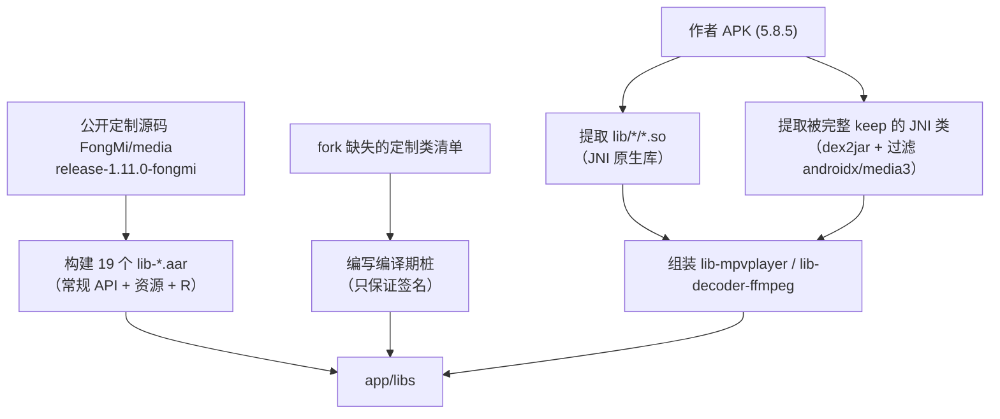

# media3 从作者 APK 提取的可行性与实施方案

> 文档版本：v1.0
> 编写日期：2026-10-31
> 作者：Shiro
> 仓库：`/workspace`（chengshengru/TV）
> 文档类型：方案设计与可行性验证
> 说明：本文档只做分析与方案设计，未修改任何业务代码。

## 1. 结论先行

按你的约束「只能从作者发布的 APK 中提取」，直接提取出**可用于编译的 media3 AAR 是不可行的**。原因不是操作难度，而是官方发布包经过 R8 混淆与裁剪：

- 实测 `FongMi/Release` 5.8.5 `leanback-arm64_v8a.apk`：
  - 所有 dex 中仍保留原名的 `androidx.media3.*` 类只有 **84 个**；
  - 代码实际使用的定制类（`MpvLibrary`、`LibassPlaybackSession`、`DanmakuConfig`、`DiscMenuController`、`SubtitleOffsets`、`MediaEdition` 等）在 dex 中**已不存在原名**；
  - 即使保留类名的 `PlayerView`，其成员方法名也被混淆（`setPlayer` 在 dex 字符串表中不存在），无法作为编译期 API。
- APK 内**不含** `mapping.txt`，没有映射表就无法把 `a.a.a` 还原成 `androidx.media3.xxx`。

因此：**APK 只能提供 native `.so` 与少数被完整保留的 JNI 桥接类**，其余 Java API 必须另行获得（公开源码或编译期桩）。

## 2. 实测证据

### 2.1 提取对象

| 项目 | 值 |
| --- | --- |
| 发布包 | `https://github.com/FongMi/Release/releases/download/5.8.5/leanback-arm64_v8a.apk` |
| 大小 | 50 MB |
| dex | `classes.dex`、`classes2.dex`、`classes3.dex` |
| 混淆 | `minifyEnabled = true`，[app/proguard-rules.pro](../../app/proguard-rules.pro) 中没有 `androidx.media3.**` 整体 keep |

### 2.2 dex 内保留的 media3 类（节选）

```
androidx/media3/exoplayer/libass/LibassNative        （JNI，完整 keep）
androidx/media3/exoplayer/libass/LibassFrame
androidx/media3/exoplayer/libass/LibassImage
androidx/media3/decoder/ffmpeg/FfmpegAudioDecoder    （成员部分 keep）
androidx/media3/decoder/ffmpeg/FfmpegDolbyVisionP7Converter$Factory
androidx/media3/decoder/mpegh/MpeghAudioRenderer
androidx/media3/exoplayer/hls/CmgNativeRuntime
androidx/media3/exoplayer/image/ImageOutput
androidx/media3/exoplayer/iso/IsoNavigationSession
androidx/media3/effect/NativeWindow
androidx/media3/session/MediaLibraryService
androidx/media3/ui/PlayerView / PlayerSeekView / SubtitleView / AspectRatioFrameLayout
androidx/media3/exoplayer/ExoPlayer                    （仅类名 keep）
```

这些类名之所以保留，是因为被 XML 布局引用或 JNI/反射需要（见上游历史文件 `app/proguard-rules-media.pro` 中的 `-keep class androidx.media3.exoplayer.libass.LibassNative { *; }` 等规则）。**类名保留 ≠ 成员保留**。

### 2.3 缺失验证

| 类 | dex 中是否保留原名 |
| --- | --- |
| `androidx.media3.mpvplayer.MpvLibrary` | 否 |
| `androidx.media3.exoplayer.libass.LibassPlaybackSession` | 否 |
| `androidx.media3.ui.danmaku.DanmakuConfig` | 否 |
| `androidx.media3.common.DiscMenuController` | 否 |
| `androidx.media3.common.text.SubtitleOffsets` | 否 |
| `androidx.media3.common.MediaEdition` | 否 |

### 2.4 可提取的 native 库（`lib/arm64-v8a`）

```
libavif_android.so   libc++_shared.so    libcmg_decrypt.so
libffmpeg.so         libffmpegDoviJNI.so libffmpegJNI.so
libisoJNI.so         libmedia3ass.so     libmedia3effect.so
libmpeghJNI.so       libpl_droidsonroids_gif.so  librtmp-jni.so
```

注意：`libmpv.so` **不在**主 APK 内，它属于可独立安装的 mpv 运行时模块（`runtime` 模块 APK），需单独获取对应模块包。

## 3. 可行方案：APK 提取 + 公开源码 + 编译桩（混合方案）



### 3.1 步骤一：提取原生库

```bash
# 1. 下载与代码版本最接近的发布包（当前代码 5.8.4，选 5.8.5 最接近）
curl -L -o lb585.apk \
  https://github.com/FongMi/Release/releases/download/5.8.5/leanback-arm64_v8a.apk

# 2. 解出原生库（arm64 / armeabi-v7a 两个包各取一次）
unzip -o lb585.apk 'lib/*' -d extracted
```

### 3.2 步骤二：提取被 keep 的 JNI 类

```bash
# dex2jar（需要 JDK）
curl -L -o dex-tools.zip \
  https://github.com/pxb1988/dex2jar/releases/download/2.4/dex-tools-2.4.zip
unzip -q dex-tools.zip
./dex-tools-2.4/d2j-dex2jar.sh extracted_classes/classes.dex -o media3-all.jar

# 只保留仍以 androidx/media3 命名的类（其余是混淆类，不可用）
mkdir kept && cd kept
unzip -q ../media3-all.jar 'androidx/media3/*'
zip -qr ../media3-kept.jar .
```

说明：`kept` 中的类成员名是否可用取决于 keep 规则；`LibassNative`、`LibassFrame`、`LibassImage`、`is.xyz.mpv.MPVLib` 等被 `-keep ... { *; }` 完整保留，可作为运行时 JNI 桥接；其余类只适合做依赖但不作为业务 API。

### 3.3 步骤三：公开源码构建其余 AAR

```bash
git clone -b release-1.11.0-fongmi https://github.com/FongMi/media media-src
cd media-src
./gradlew :libraries:common:assembleRelease \
          :libraries:exoplayer:assembleRelease \
          :libraries:ui:assembleRelease \
          :libraries:ui_danmaku:assembleRelease \
          :libraries:session:assembleRelease \
          :libraries:datasource:assembleRelease \
          :libraries:datasource_okhttp:assembleRelease \
          :libraries:exoplayer_hls:assembleRelease \
          :libraries:decoder_ffmpeg:assembleRelease \
          :libraries:mpvplayer:assembleRelease \
          :libraries:effect:assembleRelease
```

产物命名规则为 `lib-<模块名>-release.aar`，按上游 `move.txt`（19 项）复制到 [app/libs](../../app/libs)。

### 3.4 步骤四：补齐 fork 缺失类的编译桩

公开源码缺少表 3 节列出的类（libass 高层 API、`exoplayer.iso`、`DiscMenu*`、字幕扩展、`DanmakuPlayerViewController`、`DecoderMode` 等）。处理原则：

- 建立独立 `media3-stubs` 模块，仅提供**方法签名**，用 `compileOnly` 引入，不进入运行时；
- 与 3.2 提取的 JNI 类**不得重名**（`LibassNative` 等由提取 jar 提供）；
- 运行期如果业务走到桩代码，需要代码层做特性降级（如禁用 libass/蓝光入口），否则会抛异常。

> 该步骤涉及新增代码，属于后续实施任务，不在本文档范围内。

### 3.5 组装 AAR

`app/libs` 中 `runtime` 构建脚本强依赖两个固定文件名（[runtime/build.gradle](../../runtime/build.gradle#L136-L147)）：

| AAR | 必需内容 |
| --- | --- |
| `lib-mpvplayer-release.aar` | mpvplayer 类 + `libmpv.so`（来自 mpv 运行时模块包） |
| `lib-decoder-ffmpeg-release.aar` | ffmpeg decoder 类 + `libffmpeg*.so` + `libavif_android.so` |

最小 AAR 结构：

```
lib-xxx-release.aar
├── AndroidManifest.xml        # <manifest package="androidx.media3.xxx"/>
├── classes.jar                # 3.2 提取 jar / 3.3 构建产物
├── jni/arm64-v8a/*.so         # 3.1 提取的原生库
├── jni/armeabi-v7a/*.so
└── res/                       # 仅源码构建产物自带，提取 AAR 无此目录
```

### 3.6 验收标准

| 项 | 标准 |
| --- | --- |
| 编译 | `./gradlew :app:assembleLeanbackDebug` 通过 |
| 基础播放 | ExoPlayer / mpv 引擎可正常起播 |
| 字幕 | 普通外挂字幕正常；libass 高级字幕、蓝光 ISO 导航、盘片菜单需验证是否降级 |
| 资源 | `PlayerView`、`exo_progress` 等 id 能正确指向 AAR 自带资源（必须来自 3.3 源码构建，不能用提取包的资源 id） |

## 4. 若可获得 mapping.txt / debug 包（推荐争取）

这是唯一能让「纯 APK 提取」真正可用的前提：

1. 向作者索要与发布包对应的 `mapping.txt`（R8 映射文件），或索取 debug 版 APK；
2. 用映射表对 dex 做逆向重命名（baksmali 反汇编 → 按映射改类/成员名 → smali 回汇编），得到未混淆 jar；
3. 再按 3.5 组装 AAR。

风险与边界：即使有 mapping，R8 的内联/裁剪也会导致部分方法不存在，仍可能有少量 API 缺失，需要用桩补齐。

## 5. 风险与注意事项

- **资源 ID 错位**：提取包的 `R` 常量与新建 APK 的资源 id 不一致，直接用提取 class 会导致 `findViewById` 返回 null；因此 UI/资源类必须来自源码构建的 AAR。
- **混淆不可逆**：无 mapping 时无法还原类名和成员名，不要尝试用 dex 反编译结果直接当 API 使用。
- **JNI 绑定**：`LibassNative` / `IsoNavigationSession` 等按类名与包名绑定 native 符号，替换实现时必须保持原类名，否则 `UnsatisfiedLinkError`。
- **版本错位**：当前代码 5.8.4，发布包 5.8.5，API 可能有少量差异，优先选择与代码一致的版本。
- **模块 APK**：mpv 运行时（`libmpv.so`）与 python/quickjs 模块均来自「模块」发布通道，不在主 APK 内。

## 6. 附录

- 相关文档：[media3缺失类解决方案.md](./media3缺失类解决方案.md)、[fm-fongmi分支合并方案.md](./fm-fongmi分支合并方案.md)
- 关键代码位置：[app/build.gradle](../../app/build.gradle#L102-L106)、[runtime/build.gradle](../../runtime/build.gradle#L136-L147)、[app/libs](../../app/libs)、[app/proguard-rules.pro](../../app/proguard-rules.pro)
- 上游定制源码：`https://github.com/FongMi/media`
- 发布包：`https://github.com/FongMi/Release/releases`

> 本文档未做任何代码改动；第 3 节的桩与组装工作需确认后再实施。
