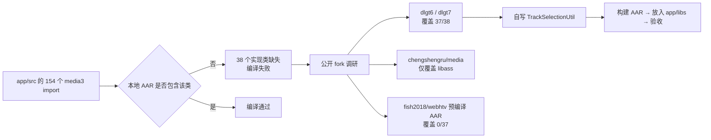
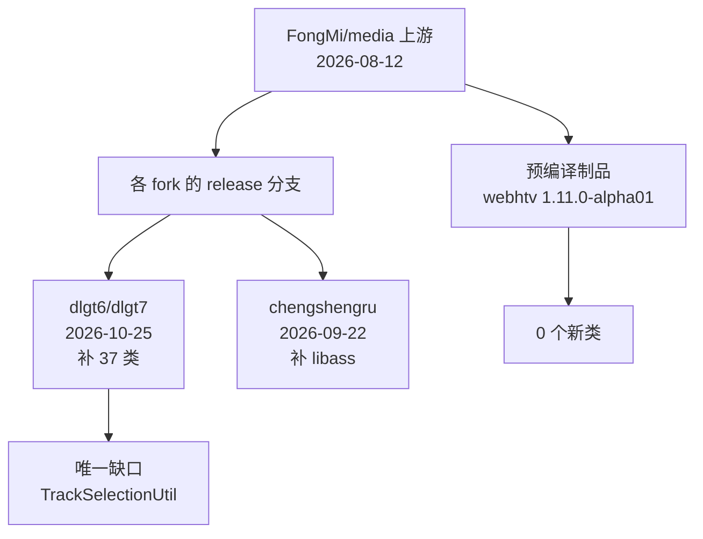
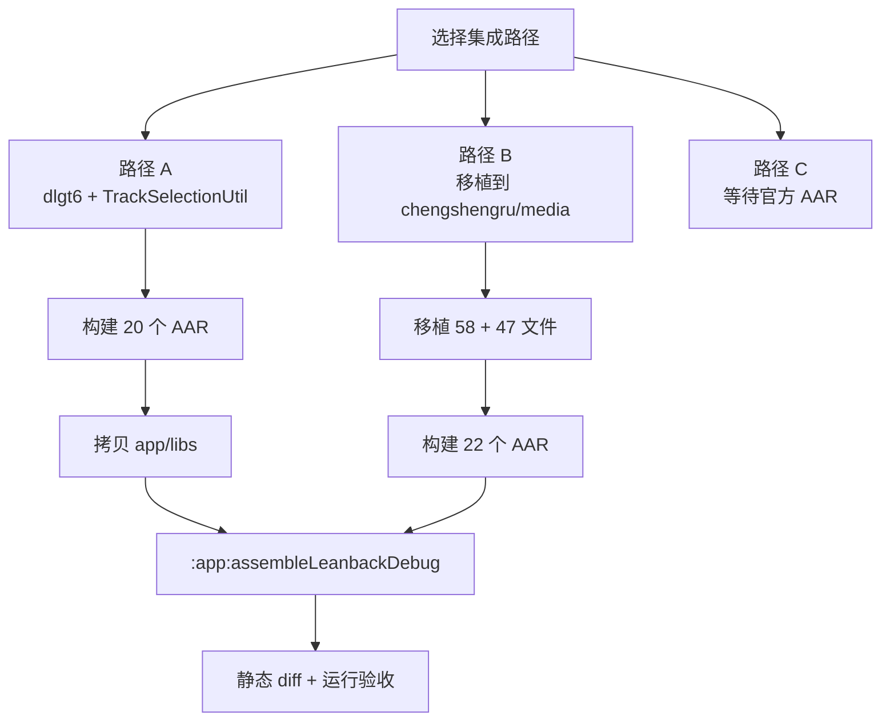
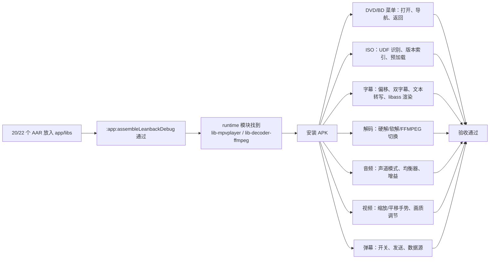

# media3 缺失类代码补全方案（全网 fork 调研）

> 文档版本：v1.0
> 编写日期：2026-10-31
> 作者：Shiro
> 仓库：`/workspace`（chengshengru/TV，当前分支 `trae/agent-Za3gKc`，`versionName 5.8.4` / `versionCode 584`）
> 文档类型：调研结论 + 代码补全方案设计
> 说明：本文档只做调研与方案设计，**未修改任何业务代码**；所有链接均为相对链接或公开来源地址。

## 1. 结论摘要

经过对 GitHub 上 `FongMi/media` 全部公开 fork、预编译制品、代码搜索引擎与上游 Issue 的排查，结论如下：

| 项目 | 结论 |
| --- | --- |
| 缺失规模 | 工程共 **154** 个 `androidx.media3.*` import，其中 **38 个实现类** 在公开源码/制品中缺失（另有 1 个生成类 `androidx.media3.ui.R`，无需补全） |
| 是否有人补全 | **有**。`dlgt6/media` 与 `dlgt7/media` 的 `release-1.11.0-fongmi` 分支已补齐 **37/38** 个缺失类，且对 `Player`、`ExoPlayerImpl`、`PlayerView`、`MpvPlayer`、`LibassSubtitleController` 等既有类做了配套扩展，与当前 `app/src` 调用签名一致 |
| 剩余缺口 | 仅 `androidx.media3.common.util.TrackSelectionUtil`（38 个中唯一无人实现的自定义工具类），需按调用点自行实现（约 150 行） |
| 推荐路径 | **路径 A**：以 `dlgt6/media` 为基线，补 1 个工具类，构建 20 个 AAR 放入 `app/libs`；若需保留自己的 22 个 AAR 拆分结构，走 **路径 B**：把 58 个新增 + 47 个修改文件移植到 `chengshengru/media` |
| 不推荐 | 从 APK 提取（R8 混淆、无 mapping、资源 ID 错位），结论见 [media3从APK提取方案.md](./media3从APK提取方案.md) |



## 2. 缺口复现方式

缺口来源于：`app/build.gradle` 通过 `fileTree(dir: "libs", include: ["*.aar"])` 引入定制 media3，而当前 [`app/libs`](../../app/libs) 只有 `hook-release.aar`、`tvbus-release.aar`，20 余个 `lib-*.aar` 全部缺失。

复现步骤如下（只读命令，不修改代码）：

```bash
# 1. 收集工程内全部 media3 import
cd /workspace
grep -rhoE 'import (static )?androidx\.media3\.[A-Za-z0-9_.*]+;' app/src runtime/src \
  | sed -E 's/import (static )?/import /' | sort -u > /tmp/m3_imports.txt

# 2. 与候选源码树做类名比对
#    （把 154 个 import 转成 a/b/C 形式，逐个查 src/main/java 下是否存在同名 .java）
```

比对结果见第 4 节覆盖矩阵；缺失调用集中分布在：

| 文件 | 关注点 |
| --- | --- |
| [ExoPlayerEngine.java](../../app/src/main/java/com/fongmi/android/tv/player/exo/ExoPlayerEngine.java#L42-L70) | 菜单控制器、字幕偏移、EndTrim/DefaultPosition 包装源 |
| [PlaybackActivity.java](../../app/src/main/java/com/fongmi/android/tv/ui/activity/PlaybackActivity.java#L122-L230) | `DiscMenuController` / `DiscMenuState`、弹幕控制器 |
| [PlayerManager.java](../../app/src/main/java/com/fongmi/android/tv/player/PlayerManager.java#L163-L168) | `getDiscMenuState()`、ISO 判定、字幕状态 |
| [ExoCommand.java](../../app/src/main/java/com/fongmi/android/tv/player/exo/ExoCommand.java#L100-L113) | `TrackSelectionUtil` 五个静态方法 |
| [ModuleViewModel.java](../../app/src/main/java/com/fongmi/android/tv/model/ModuleViewModel.java#L220) | `BdjRuntime.prepare/getStatus` |
| [AudioSetting.java](../../app/src/main/java/com/fongmi/android/tv/setting/AudioSetting.java#L30-L33) | `AudioChannelMode` 声道模式 |
| [TouchInput.java](../../app/src/mobile/java/com/fongmi/android/tv/ui/custom/TouchInput.java#L79-L88) | `VideoTransform` 手势缩放 |

## 3. 全网调研过程与结果

### 3.1 调研手段

1. **GitHub fork 列表**：`GET /repos/FongMi/media/forks`（按最近推送排序，取前 100 个）逐个比对 `pushed_at`。
2. **分支探测**：`git ls-remote --heads` 获取每个 fork 的真实分支与 HEAD。
3. **原始文件探测**：对每个候选 fork 直接请求 `raw.githubusercontent.com/<repo>/<branch>/libraries/common/src/main/java/androidx/media3/common/DiscMenuController.java`，命中 200 即说明已补全。
4. **稀疏克隆 + 全量类索引**：对命中的 fork 用 `--filter=blob:none --sparse` 只拉 `libraries/`，把 `src/main/java` 下类名全部建索引，与工程 154 个 import 做差集。
5. **预编译制品核对**：`fish2018/webhtv` 的 `third_party/maven/androidx/media3/*/1.11.0-alpha01-fongmi/` 共 17 个模块，逐个解包 `aar` 内的 `classes.jar`，索引 4534 个 class，再查目标类。
6. **代码搜索**：grep.app 对 `DiscMenuController`、`IsoNavigationPlayerController`、`MpvConfigFileInspector`、`LibassPlayerViewController`、`DanmakuPlayerViewController`、`MediaEdition` 等关键词检索。
7. **上游 Issue**：`FongMi/TV` Issue #729 等编译失败反馈，作者未给出实现。

### 3.2 调研结果

| 来源 | 分支/制品 | HEAD / 时间 | 对 38 个缺失类的覆盖 | 结论 |
| --- | --- | --- | --- | --- |
| `FongMi/media`（上游） | `release-1.11.0-fongmi` | `3c2cbe8` / 2026-08-12 | 0/38 | 上游公开源码停在 8 月，未包含 9 月 libass 与 10 月菜单/字幕改动 |
| `chengshengru/media`（自有） | `release-1.11.0-fongmi-libass` | `1324f59` / 2026-09-22 | 0/38 | 提供 libass 基础类与 22 个 AAR 拆分，但不含 10 月新增 API |
| **`dlgt6/media`** | `release-1.11.0-fongmi` | `01116ca` / 2026-10-25 | **37/38** | **唯一完整覆盖（含 CMG 解密伴随类）** |
| **`dlgt7/media`** | `release-1.11.0-fongmi` | `3382803` / 2026-10-25 | **37/38** | 与 dlgt6 近乎同源，可作镜像备选（构建前需清理 2 个跨模块重复类） |
| `fish2018/webhtv` | 预编译 Maven `1.11.0-alpha01-fongmi` | lock 提交 `e3e922d` / 2026-10-07 | 0/37 | 预编译 AAR 早于 10 月 API，全部缺失 |
| `lifengZero` / `thonsi` / `cy1798` / `yangxw8820` / `Shaqudabao` / `top355` 等近期 fork | `release`、`libs`、`cbcs` 等 | 2026-10-23 ～ 10-31 | 抽查 `DiscMenuController.java` 均 404 | 仅有常规同步，未上传补全实现 |
| grep.app | 全站代码搜索 | — | 仅命中 `FongMi/TV` 应用侧调用 | 无第三方 media3 实现；当前站点已加 Vercel 校验，API 访问受限 |



### 3.3 调研限制

- GitHub fork 列表只取最近 100 个；更早或私有 fork 不可见。
- `dlgt6/dlgt7` 的补全以 “Add files via upload” 形式提交（2026-10-25 多条），**没有对应的 CI、Release 或 AAR 制品**，需要本地自行构建。
- 两个仓库均 fork 自 `FongMi/media`，`LICENSE` 为 Apache-2.0；文件头基本保留 AOSP 版权声明。
- 上游对比接口当前返回异常，未能用 GitHub Compare API 精确给出“领先上游 N 个提交”；以分支 HEAD 与文件差集为准。

## 4. 候选 fork 覆盖矩阵

`dlgt6` 与 `dlgt7` 对 37 个类的方法签名完全一致（逐类 `public` 方法集合比对差异为 0），差异仅在 4 个 CMG 伴随类和 14 个既有文件实现细节：

| 对比项 | dlgt6 | dlgt7 |
| --- | --- | --- |
| 新增/补全类 | 37/38 | 37/38 |
| CMG 解密伴随类 | `CmgDataSource`、`CmgDecryptor`、`CmgSession` | 无 |
| 相对 `chengshengru/media` 的差异 | 58 新增 + 47 修改 | 54 新增 + 39 修改 |
| `SimpleBasePlayer` 菜单状态 | 已加入 `discMenuState` | 未加入（不影响本工程编译） |
| 建议用途 | **主选**（更新、含 CMG） | 备选/镜像 |

> 两个仓库的 20 个 AAR 清单（`move.txt`）完全一致，均不含独立的 `lib-exoplayer-libass` / `lib-ui-libass`，libass 类分别打包在 `exoplayer` 与 `ui` 模块内。
>
> 模块完整性差异：dlgt6 的 `libraries` 下无跨模块重复类；dlgt7 有 2 个重复类——`androidx/media3/exoplayer/hls/CmgConfiguration`（同时出现在 `exoplayer` 与 `exoplayer_hls`，两份内容不同）和 `androidx/media3/mpvplayer/MpvSubtitleContentLoader`（同时出现在 `mpvplayer` 与 `exoplayer`）。若直接构建 dlgt7 的 20 个 AAR，AGP 会报 `Duplicate class`，需删除多余副本（保留 `exoplayer_hls` 的 `CmgConfiguration` 与 `mpvplayer` 的 `MpvSubtitleContentLoader`）。

## 5. 逐组补全设计

### 5.1 菜单与 ISO（5 类）

| 类 | 关键 API（当前工程实际使用） | 工程调用点 | dlgt6 归属模块 |
| --- | --- | --- | --- |
| `DiscMenuController` | `open(String, Consumer<OpenResult>)`、`sendAction(String)`、`isActive()`、`isNavigationPlayback()`、`supportsPointer()` | [PlaybackActivity.java](../../app/src/main/java/com/fongmi/android/tv/ui/activity/PlaybackActivity.java#L122-L230) | `common` |
| `DiscMenuState` | 常量 `EMPTY`、`AVAILABILITY_*`、`PHASE_*`；字段 `availability`、`phase`、`navigationPlaybackOngoing` | [PlayerManager.java](../../app/src/main/java/com/fongmi/android/tv/player/PlayerManager.java#L163-L168)、[PlaybackActivity.java](../../app/src/main/java/com/fongmi/android/tv/ui/activity/PlaybackActivity.java#L127-L150) | `common` |
| `IsoNavigationPlayerController` | `IsoNavigationPlayerController(ExoPlayer)`、`getPlayer()`、`getDiscMenuState()`、实现 `DiscMenuController` | [ExoPlayerEngine.java](../../app/src/main/java/com/fongmi/android/tv/player/exo/ExoPlayerEngine.java#L50-L70) | `exoplayer` |
| `IsoDiscPreparation` | `static boolean isIso(MediaItem)` | [ExoPlayerEngine.java](../../app/src/main/java/com/fongmi/android/tv/player/exo/ExoPlayerEngine.java#L203)、[PlayerManager.java](../../app/src/main/java/com/fongmi/android/tv/player/PlayerManager.java#L287) | `exoplayer` |
| `BdjRuntime` | `prepare(Context, CancellationSignal)`、`getStatus(Context).restartRequired` | [ModuleViewModel.java](../../app/src/main/java/com/fongmi/android/tv/model/ModuleViewModel.java#L220) | `exoplayer` |

伴随类（必须一起移植，否则上述类无法编译）：`DiscMenuHighlight`、`DiscMenuOverlay`、`IsoNavigationSession`。

`DiscMenuController.OpenResult` 的枚举值必须包含 `OPENED`、`UNAVAILABLE`、`TIMED_OUT`、`CANCELLED`、`RUNTIME_MISSING`，工程在 [PlaybackActivity.java](../../app/src/main/java/com/fongmi/android/tv/ui/activity/PlaybackActivity.java#L208-L212) 中对其中三个做了分支提示。

### 5.2 字幕核心（7 类）

| 类 | 关键 API | 工程调用点 | 归属模块 |
| --- | --- | --- | --- |
| `SubtitleContent` | `UNSUPPORTED`、`LOADING`、`State`、`Entry(startUs,endUs,text,image)` | [ExoPlayerEngine.java](../../app/src/main/java/com/fongmi/android/tv/player/exo/ExoPlayerEngine.java#L313-L320)、[PlaybackContentPanel.java](../../app/src/main/java/com/fongmi/android/tv/ui/dialog/PlaybackContentPanel.java#L244-L245) | `common` |
| `SubtitleOffsets` | `ZERO`、`primaryMs`、`secondaryMs`、构造器 | [SubtitleOffsetPanel.java](../../app/src/main/java/com/fongmi/android/tv/ui/dialog/SubtitleOffsetPanel.java#L63-L117) | `common` |
| `SubtitleSelectionState` | `EMPTY`、`isPrimary()`、`isActiveSecondary()`、`activeSecondarySelection` | [TrackDialog.java](../../app/src/main/java/com/fongmi/android/tv/ui/dialog/TrackDialog.java#L191) | `common` |
| `SubtitleTranscript` | 字幕文本转写数据载体 | [ExoMediaSourceFactory.java](../../app/src/main/java/com/fongmi/android/tv/player/exo/ExoMediaSourceFactory.java#L150) | `exoplayer` |
| `SubtitleTranscriptParserFactory` | `SubtitleTranscriptParserFactory(SubtitleTranscript)` | [ExoMediaSourceFactory.java](../../app/src/main/java/com/fongmi/android/tv/player/exo/ExoMediaSourceFactory.java#L158) | `exoplayer` |
| `SubtitleTranscriptSession` | `getContent(Format, long)`、`setContentEnabled`、`canRetryContent`、`retryContent`、`forMediaItem` | [ExoPlayerEngine.java](../../app/src/main/java/com/fongmi/android/tv/player/exo/ExoPlayerEngine.java#L319-L355) | `exoplayer` |
| `DefaultSubtitleContentLoader` | `DefaultSubtitleContentLoader(DataSource.Factory).load(MediaItem, Uri, Format)` | [SubtitleFileContent.java](../../app/src/main/java/com/fongmi/android/tv/player/subtitle/SubtitleFileContent.java#L23-L32) | `exoplayer` |

伴随类：`SubtitleContentLoader`、`SecondaryTextOutput`、`TextRenderer`、`TextOutput`、`CuesResolver`、`MergingCuesResolver`、`ReplacingCuesResolver`、`DelegatingSubtitleDecoder`，均在 dlgt6 的 `exoplayer/text` 包内。

配套的既有类改动：

- `Player` 接口新增默认方法：`getSubtitleOffsets()`、`setSubtitleOffsets()`、`getSubtitleSelectionState()`、`getSubtitleContentForSelection()`、`setSubtitleContentEnabled()`、`canRetrySubtitleContent()`、`retrySubtitleContent()`、`getDiscMenuState()`。
- `ExoPlayerImpl` 实现上述方法，并在 `currentTracks` 变化时同步字幕转写会话。

### 5.3 解码器（3 类）

| 类 | 关键 API | 工程调用点 | 归属模块 |
| --- | --- | --- | --- |
| `androidx.media3.common.DecoderMode` | 枚举 `AUTO`、`HARDWARE`、`SOFTWARE`、`FFMPEG`；`fromCommonDecoderMode()` | [DecodeSetting.java](../../app/src/main/java/com/fongmi/android/tv/setting/DecodeSetting.java#L12-L37) | `common` |
| `androidx.media3.exoplayer.DecoderMode` | 与 common 版一一对应，供 RenderersFactory 使用 | [ExoPlayerSession.java](../../app/src/main/java/com/fongmi/android/tv/player/exo/ExoPlayerSession.java#L44-L58) | `exoplayer` |
| `DecoderManager` | `DecoderManager(DecoderMode audio, DecoderMode video)`，为 RenderersFactory/Selector 提供编解码策略 | [ExoUtil.java](../../app/src/main/java/com/fongmi/android/tv/player/exo/ExoUtil.java#L74-L106) | `exoplayer` |

配套类：`DecoderFallback`、`DefaultDecoderFactory` 改动、`MediaCodecSelector` 改动，均在 dlgt6 中已包含。

### 5.4 音频（5 类）

| 类 | 关键 API | 工程调用点 | 归属模块 |
| --- | --- | --- | --- |
| `AudioChannelMode` | `AUTO/STEREO/MONO/REVERSE`、`clamp()`、`resolve()`、`isAvailable()`、`canBalance()`、`isAuto()` | [AudioSetting.java](../../app/src/main/java/com/fongmi/android/tv/setting/AudioSetting.java#L30-L33) | `common` |
| `AudioChannelMix` | `createFrontCenterGainMix()`、`createStereoMix()`、`createMonoMix()`、`createFrontBalanceMix()`、`compose()` | [MpvAudioEffectFilter.java](../../app/src/main/java/com/fongmi/android/tv/player/effect/audio/MpvAudioEffectFilter.java#L31-L84) | `common` |
| `AudioEffectParameters` | `DEFAULT`、`Builder`、`hasEffect()`、`hasBands()`、`isCenterGainAvailable()` | [AudioEffectConfig.java](../../app/src/main/java/com/fongmi/android/tv/player/effect/audio/AudioEffectConfig.java#L12-L30) | `common` |
| `AudioEffectProcessor` | 无参构造、`setParameters(AudioEffectParameters, boolean)`、`resetParameters()` | [ExoAudioEffectController.java](../../app/src/main/java/com/fongmi/android/tv/player/effect/audio/ExoAudioEffectController.java#L14-L49) | `common` |
| `AudioEqualizerController` | `AudioEqualizerController(Context)`、`apply(ExoPlayer, AudioEffectParameters)`、`release()` | [ExoAudioEffectController.java](../../app/src/main/java/com/fongmi/android/tv/player/effect/audio/ExoAudioEffectController.java#L18-L47) | `exoplayer` |

### 5.5 视频效果（4 类）

| 类 | 关键 API | 工程调用点 | 归属模块 |
| --- | --- | --- | --- |
| `VideoTransform` | `DEFAULT`、`MAX_SCALE`、`scaleX/scaleY/panX/panY` | [TouchInput.java](../../app/src/mobile/java/com/fongmi/android/tv/ui/custom/TouchInput.java#L79-L88)、[ExoCommand.java](../../app/src/main/java/com/fongmi/android/tv/player/exo/ExoCommand.java#L43-L46) | `common` |
| `VideoAdjustment` | `Builder.setSaturation/setContrast/...` | [VideoEffectProfile.java](../../app/src/main/java/com/fongmi/android/tv/player/effect/video/VideoEffectProfile.java#L107-L108) | `effect` |
| `ColorToneAdjustEffect` | 无参构造，供 `ExoVideoEffectController` 组合效果 | [ExoVideoEffectController.java](../../app/src/main/java/com/fongmi/android/tv/player/effect/video/ExoVideoEffectController.java#L14-L30) | `effect` |
| `DetailAdjustEffect` | 无参构造，同上 | [ExoVideoEffectController.java](../../app/src/main/java/com/fongmi/android/tv/player/effect/video/ExoVideoEffectController.java#L15-L21) | `effect` |

`PlayerView` 需要同步新增 `getVideoTransform()`、`setVideoTransform()`、`animateVideoTransform(VideoTransform, int)`，并新增 `getVideoSurfaceView()` 的公开访问；这些属于既有类改动，不是新类。

### 5.6 播放源包装（3 类）

| 类 | 关键 API | 工程调用点 | 归属模块 |
| --- | --- | --- | --- |
| `EndTrimMediaSource` | `EndTrimMediaSource(MediaSource, long endingMs)` | [ExoPlayerEngine.java](../../app/src/main/java/com/fongmi/android/tv/player/exo/ExoPlayerEngine.java#L203-L245) | `exoplayer` |
| `DefaultPositionMediaSource` | `DefaultPositionMediaSource(MediaSource, long startPositionMs)` | [ExoPlayerEngine.java](../../app/src/main/java/com/fongmi/android/tv/player/exo/ExoPlayerEngine.java#L245) | `exoplayer` |
| `ContentTypeResolvingMediaSource` | 内部 `Factory(MediaSource.Factory, DataSource.Factory)` | [ExoMediaSourceFactory.java](../../app/src/main/java/com/fongmi/android/tv/player/exo/ExoMediaSourceFactory.java#L161) | `exoplayer` |

### 5.7 数据源、DRM 与 CMG（4 类）

| 类 | 关键 API | 工程调用点 | 归属模块 |
| --- | --- | --- | --- |
| `IsoUri` | `withEditionIndex(Uri, int)` | [MediaItemFactory.java](../../app/src/main/java/com/fongmi/android/tv/player/media/MediaItemFactory.java#L62) | `datasource` |
| `ProgressiveIsoCache` | `withDiskCache(DataSource.Factory, Cache)` | [MpvUtil.java](../../app/src/main/java/com/fongmi/android/tv/player/mpv/MpvUtil.java#L128)、[ExoMediaSourceFactory.java](../../app/src/main/java/com/fongmi/android/tv/player/exo/ExoMediaSourceFactory.java#L97) | `datasource` |
| `LocalClearKeyLicense` | `parse(String)`、`parse(MediaItem.DrmConfiguration)` | [MediaItemFactory.java](../../app/src/main/java/com/fongmi/android/tv/player/media/MediaItemFactory.java#L119)、[ExoMediaSourceFactory.java](../../app/src/main/java/com/fongmi/android/tv/player/exo/ExoMediaSourceFactory.java#L152) | `common` |
| `CmgConfiguration` | `fromMediaUri(Uri)` | [PlayerEngineFactory.java](../../app/src/main/java/com/fongmi/android/tv/player/engine/PlayerEngineFactory.java#L55) | `exoplayer_hls` |

CMG 仅 dlgt6 带有完整伴随实现：`CmgDataSource`、`CmgDecryptor`、`CmgSession`（位于 `libraries/exoplayer_hls`，对应 AAR 为 `lib-exoplayer-hls-release.aar`），以及 `extractor/iso/udf/NativeUdfFileSystem`、`extractor/DefaultExtractorsFactory` 改动。若选 dlgt7，则该分支只保证 `CmgConfiguration` 类存在，CMG 解密链路功能不完整。

### 5.8 MPV（4 类）

| 类 | 关键 API | 工程调用点 | 归属模块 |
| --- | --- | --- | --- |
| `MpvConfigFileInspector` | `MpvConfigFileInspector(File)`、`readSubtitleFontsDirectory()`、`getEffectiveOptionNames(CharSequence)` | [MpvConfigFile.java](../../app/src/main/java/com/fongmi/android/tv/player/mpv/MpvConfigFile.java#L39-L52) | `mpvplayer` |
| `MpvDecoderMode` | `fromCommonDecoderMode(DecoderMode)` | [MpvUtil.java](../../app/src/main/java/com/fongmi/android/tv/player/mpv/MpvUtil.java#L97) | `mpvplayer` |
| `MpvSubtitleContentLoader` | 继承 `SubtitleContentLoader`，工程侧以 `implements` 方式实现 | [SubtitleFileContent.java](../../app/src/main/java/com/fongmi/android/tv/player/subtitle/SubtitleFileContent.java#L23) | `mpvplayer` |
| `MpvDrmSupport` | `static boolean supports(MediaItem)` | [PlayerEngineFactory.java](../../app/src/main/java/com/fongmi/android/tv/player/engine/PlayerEngineFactory.java#L51) | `mpvplayer` |

配套既有类改动：`MpvPlayer` 新增 `getSubtitleContentForSelection`、`setSubtitleOffsets`、`setVideoDecoderMode`、`getDiscMenuState`；`MpvCommandDispatcher`、`MpvConstants`、`MpvEventAdapter` 等 JNI 桥接同步更新。

### 5.9 libass（1 类）

| 类 | 关键 API | 工程调用点 | 归属模块 |
| --- | --- | --- | --- |
| `LibassFontConfig` | `write(File output, File cacheDir, List<File> fontDirs)` | [AndroidFontConfig.java](../../app/src/main/java/com/fongmi/android/tv/player/subtitle/AndroidFontConfig.java#L22) | `exoplayer`（dlgt6）/ `exoplayer_libass`（自有 fork） |

libass 不是“只补 1 个类”那么简单：`LibassSubtitleController` 必须提供 `getSubtitleSelectionState()`、`setSecondaryTextTrackSelectionOverride()`、`setSecondaryTextTrackAutoSelectionEnabled()`；`LibassPlaybackSession` 必须提供 `setBottomPositionFraction`、`setSecondaryBottomPositionFraction`、`setFontScale`、`setStyleOverride`、`createClockRenderer` 等，供 [ExoSubtitleController.java](../../app/src/main/java/com/fongmi/android/tv/player/exo/ExoSubtitleController.java#L21-L64) 与 [ExoPlayerSession.java](../../app/src/main/java/com/fongmi/android/tv/player/exo/ExoPlayerSession.java#L63-L72) 使用。`ui/libass/LibassPlayerViewController` 的三参构造与 `bind/setStyleOverride/setSecondarySubtitleViewConfigurator/close` 也必须一致。

`chengshengru/media` 的 libass 拆分模块（`exoplayer_libass`/`ui_libass`）与 dlgt6 的合并实现**不是同一份代码**：自有 fork 额外有 `AssExtractorsFactory`、`AssFontSet` 等 10 个 Ass 字体子集类，dlgt6 则使用 `LibassMediaSession`、`LibassGlRenderer` 等 19 个文件。移植时不可整目录覆盖，需按 API 契约合并。

### 5.10 弹幕（1 类）

| 类 | 关键 API | 工程调用点 | 归属模块 |
| --- | --- | --- | --- |
| `DanmakuPlayerViewController` | 无参构造、`bind(PlayerView)`、`getItems()`、`post(Danmaku)`、`sendNow(String)`、`setOkHttpClient(OkHttpClient)`、`setEnabled(boolean)`、`setConfig(DanmakuConfig)`、`setDataSource(String)`、`setDataSource(Uri)`、`close()` | [PlaybackActivity.java](../../app/src/main/java/com/fongmi/android/tv/ui/activity/PlaybackActivity.java#L77-L78)、[PlaybackActivity.java](../../app/src/main/java/com/fongmi/android/tv/ui/activity/PlaybackActivity.java#L828-L856) | `ui`（dlgt6）/ `ui_danmaku`（自有 fork） |

### 5.11 轨道工具（1 类，需自写）

`TrackSelectionUtil` 是唯一没有公开实现（dlgt6、dlgt7、chengshengru 均无）的类，详见第 6 节。

## 6. `TrackSelectionUtil` 自写方案

### 6.1 调用点与必需签名

[ExoCommand.java](../../app/src/main/java/com/fongmi/android/tv/player/exo/ExoCommand.java#L100-L113) 中固定使用以下 5 个静态方法：

```java
TrackSelectionUtil.cycleTrack(Player player, int trackType, boolean forward, boolean flag);
TrackSelectionUtil.cycleTrack(Player player, int trackType, List<String> trackIds, boolean forward, boolean flag);
TrackSelectionUtil.setTrackTypeDisabled(Player player, int trackType, boolean disabled);
TrackSelectionUtil.resetTrackSelection(Player player, int trackType);
TrackSelectionUtil.selectTrack(Player player, int trackType, String trackId);
```

对应 `mpv` 语义：`cycle audio`、`cycle-values audio <id...>`、`set audio no|auto|<id>`。返回 `boolean` 表示“是否成功应用”，调用方据此返回 `APPLIED` 或 `UNAVAILABLE`。

> 注意：第 4 个 `boolean` 参数在应用侧只以 `true` / `false` 字面量传入，无法从调用点反推其确切语义。建议实现为 `includeDisabled`（是否允许循环到“关闭轨道”状态），并在验收阶段以实际按键行为确认。
>
> 另注意：候选 fork 内已存在 `androidx.media3.exoplayer.trackselection.TrackSelectionUtil`，那是 AOSP 原有的内部工具类（`@UnstableApi`，用于 `ExoTrackSelection`），与本工程 `import` 的 `androidx.media3.common.util.TrackSelectionUtil` **不是同一个类**，无法替代。

### 6.2 实现骨架（建议放入 `common` 模块）

建议路径（路径 A）：`libraries/common/src/main/java/androidx/media3/common/util/TrackSelectionUtil.java`。该类只依赖 `Player`、`Tracks`、`TrackSelectionParameters`、`TrackSelectionOverride`，不依赖 `exoplayer`，因此不会引入反向依赖。

```java
/*
 * Copyright (C) 2026 The Android Open Source Project
 *
 * Licensed under the Apache License, Version 2.0 (the "License");
 * you may not use this file except in compliance with the License.
 * You may obtain a copy of the License at
 *
 *      http://www.apache.org/licenses/LICENSE-2.0
 *
 * Unless required by applicable law or agreed to in writing, software
 * distributed under the License is distributed on an "AS IS" BASIS,
 * WITHOUT WARRANTIES OR CONDITIONS OF ANY KIND, either express or implied.
 * See the License for the specific language governing permissions and
 * limitations under the License.
 */
package androidx.media3.common.util;

import androidx.annotation.Nullable;
import androidx.media3.common.C;
import androidx.media3.common.Format;
import androidx.media3.common.Player;
import androidx.media3.common.TrackSelectionOverride;
import androidx.media3.common.TrackSelectionParameters;
import androidx.media3.common.Tracks;
import java.util.ArrayList;
import java.util.List;

/**
 * 轨道选择工具类。
 *
 * <p>提供按轨道 id 选中、按顺序循环、禁用整类轨道与恢复自动选择等能力，
 * 供播放命令层按 mpv 风格的 {@code audio} / {@code sub} 指令调用。
 *
 * @author Shiro
 */
@UnstableApi
public final class TrackSelectionUtil {

  private TrackSelectionUtil() {}

  /**
   * 选中指定轨道 id 的单条轨道。
   *
   * @param player 目标播放器
   * @param trackType 轨道类型，取值见 {@link C} 的 {@code TRACK_TYPE_*} 常量
   * @param trackId 轨道 id，对应 {@link Format#id}
   * @return 找到并应用返回 {@code true}，否则返回 {@code false}
   */
  public static boolean selectTrack(Player player, int trackType, String trackId) {
    for (TrackSelectionOverride override : collectOverrides(player, trackType, null)) {
      Format format = override.mediaTrackGroup.getFormat(override.trackIndices.get(0));
      if (trackId.equals(format.id)) {
        applyOverride(player, override);
        return true;
      }
    }
    return false;
  }

  /**
   * 按当前可用轨道顺序循环切换。
   *
   * @param player 目标播放器
   * @param trackType 轨道类型
   * @param forward {@code true} 表示向后循环，{@code false} 表示向前
   * @param includeOff 是否把“关闭该类型轨道”的占位项纳入循环
   * @return 成功切换返回 {@code true}
   */
  public static boolean cycleTrack(Player player, int trackType, boolean forward, boolean includeOff) {
    return cycle(player, trackType, collectOverrides(player, trackType, null), forward, includeOff);
  }

  /**
   * 仅在给定轨道 id 集合内循环切换。
   *
   * @param player 目标播放器
   * @param trackType 轨道类型
   * @param trackIds 参与循环的轨道 id 列表，顺序即循环顺序
   * @param forward {@code true} 表示向后循环
   * @param includeOff 是否把“关闭”占位项纳入循环
   * @return 成功切换返回 {@code true}
   */
  public static boolean cycleTrack(
      Player player, int trackType, List<String> trackIds, boolean forward, boolean includeOff) {
    return cycle(player, trackType, collectOverrides(player, trackType, trackIds), forward, includeOff);
  }

  /**
   * 启用或禁用某一类轨道。
   *
   * @param player 目标播放器
   * @param trackType 轨道类型
   * @param disabled {@code true} 表示禁用该类轨道
   * @return 参数已提交返回 {@code true}
   */
  public static boolean setTrackTypeDisabled(Player player, int trackType, boolean disabled) {
    TrackSelectionParameters parameters =
        player.getTrackSelectionParameters().buildUpon()
            .setTrackTypeDisabled(trackType, disabled)
            .build();
    player.setTrackSelectionParameters(parameters);
    return true;
  }

  /**
   * 清除某一类轨道的覆盖并恢复自动选择。
   *
   * @param player 目标播放器
   * @param trackType 轨道类型
   * @return 参数已提交返回 {@code true}
   */
  public static boolean resetTrackSelection(Player player, int trackType) {
    TrackSelectionParameters parameters =
        player.getTrackSelectionParameters().buildUpon()
            .setTrackTypeDisabled(trackType, false)
            .clearOverridesOfType(trackType)
            .build();
    player.setTrackSelectionParameters(parameters);
    return true;
  }

  /** 收集指定类型、可选 id 过滤后的轨道覆盖项，顺序与 {@link Tracks} 一致。 */
  private static List<TrackSelectionOverride> collectOverrides(
      Player player, int trackType, @Nullable List<String> trackIds) {
    List<TrackSelectionOverride> overrides = new ArrayList<>();
    for (Tracks.Group group : player.getCurrentTracks().getGroups()) {
      if (group.getType() != trackType) continue;
      for (int index = 0; index < group.length(); index++) {
        if (!group.isTrackSupported(index)) continue;
        Format format = group.getTrackFormat(index);
        if (trackIds != null && (format.id == null || !trackIds.contains(format.id))) continue;
        overrides.add(new TrackSelectionOverride(group.getMediaTrackGroup(), index));
      }
    }
    return overrides;
  }

  /**
   * 计算当前选中项的下一个目标并应用。
   *
   * <p>未选中任何轨道时，向后循环取第一项；已选中时按 {@code forward} 取相邻项，
   * 到边界后回绕。{@code includeOff} 为 {@code true} 时，回绕点先切换到“关闭”。
   */
  private static boolean cycle(
      Player player,
      int trackType,
      List<TrackSelectionOverride> candidates,
      boolean forward,
      boolean includeOff) {
    if (candidates.isEmpty()) return setTrackTypeDisabled(player, trackType, !includeOff);
    int current = indexOfSelected(player, candidates);
    if (current == C.INDEX_UNSET) {
      applyOverride(player, candidates.get(0));
      return true;
    }
    int next = forward ? current + 1 : current - 1;
    if (next < 0 || next >= candidates.size()) {
      if (!includeOff) {
        next = forward ? 0 : candidates.size() - 1;
        applyOverride(player, candidates.get(next));
      } else {
        resetTrackSelection(player, trackType);
      }
      return true;
    }
    applyOverride(player, candidates.get(next));
    return true;
  }

  /** 返回当前选中候选的下标，未选中返回 {@link C#INDEX_UNSET}。 */
  private static int indexOfSelected(Player player, List<TrackSelectionOverride> candidates) {
    Tracks tracks = player.getCurrentTracks();
    for (int i = 0; i < candidates.size(); i++) {
      TrackSelectionOverride override = candidates.get(i);
      for (Tracks.Group group : tracks.getGroups()) {
        if (!group.getMediaTrackGroup().equals(override.mediaTrackGroup)) continue;
        if (group.isTrackSelected(override.trackIndices.get(0))) return i;
      }
    }
    return C.INDEX_UNSET;
  }

  /** 以“仅保留目标类型覆盖”的方式应用一条轨道覆盖。 */
  private static void applyOverride(Player player, TrackSelectionOverride override) {
    TrackSelectionParameters parameters =
        player.getTrackSelectionParameters().buildUpon()
            .setOverrideForType(override)
            .build();
    player.setTrackSelectionParameters(parameters);
  }
}
```

> 骨架中的 API 已按 dlgt6 源码核对：`Format.id` 可为 `null`、`Tracks.Group.isTrackSupported(int)`、`Tracks.Group.isTrackSelected(int)`、`TrackSelectionParameters.Builder.setOverrideForType/TrackTypeDisabled/clearOverridesOfType`。文档不改变工程代码，实际落盘时需在 fork 内编译验证。

### 6.3 单元测试建议

新增 `libraries/common/src/test/java/androidx/media3/common/util/TrackSelectionUtilTest.java`，使用 `SimpleBasePlayer` 的子类构造固定 `Tracks`，覆盖：

1. 单条选中、循环顺序、反向循环；
2. `cycle-values` 只包含指定 id；
3. `no` / `auto` 的禁用与恢复；
4. 空轨道返回 `false` 或保持禁用状态。

## 7. 集成路径对比

| 维度 | 路径 A：dlgt6 直接构建 AAR | 路径 B：移植到自有 fork | 路径 C：等待官方 AAR |
| --- | --- | --- | --- |
| 新增类覆盖 | 37/38，另需自写 1 类 | 58 新文件 + 47 修改文件（相对 `chengshengru/media`） | 取决于作者后续发布，当前 0 |
| 改动量 | 1 个新文件 + 构建脚本 | 约 105 个文件的移植与冲突处理 | 0 |
| 模块结构 | 20 个 AAR（libass 合并在 exoplayer/ui） | 保留 22 个 AAR（`lib-exoplayer-libass`/`lib-ui-libass`） | 按官方结构 |
| libass 风险 | 需改用合并版 libass | 需人工合并 Ass* 与 LibassMediaSession 两套实现 | 低 |
| 供应链风险 | 中（第三方上传式提交，无 CI） | 低（自有仓库可审计、可回溯） | 低 |
| 适合场景 | 尽快恢复编译与验证功能 | 长期维护、需保持自有模块拆分 | 不急于交付 |



### 7.1 路径 A 实施步骤

```bash
# 1. 获取候选源码（稀疏克隆，只拉 libraries 与构建脚本）
git clone --depth 1 --filter=blob:none --sparse \
  -b release-1.11.0-fongmi https://github.com/dlgt6/media media3-dlgt6
cd media3-dlgt6
git sparse-checkout set libraries build-logic build-logic-settings gradle

# 2. 新增 TrackSelectionUtil（按第 6.2 节落盘）
#    libraries/common/src/main/java/androidx/media3/common/util/TrackSelectionUtil.java

# 3. 按 move.txt 的 20 个目标模块构建 Release AAR
#    （Gradle 工程名取自 build-logic-settings 的 Media3Modules.kt：lib-<dir>，
#     产物在 libraries/<dir>/buildout/outputs/aar/lib-<dir>-release.aar）
./gradlew --no-daemon \
  :lib-common:assembleRelease :lib-container:assembleRelease :lib-database:assembleRelease \
  :lib-datasource:assembleRelease :lib-datasource-okhttp:assembleRelease :lib-datasource-rtmp:assembleRelease \
  :lib-decoder:assembleRelease :lib-decoder-ffmpeg:assembleRelease :lib-decoder-mpegh:assembleRelease \
  :lib-effect:assembleRelease \
  :lib-exoplayer:assembleRelease :lib-exoplayer-dash:assembleRelease :lib-exoplayer-hls:assembleRelease \
  :lib-exoplayer-rtsp:assembleRelease :lib-exoplayer-smoothstreaming:assembleRelease \
  :lib-extractor:assembleRelease :lib-mpvplayer:assembleRelease :lib-session:assembleRelease \
  :lib-ui:assembleRelease :lib-ui-danmaku:assembleRelease

# 4. 按 move.txt 收集产物并拷贝到工程
find libraries -name 'lib-*-release.aar' -path '*buildout/outputs/aar*' -exec ls -l {} \;
#    move.txt 共 20 项；其中 lib-mpvplayer-release.aar 与 lib-decoder-ffmpeg-release.aar
#    同时被 runtime/build.gradle 显式引用，必须存在

# 5. 回到工程编译（工程按设备维度分 leanback / mobile 两个 flavor）
cd /workspace
./gradlew --no-daemon :app:assembleLeanbackDebug
#    或 :app:assembleMobileDebug
```

注意事项：

- 候选 fork 使用 `compileSdk 36`、AGP 9.0.1，工程使用 `compileSdk 37`、AGP 9.4.0；AAR 可被更高 `compileSdk` 的工程消费，但建议在构建日志中确认 `minCompileSdk` 检查通过。
- 构建机需要 Java 21（与工程一致）与 Android SDK 36。
- 上列命令只构建 `move.txt` 中的 20 个模块；若改为全量 `assembleRelease` 会额外产出约 29 个模块（共 49 个），仍只需拷贝 `move.txt` 的 20 个，避免同名类重复打包。
- 构建前必须确认 `libraries/common` 中的 `TrackSelectionUtil` 与 `Player` 接口同版本；若 `Player` 已提供同名工具方法，应优先复用。

### 7.2 路径 B 实施步骤

1. 以 `chengshengru/media` 的 `release-1.11.0-fongmi-libass` 为基线（保留 22 个 AAR 拆分）。
2. 用 `diff` 生成移植清单：58 个新增文件、47 个修改文件（以 dlgt6 为对照）。
3. 优先移植 `common`（12 个待移植类，另按第 6 节自写 `TrackSelectionUtil`）、`datasource`（2 类）、`effect`（3 类）、`mpvplayer`（4 类），这些与 libass 无耦合。
4. 移植 `exoplayer` 的 13 类及其伴随类（ISO、字幕转写、MediaSource 包装、DecoderManager、AudioEqualizerController），以及 `exoplayer_hls` 的 `CmgConfiguration` 与 CMG 解密伴随类。
5. `LibassFontConfig` 放入 `exoplayer_libass`；`DanmakuPlayerViewController` 放入 `ui_danmaku`；不覆盖自有的 `Ass*` 字体子集实现，按第 5.9 节契约补齐方法。
6. 最后移植 `ui` 的 `PlayerView` 与 `libass/LibassPlayerViewController` 改动，编译验证。

## 8. 验收标准

### 8.1 静态验收

```bash
# 期望输出仅剩 androidx.media3.ui.R（资源生成类）
python3 - <<'EOF'
import os
imports = [l.strip().replace('import ','').rstrip(';')
           for l in open('/tmp/m3_imports.txt') if l.strip()]
root = '/workspace/app/libs'   # 改为构建产物解包后的 classes 目录亦可
# 与 AAR classes.jar 的类索引做差集，逻辑同第 2 节
EOF
```

### 8.2 编译与运行验收



功能检查清单：

| 模块 | 检查点 | 失败定位 |
| --- | --- | --- |
| 光盘菜单 | DVD 菜单可打开/关闭、方向键导航、`OpenResult` 提示正确 | `IsoNavigationPlayerController`、`BdjRuntime` |
| ISO 播放 | ISO 被识别、版本切换、结束位置裁剪、下一集预加载 | `IsoDiscPreparation`、`EndTrim/DefaultPositionMediaSource` |
| 字幕 | 主/副字幕偏移独立生效、文本转写状态机、libass 字体缓存 | `SubtitleOffsets`、`SubtitleTranscriptSession`、`LibassFontConfig` |
| 解码 | 三种 `DecoderMode` 切换后解码器重建 | `DecoderManager`、`DecoderMode` |
| 音频 | `AUTO/STEREO/MONO/REVERSE`、平衡、均衡器 | `AudioChannelMode/Mix`、`AudioEffectProcessor` |
| 视频 | 双指缩放、平移、画质参数 | `VideoTransform`、`VideoAdjustment` 系列 |
| 弹幕 | 开关、即时发送、OkHttp 数据源 | `DanmakuPlayerViewController` |
| 依赖 | `app/libs` 20/22 个 AAR 与 `move.txt` 一致 | Gradle 依赖树 |

## 9. 风险与合规

1. **第三方代码可信度**：两个候选仓库均为上传式提交，无 CI、无 Release、无 AAR；合入前应逐文件审计（重点 `BdjRuntime`、`IsoNavigationSession`、`CmgDecryptor`、JNI 桥接），并锁定 commit hash。
2. **API 漂移**：上游 8 月后仍在演进；候选 fork 的 `Player`/`ExoPlayerImpl` 接口可能与后续 TV 代码不一致，需以本工程调用点为契约做编译验证。
3. **libass 两套实现冲突**：路径 B 必须按契约合并，禁止整目录覆盖；`Ass*` 字体子集与 `LibassMediaSession` 渲染链路的选择需以实际字幕表现为准。
4. **JNI/so 版本绑定**：`libmedia3ass.so`、`libmedia3effect.so`、`libffmpeg.so`、`libmpv.so` 与 Java 层类版本强相关；升级 AAR 时需同步核对 [app/libs](../../app/libs) 与 runtime 产物来源。
5. **R8/混淆**：历史上 `app/proguard-rules-media.pro` 被删除，现有 [proguard-rules.pro](../../app/proguard-rules.pro) 没有 `androidx.media3.**` 的全局 keep。若 release 包出现 `ClassNotFoundException`，需为 `LibassNative`、`MPVLib`、`BdjRuntime`、`IsoNavigationSession` 等 JNI 类补充 keep 规则（属于后续独立改动，不在本文档范围）。
6. **许可证**：候选仓库为 Apache-2.0，文件头保留 AOSP 声明；若移植到自有仓库，需保留版权与 NOTICE。
7. **APK 提取不可行性**：见 [media3从APK提取方案.md](./media3从APK提取方案.md)——R8 混淆、无 `mapping.txt`、资源 ID 错位，只能提取 `.so` 与少量完整 keep 的 JNI 类，不能作为编译依赖。

## 10. 附录

### 10.1 38 个缺失类覆盖矩阵

图例：✓ 表示候选源码树中存在该类；✗ 表示缺失。

| # | 类 | dlgt6 | dlgt7 | chengshengru | webhtv AAR |
| --- | --- | --- | --- | --- | --- |
| 1 | `common.DecoderMode` | ✓ | ✓ | ✗ | ✗ |
| 2 | `common.DiscMenuController` | ✓ | ✓ | ✗ | ✗ |
| 3 | `common.DiscMenuState` | ✓ | ✓ | ✗ | ✗ |
| 4 | `common.VideoTransform` | ✓ | ✓ | ✗ | ✗ |
| 5 | `common.audio.AudioChannelMix` | ✓ | ✓ | ✗ | ✗ |
| 6 | `common.audio.AudioChannelMode` | ✓ | ✓ | ✗ | ✗ |
| 7 | `common.audio.AudioEffectParameters` | ✓ | ✓ | ✗ | ✗ |
| 8 | `common.audio.AudioEffectProcessor` | ✓ | ✓ | ✗ | ✗ |
| 9 | `common.text.SubtitleContent` | ✓ | ✓ | ✗ | ✗ |
| 10 | `common.text.SubtitleOffsets` | ✓ | ✓ | ✗ | ✗ |
| 11 | `common.text.SubtitleSelectionState` | ✓ | ✓ | ✗ | ✗ |
| 12 | `common.util.LocalClearKeyLicense` | ✓ | ✓ | ✗ | ✗ |
| 13 | `common.util.TrackSelectionUtil` | ✗ | ✗ | ✗ | ✗ |
| 14 | `datasource.IsoUri` | ✓ | ✓ | ✗ | ✗ |
| 15 | `datasource.ProgressiveIsoCache` | ✓ | ✓ | ✗ | ✗ |
| 16 | `effect.ColorToneAdjustEffect` | ✓ | ✓ | ✗ | ✗ |
| 17 | `effect.DetailAdjustEffect` | ✓ | ✓ | ✗ | ✗ |
| 18 | `effect.VideoAdjustment` | ✓ | ✓ | ✗ | ✗ |
| 19 | `exoplayer.DecoderManager` | ✓ | ✓ | ✗ | ✗ |
| 20 | `exoplayer.DecoderMode` | ✓ | ✓ | ✗ | ✗ |
| 21 | `exoplayer.audio.AudioEqualizerController` | ✓ | ✓ | ✗ | ✗ |
| 22 | `exoplayer.hls.CmgConfiguration` | ✓ | ✓ | ✗ | ✗ |
| 23 | `exoplayer.iso.BdjRuntime` | ✓ | ✓ | ✗ | ✗ |
| 24 | `exoplayer.iso.IsoDiscPreparation` | ✓ | ✓ | ✗ | ✗ |
| 25 | `exoplayer.iso.IsoNavigationPlayerController` | ✓ | ✓ | ✗ | ✗ |
| 26 | `exoplayer.libass.LibassFontConfig` | ✓ | ✓ | ✗ | ✗ |
| 27 | `exoplayer.source.ContentTypeResolvingMediaSource` | ✓ | ✓ | ✗ | ✗ |
| 28 | `exoplayer.source.DefaultPositionMediaSource` | ✓ | ✓ | ✗ | ✗ |
| 29 | `exoplayer.source.EndTrimMediaSource` | ✓ | ✓ | ✗ | ✗ |
| 30 | `exoplayer.text.DefaultSubtitleContentLoader` | ✓ | ✓ | ✗ | ✗ |
| 31 | `exoplayer.text.SubtitleTranscript` | ✓ | ✓ | ✗ | ✗ |
| 32 | `exoplayer.text.SubtitleTranscriptParserFactory` | ✓ | ✓ | ✗ | ✗ |
| 33 | `exoplayer.text.SubtitleTranscriptSession` | ✓ | ✓ | ✗ | ✗ |
| 34 | `mpvplayer.MpvConfigFileInspector` | ✓ | ✓ | ✗ | ✗ |
| 35 | `mpvplayer.MpvDecoderMode` | ✓ | ✓ | ✗ | ✗ |
| 36 | `mpvplayer.MpvSubtitleContentLoader` | ✓ | ✓ | ✗ | ✗ |
| 37 | `mpvplayer.media.MpvDrmSupport` | ✓ | ✓ | ✗ | ✗ |
| 38 | `ui.danmaku.DanmakuPlayerViewController` | ✓ | ✓ | ✗ | ✗ |

说明：

- `chengshengru` 一列按“是否含该类文件”判定；其 libass 包内类名与 dlgt6 不同，不能逐类一一对应。
- `androidx.media3.ui.R` 为 `ui` 模块资源生成的 `R` 常量类，不需要源码补全。

### 10.2 关键验证结论

| 验证项 | 结果 |
| --- | --- |
| dlgt6 / dlgt7 对 37 个类的方法签名一致性 | 一致（`public` 方法集合差异 0） |
| `DiscMenuController` 枚举与工程分支 | 一致（含 `RUNTIME_MISSING`、`TIMED_OUT`） |
| `IsoNavigationPlayerController` 构造与 `getPlayer()` 返回类型 | 一致（`ExoPlayer` 入参、`Player` 返回） |
| `LibassSubtitleController` 四参构造与工程调用 | 一致（`Player`、`LibassPlaybackSession`、`Selector.Factory`、`SecondaryTextOutput`） |
| `LibassPlayerViewController` 三参构造与 `bind/setStyleOverride/setSecondarySubtitleViewConfigurator/close` | 一致 |
| `MpvPlayer.setVideoDecoderMode(MpvDecoderMode)` | 一致 |
| `MpvConfigFileInspector` 构造与两个查询方法 | 一致 |
| `DanmakuPlayerViewController` 全部调用方法 | 一致 |
| webhtv 预编译 AAR 类索引 | 4534 个 class，37 个目标类命中 0 |
| 跨模块重复类 | dlgt6：0；dlgt7：2（`CmgConfiguration`、`MpvSubtitleContentLoader`），构建 AAR 前需删除多余副本 |
| `common.util.TrackSelectionUtil` 是否已存在 | 三个 fork 均无；仅存在同名的 AOSP `exoplayer.trackselection.TrackSelectionUtil` |

### 10.3 调研命令速查

```bash
# fork 列表（按最近推送）
curl -s -H 'User-Agent: curl' \
  'https://api.github.com/repos/FongMi/media/forks?per_page=100&sort=newest'

# 分支探测
git ls-remote --heads https://github.com/dlgt6/media
git ls-remote --heads https://github.com/dlgt7/media

# 目标类探测（200 即存在）
curl -s -o /dev/null -w '%{http_code}\n' \
  https://raw.githubusercontent.com/dlgt6/media/release-1.11.0-fongmi/libraries/common/src/main/java/androidx/media3/common/DiscMenuController.java

# 稀疏克隆
git clone --depth 1 --filter=blob:none --sparse -b release-1.11.0-fongmi \
  https://github.com/dlgt6/media media3-dlgt6
cd media3-dlgt6 && git sparse-checkout set libraries

# 预编译 AAR 类索引（webhtv）
# 解包 each.aar 的 classes.jar 后，统计 androidx/media3/ 下的 class 路径
```

### 10.4 参考来源

| 来源 | 地址 |
| --- | --- |
| 上游仓库 | https://github.com/FongMi/media |
| 主选 fork（dlgt6） | https://github.com/dlgt6/media/tree/release-1.11.0-fongmi |
| 备选 fork（dlgt7） | https://github.com/dlgt7/media/tree/release-1.11.0-fongmi |
| 自有 libass fork | https://github.com/chengshengru/media/tree/release-1.11.0-fongmi-libass |
| 预编译制品参考 | https://github.com/fish2018/webhtv（`third_party/maven/androidx/media3/*/1.11.0-alpha01-fongmi`） |
| 上游编译反馈 Issue | https://github.com/FongMi/TV/issues/729 |

### 10.5 相关文档

- [media3 缺失类问题分析与解决方案](./media3缺失类解决方案.md)
- [media3 从 APK 提取方案](./media3从APK提取方案.md)
- [fm/fongmi 分支合并方案](./fm-fongmi分支合并方案.md)
- [自有 libass 模块设计（fork 内）](https://github.com/chengshengru/media/blob/release-1.11.0-fongmi-libass/FongMi-media-libass模块开发设计文档.md)
