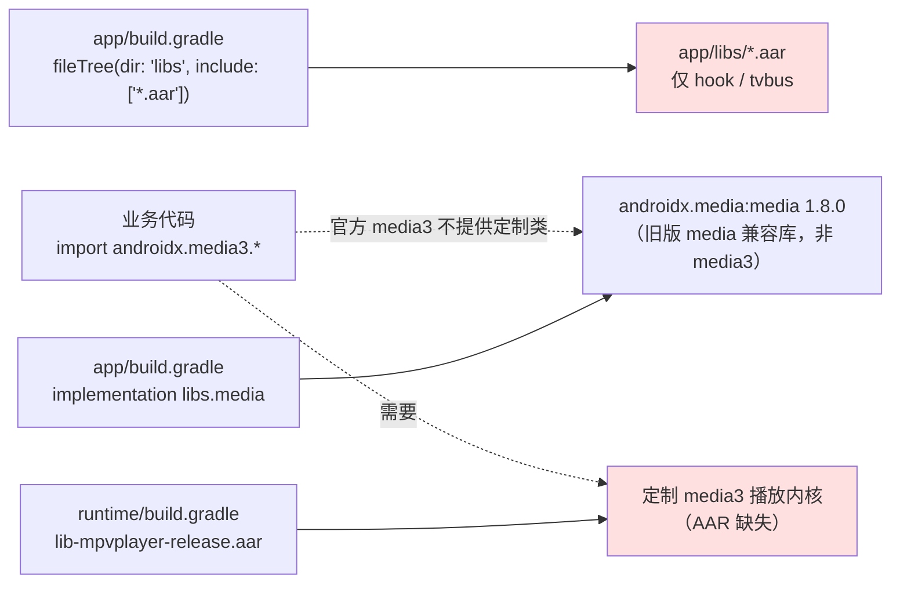
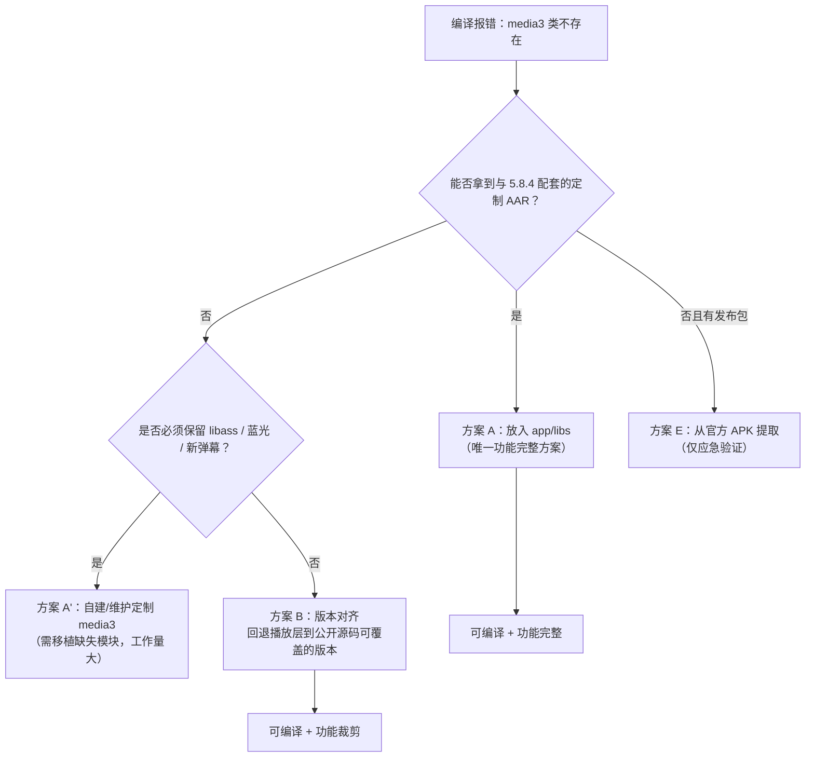

# media3 缺失类问题分析与解决方案

> 文档版本：v1.0
> 编写日期：2026-10-31
> 作者：Shiro
> 仓库：`/workspace`（chengshengru/TV）
> 文档类型：问题诊断与方案设计
> 说明：本文档只做分析与方案设计，未修改任何业务代码。

## 1. 问题概述

合并 `fm/fongmi` 分支后（当前代码版本 `5.8.4` / `versionCode 584`），工程引用了大量在「官方 media3」以及「公开的定制版 media3 源码」中都不存在的类，典型报错形式为：

```
程序包 androidx.media3.exoplayer.libass 不存在
程序包 androidx.media3.exoplayer.iso 不存在
找不到符号 类 DanmakuPlayerViewController
```

这不是代码写错了，而是**依赖模型与上游一致、但依赖产物缺失**导致的。本文分析的结论是：当前工程并不依赖 Google 官方 media3 Maven 构件，而是依赖 FongMi 定制版 media3 的**本地 AAR 集合**（`app/libs/lib-*.aar`），该集合在当前仓库中完全缺失，且公开的定制版源码分支落后于 `5.8.4` 代码。

## 2. 根因分析

### 2.1 依赖链路



- [app/build.gradle](../../app/build.gradle#L102) 通过 `fileTree(dir: "libs", include: ["*.aar"])` 引入本地 AAR；[app/build.gradle](../../app/build.gradle#L106) 的 `libs.media` 是 `androidx.media:media`（见 [gradle/libs.versions.toml](../../gradle/libs.versions.toml#L15-L62)），**并不包含任何 `androidx.media3.*` 包**。
- [runtime/build.gradle](../../runtime/build.gradle#L136) 、[chaquo/runtime/build.gradle](../../chaquo/runtime/build.gradle#L104) 与 [AbiApkPackaging.groovy](../../buildSrc/src/main/groovy/com/fongmi/gradle/AbiApkPackaging.groovy#L50-L51) 都直接引用 `app/libs/lib-mpvplayer-release.aar`、`app/libs/lib-decoder-ffmpeg-release.aar`，说明定制播放内核是以 AAR 形式参与构建的。
- [.gitignore](../../.gitignore) 中包含 `lib-*.aar`，这些 AAR **不入库**；当前 [app/libs](../../app/libs) 只有 `hook-release.aar`、`tvbus-release.aar`，定制 media3 的 20 个 AAR 全部缺失。

### 2.2 定制版 media3 的来源

定制版 media3 由独立仓库编译产出，编译完成后按清单拷贝到 `app/libs`。清单（20 个 AAR）为：

```
lib-common / lib-container / lib-database / lib-datasource / lib-datasource-okhttp
lib-datasource-rtmp / lib-decoder / lib-decoder-ffmpeg / lib-decoder-mpegh / lib-effect
lib-exoplayer / lib-exoplayer-dash / lib-exoplayer-hls / lib-exoplayer-rtsp
lib-exoplayer-smoothstreaming / lib-extractor / lib-mpvplayer / lib-session
lib-ui / lib-ui-danmaku
```

对应公开源码仓库 `https://github.com/FongMi/media`，分支为 `release-1.11.0-fongmi`。

### 2.3 代码与公开源码的时间错位（核心矛盾）

| 项目 | 时间 | 说明 |
| --- | --- | --- |
| 公开定制源码 `release-1.11.0-fongmi` | 2026-07-27 | 已包含 `mpvplayer`、`ui_danmaku`、`MediaEdition`、`PlayerSeekView` 等 |
| 公开定制源码 `release` | 2026-08-07 | 同上，版本更旧 |
| TV 引入 libass | 2026-08-27（提交 `773cae11`） | 新增 `androidx.media3.exoplayer.libass`、`androidx.media3.ui.libass` |
| TV 引入蓝光 ISO / 盘片菜单 | 2026-10 系列提交 | 新增 `androidx.media3.exoplayer.iso`、`DiscMenuController/DiscMenuState` |
| 当前代码 | 2026-10-30 合并 | 版本 5.8.4 |

结论：**公开的定制 media3 源码未同步 TV 5.8.3 之后的改动**（libass 字幕、蓝光导航、盘片菜单、字幕偏移/选择状态、解码模式等），因此即使本地自己编译公开源码，也补不齐这些类。当前仓库也没有任何分支提交过这些 AAR（已核对全部分支的 `app/libs` 与历史）。

### 2.4 缺失规模

- 业务代码共 151 条 `import androidx.media3.*` 引用，其中约 50 个类是定制版新增/更名的类；
- 直接受影响文件 29 个，集中在播放链路：`player/exo`、`player/mpv`、`ui/activity/PlaybackActivity`、`setting/*`、`ui/dialog/*`。

## 3. 缺失类清单（按功能域）

| 功能域 | 缺失类（示例） |
| --- | --- |
| libass 字幕 | `exoplayer.libass.LibassConfiguration`、`LibassFontConfig`、`LibassFontFile`、`LibassPlaybackSession`、`LibassSubtitleController`、`ui.libass.LibassPlayerViewController` |
| 蓝光 / ISO | `exoplayer.iso.BdjRuntime`、`IsoDiscPreparation`、`IsoNavigationPlayerController`、`datasource.IsoUri`、`ProgressiveIsoCache` |
| 盘片菜单 | `common.DiscMenuController`、`common.DiscMenuState` |
| 字幕扩展 | `common.text.SubtitleContent`、`SubtitleOffsets`、`SubtitleSelectionState`、`exoplayer.text.SubtitleTranscript*`、`DefaultSubtitleContentLoader`、`SecondaryTextOutput`、`SecondaryTextTrackSelector` |
| 弹幕 | `ui.danmaku.DanmakuPlayerViewController`（公开源码只有 `DanmakuView` / `DanmakuController`） |
| 解码 / 音频 | `common.DecoderMode`、`exoplayer.DecoderMode`、`exoplayer.DecoderManager`、`common.audio.AudioChannelMode`、`AudioEffectParameters`、`AudioEffectProcessor`、`exoplayer.audio.AudioEqualizerController`、`mpvplayer.MpvDecoderMode` |
| 画面处理 | `effect.ColorToneAdjustEffect`、`DetailAdjustEffect`、`VideoAdjustment`、`common.VideoTransform` |
| MPV 扩展 | `mpvplayer.MpvConfigFileInspector`、`MpvSubtitleContentLoader`、`media.MpvDrmSupport` |
| 媒体源 / 预加载 | `exoplayer.source.ContentTypeResolvingMediaSource`、`DefaultPositionMediaSource`、`EndTrimMediaSource` |
| 其他 | `common.util.LocalClearKeyLicense`、`TrackSelectionUtil`、`exoplayer.hls.CmgConfiguration` |

> 说明：`MediaEdition`、`MediaChapter`、`PlayerSeekView`、`DolbyVisionOutputPolicy`、`MpvLibrary`、`Danmaku` 等在公开源码中已存在，缺失集中在上述新增/改名的类。

## 4. 解决方案



### 方案 A：补齐与 5.8.4 配套的定制 media3 AAR（推荐）

适用前提：能取得与 `5.8.4` 代码配套的 AAR 产物（向作者/已有构建环境索取，或使用内部制品库缓存）。

步骤：

1. 将 20 个 `lib-*.aar` 放入 [app/libs](../../app/libs)（清单见 2.2）。
2. 确认 `lib-mpvplayer-release.aar`、`lib-decoder-ffmpeg-release.aar` 存在，否则 `runtime` 模块（`mpv` / `python` 打包）也会失败。
3. 执行 `./gradlew :app:assembleLeanbackDebug`（或 `assembleMobileDebug`）验证。
4. 后续在 [.gitignore](../../.gitignore) 与制品仓库中固化这套 AAR 的版本，避免再次出现「代码已合并、依赖未同步」。

优点：功能完整，与上游行为一致。缺点：依赖外部产物；AAR 与代码版本必须严格对应。

### 方案 A'：基于公开源码自建（需要补齐缺失模块）

适用前提：无法取得配套 AAR，但可以长期维护定制内核。

步骤：

1. `git clone -b release-1.11.0-fongmi https://github.com/FongMi/media`。
2. 依次构建 `libraries` 下各模块（`assembleRelease`），得到 `lib-*.aar`。
3. 按 2.2 清单复制到 `app/libs`。
4. 针对本代码使用的缺失 API（第 3 节），在 fork 中**新增/移植**实现：libass 模块、`exoplayer.iso` 蓝光模块、盘片菜单、字幕扩展、`DanmakuPlayerViewController`、`DecoderMode`/音频通道模式等；其中 libass、蓝光导航涉及 native 依赖（`.so`），需同时准备 JNI 产物。

优点：不依赖第三方二进制。缺点：公开源码落后约 3 个月，缺失模块数量多、含 native 组件，属重量级工程；风险高。

### 方案 B：版本对齐（可立即编译，功能裁剪）

适用前提：暂时不需要 libass、蓝光 ISO 导航、盘片菜单等新特性，优先让工程可编译运行。

做法：以「与公开定制源码相容」的上游 TV 提交为基线，替换当前播放层相关文件：

- 播放引擎、字幕、轨道、设置项等目录回退到 libass 引入之前（`773cae11` 之前）的版本；
- 保留本次合并中与播放无关的改动（爬虫、运行时、更新流程等）；
- 或仅删除引用定制类的 29 个文件中的新特性分支，退回官方 media3 可表达的能力。

优点：不依赖外部二进制，立刻可编译。缺点：丢失字幕/蓝光/新弹幕等功能，后续仍需回到方案 A。

### 方案 C：本地补 stub 类（仅用于先跑通编译）

为缺失类编写空实现/占位类（`UnsupportedOperationException`）。仅适合非播放功能的开发调试：

- JNI 相关（`MpvLibrary`、libass native、蓝光 JNI）无对应 `.so`，运行到播放时必然 `UnsatisfiedLinkError`；
- stub 与真实 AAR 同名类会冲突，后续接入 AAR 时必须全部删除。

**不建议用于发布或长期分支。**

### 方案 D：迁移到 Google 官方 media3（不推荐）

删除全部定制 API（libass/mpv/弹幕/蓝光/画质策略），重写播放层。影响 29+ 文件与所有播放配置项，工作量与回归成本极高，且会丢失上游核心特性，不建议作为本次问题的解法。

### 方案 E：从官方发布 APK 提取（应急验证，不用于发布）

官方发布包（`FongMi/Release` 的 `leanback-*.apk`）内含已编译的定制 media3 与 JNI `.so`，可用 `dex2jar` 等工具提取 `classes.jar` 并打包成临时 AAR 供本地验证。风险：产物不可控、与源码版本无法追溯、许可证与维护问题，**仅限临时验证**。

## 5. 方案对比与推荐

| 方案 | 可编译 | 功能完整 | 依赖外部产物 | 工作量 | 适用场景 |
| --- | --- | --- | --- | --- | --- |
| A 配套 AAR | 是 | 是 | 是 | 低 | **首选**：能拿到 5.8.4 配套 AAR |
| A' 自建 fork | 是 | 是 | 否 | 很高 | 长期维护定制内核 |
| B 版本对齐 | 是 | 否 | 否 | 中 | 先恢复可编译，功能裁剪 |
| C stub | 是 | 否 | 否 | 中 | 临时跑非播放功能 |
| D 官方 media3 | 否（需重写） | 否 | 否 | 极高 | 不建议 |
| E APK 提取 | 是 | 是 | 是 | 低 | 仅应急验证 |

推荐顺序：

1. 先确认是否持有旧版 `app/libs` 中的 media3 AAR（既有版本同样会缺类，必须与 `5.8.4` 对齐）；
2. 能取得配套 AAR → **方案 A**；
3. 取不到且需尽快可编译 → **方案 B**（同时把「播放层版本与定制内核版本」纳入合并检查项）；
4. 长期由构建方统一维护 AAR 版本（方案 A'/A 的固化流程）。

## 6. 后续建议（防止再次发生）

- 在合并上游前，先核对上游 `move.txt` 清单与本地 `app/libs` 是否一致；
- 把定制 media3 的版本号（如 `media3-1.11.0-fongmi-<commit>`）记录在文档与制品名中；
- 在 CI 中增加一步「检查 20 个 `lib-*.aar` 是否齐全」，避免出现代码已合并但依赖缺失的静默失败。

## 7. 附录：参考信息

- 定制 media3 源码：`https://github.com/FongMi/media`（分支 `release-1.11.0-fongmi`、`release`）
- AAR 清单与拷贝脚本：仓库内 `move.txt` / `move.bat`（上游定制源码根目录）
- 本仓库关键文件：[app/build.gradle](../../app/build.gradle)、[runtime/build.gradle](../../runtime/build.gradle)、[gradle/libs.versions.toml](../../gradle/libs.versions.toml)、[.gitignore](../../.gitignore)、[app/libs](../../app/libs)
- 合并背景：[fm-fongmi分支合并方案.md](./fm-fongmi分支合并方案.md)

> 本文档未做任何代码改动；方案落地前请先确认第 5 节的决策点。
